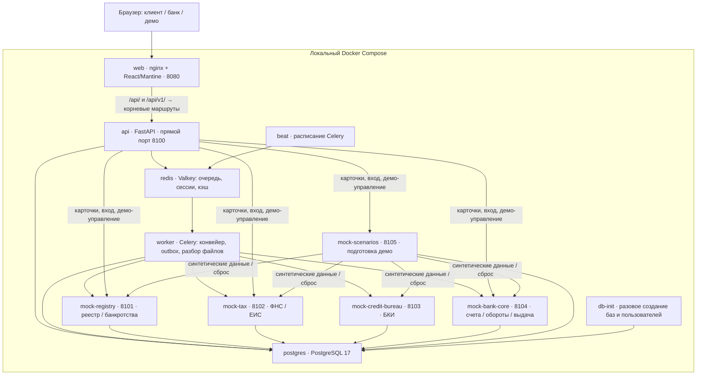

# Архитектура работающего прототипа

Сверено с main `1114d1c` 24.10.2026. Источники: [Compose](../../docker-compose.yml), [локальные порты](../../docker-compose.override.yml), [маршруты API](../../api/app/main.py), [сборка связей модулей](../../api/app/wiring.py). Это описание реализации; проектные варианты остаются в [плане](../plan/50-architecture/01-overview.md).

В Compose 12 сервисов: 11 длительно работающих контейнеров и завершающийся `db-init`. Моки запускаются из одного образа с разными `MOCK_ROLE`; каждый использует собственную базу в общем PostgreSQL. База API отделена от пяти баз моков. Миграции выполняются при старте приложений. Внутренний порт Python-сервисов — 8000; опубликованные порты из схемы доступны только на `127.0.0.1`. Порт web меняется через `WEB_PORT`; 8090 — адрес отдельного ранее поднятого стенда, не значение по умолчанию.

## Как проходит заявка

1. API сохраняет черновик, согласия и неизменяемую версию отправленной заявки. Клиент и банк имеют независимые cookie-сессии (`sid_client`, `sid_bank`). Банковская карточка возвращается отдельной моделью, внутреннее пояснение не включается в клиентский ответ.
2. Celery worker получает задание конвейера. Адаптеры обращаются к локальным мокам, сохраняют ответы и происхождение данных в `source_snapshots`, попытки — в `integration_calls`.
3. Чистая функция `decisioning.decide()` получает снимки, дату приложения и версию политики. Без сети, базы и случайности она считает причины, риск, доступность платежа, ставку, маршрут и встречные варианты. Правила — [api/policy/v1.yaml](../../api/policy/v1.yaml); ИИ решение не принимает.
4. `pipeline` сохраняет решение, причины и переход заявки. Ручные действия банка проходят проверку текущих полномочий и тех же ограничений ядра; предпросмотр ручных условий не записывает решение.
5. Файлы сохраняются в PostgreSQL (`documents` и `document_blobs`). Worker разбирает ограниченную текстовую выписку 1С без сети/ИИ; подтверждение поступлений отдельно от разбора. Ошибка сохраняет исходник, замена — новый файл; сброс компании чистит связанные документы.
6. Принятие варианта создаёт договор. Расчётные условия сохраняются в JSON, новый договор и график — как PDF с кириллицей; хеш подписи привязан к сохранённым байтам PDF, старые JSON-договоры совместимы. Код простой подписи показывается в интерфейсе; после подписи выдача идёт через outbox в мок bank-core, а затем создаются кредит и график, отправляется сообщение в мок БКИ. Реальных денег и юридически значимой подписи нет.

## Надёжность и пределы

Реализованы транзакции PostgreSQL, версии заявок, ключи идемпотентности банковских команд, уникальность выдачи, аренда запуска конвейера и outbox с повторами. Сброс одной компании ограждает её операции и чистит связанные данные. Это не подтверждает промышленную отказоустойчивость или производительность: нагрузочные замеры здесь не проводились.

Живые статусы идут через `/events/stream?zone=client|bank`: Redis оповещает API о событиях, браузер перечитывает данные обычными HTTP-запросами. Есть восстановление по Last-Event-ID/lastEventId, повторная проверка прав и запасной опрос при потере потока. В Compose нет сервисов `nlu`, LLM, Kafka, отдельной системы наблюдаемости или профилей `ai`/`obs`. Загрузка PDF/1С, разбор и отдельное подтверждение поступлений подключены. Подтверждённые числа фиксируются как CLIENT_UPLOAD в снимке конвейера; это утверждение клиента, не банковское доказательство выручки. Полный путь передачи от бухгалтера руководителю и кнопка генерации через мок не объявляются проверенными; фактические границы — в отчёте обновления комплекта. Сервис scenarios управляет демо, а не представляет реальную внешнюю банковскую интеграцию. Все данные синтетические.

См. также [состояния](state_machine.md), [модель данных](data_model.md), [API](../api/README.md), [сторонние компоненты](../../THIRD_PARTY_NOTICES.md).
