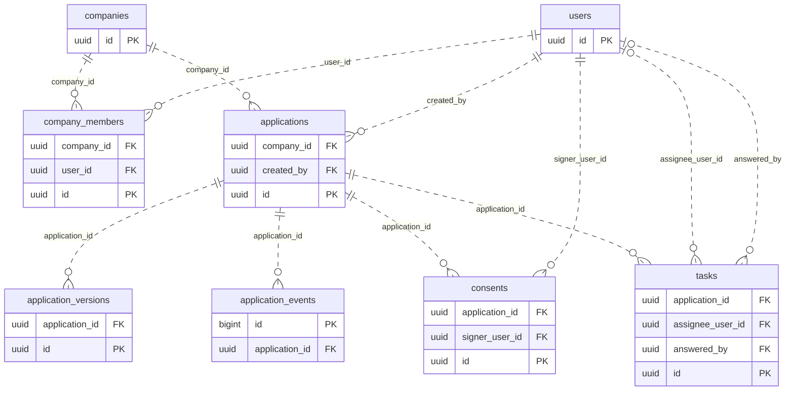
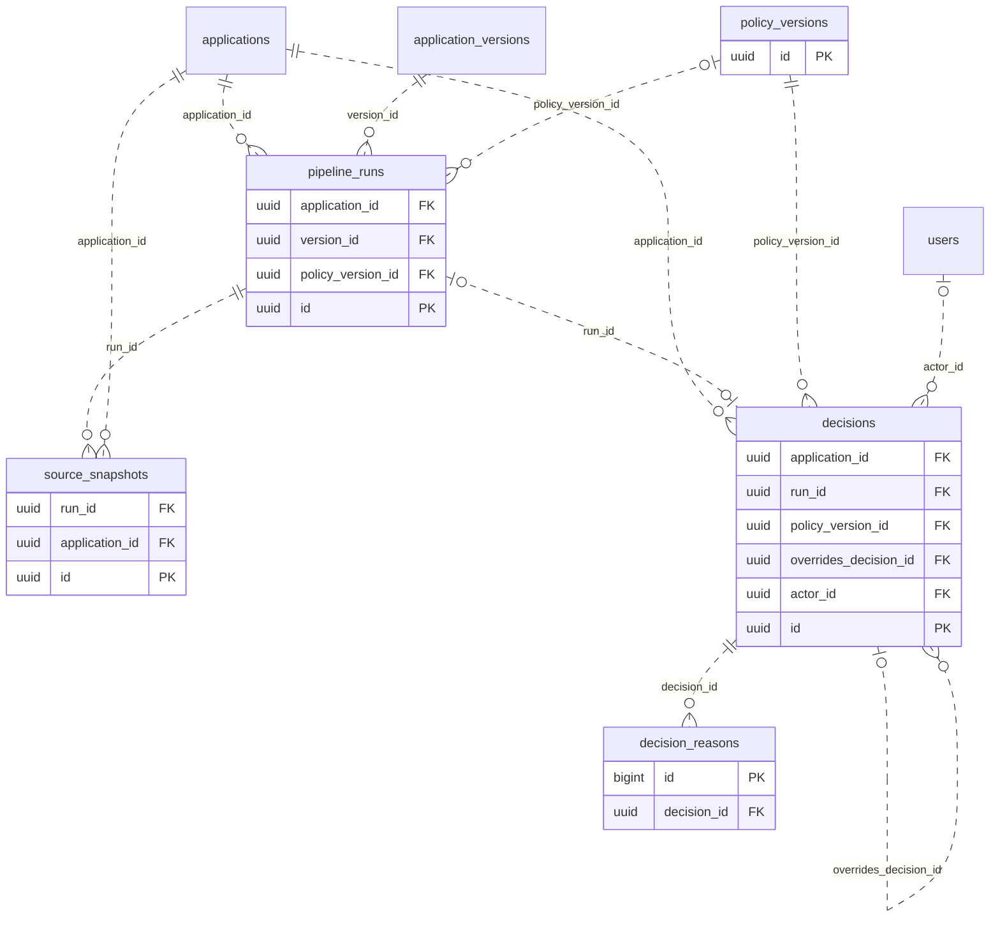
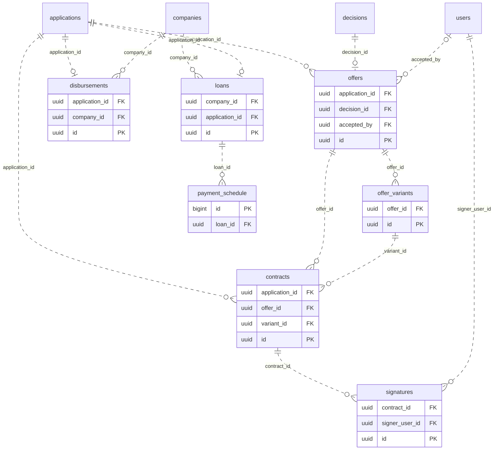
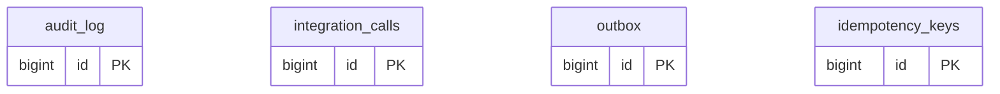

# Модель данных реализации

Финальная сверка после main `46bc75f` (PR #111): Compose, статусы, модели и миграции не менялись; подтверждения живой БД относятся к `78fda5e`.

Сверено с main `78fda5e` 24.10.2026. Ниже все 24 таблицы API, зарегистрированные в [db_models.py](../../api/app/db_models.py), и реальные внешние ключи SQLAlchemy. Набор таблиц сверен с `create_table` в [миграциях](../../api/alembic/versions/); текущая голова — `0012_client_tasks`. Набор таблиц и все 36 FK также сверен с живой БД отдельного стенда после автоматических миграций на чистом томе; [отчёт проверки](../plan/reviews/C-2026-10-24-jury-package-check.md).

В каждой схеме перечислены первичный ключ и поля внешних ключей; остальные поля опущены для читаемости. Пунктирные связи — существующие неидентифицирующие FK (FK не входит в PK ребёнка). `|o` слева означает необязательного родителя (nullable FK), `||` — обязательного. Со стороны дочерней таблицы `o{` — ноль или больше строк; уникальные FK обозначены `o|`. Идентификаторы преимущественно UUID; последовательные журналы и строки графика — bigint.

## Люди и заявка

## Конвейер и решение

## Предложение, подпись и выдача

## Платформенные журналы

## Как читать данные

| Группа | Для чего хранится |
|---|---|
| users, companies, company_members | Люди, компании, членство, право подписи и уровень сотрудника банка |
| applications | Текущее состояние и версия записи; JSONB `draft` — черновик |
| application_versions | Неизменяемый ввод при отправке/дополнении; номер уникален в заявке, есть SHA-256 |
| application_events | Последовательная история переходов и действий |
| consents, tasks | Доказательства согласий; задачи и отправленные ответы по раундам |
| policy_versions, pipeline_runs | Сохранённые правила; запуск на конкретной версии заявки и аренда выполнения |
| source_snapshots | Ответы источников с датой, статусом и хешем |
| decisions, decision_reasons | Снимок ENGINE/UNDERWRITER: ввод, хеш, политика, расчёт, причины и переопределение |
| offers, offer_variants | Предложение по решению и зафиксированные варианты условий |
| contracts, signatures | Тело договора JSON, хеш, ревизия и доказательство демо-подписи |
| disbursements | Уникальная выдача на заявку, исходный ключ и тело запроса в мок банка |
| loans, payment_schedule | Кредит после подтверждения выдачи и график; фактические погашения не моделируются |
| outbox, idempotency_keys | Доставка сообщений и сохранённые ответы на повторные команды |
| audit_log, integration_calls | Аудит действий и журнал попыток внешних вызовов; без полных тел в integration_calls |

## Важные ограничения и связи по значению

- `applications.current_version_id`, `offers.accepted_variant_id`, `contracts.document_id`, `loans.disbursement_id`, `decisions.snapshot_ids` — ссылки по значению, **без FK**. Они не нарисованы как ограничения БД. У `loans.disbursement_id` есть уникальность. `contracts.document_id` пока не ведёт в существующую таблицу документов.
- В `audit_log` ссылки на участника/компанию/объект, в `integration_calls.application_id` и `outbox.aggregate_id` также нет FK; журналы нельзя ошибочно изображать дочерними таблицами с каскадным удалением.
- UNIQUE: пара компания/участник; заявка/номер версии; запуск/ключ; решение/запуск (nullable для ручного решения); предложение/решение; вариант/позиция; одна живая ревизия договора на заявку; договор/подписант; одна выдача и один кредит на заявку; кредит/номер платежа; scope/key идемпотентности.
- Частичные индексы: одна заявка в работе на компанию; одно действующее согласие на субъект/вид в заявке; один договор не в `CANCELLED` на заявку. Статусы ограничены CHECK, банковский уровень — L1/L2 только для банковских ролей.
- Неизменяемые записи защищены триггерами миграций: события, снимки, решения/причины, версии политики, варианты, подписи и аудит. Версии заявки сохраняются сервисом как новые записи, но отдельного триггера их неизменности нет. Обычное обновление/удаление защищённых журналов запрещено; контролируемый демо-сброс имеет отдельный разрешённый путь. Это не цепочка блоков и не внешнее доказательство неизменности.
- PostgreSQL хранит отдельные базы `api`, `mock_registry`, `mock_tax`, `mock_bki`, `mock_bank_core`, `mock_scenarios`; межбазовых FK нет. Таблицы моков и их упрощения описаны в [спецификации](../specs/mocks.md); эта ER охватывает базу API.
- В этом снимке нет таблиц файлов, залога, поручительств или отдельной таблицы уведомлений. Наличие названий модулей/полей в плане не означает готовую подсистему.

См. [архитектуру](architecture.md), [состояния](state_machine.md), [проектную модель](../plan/50-architecture/06-data-model.md).
