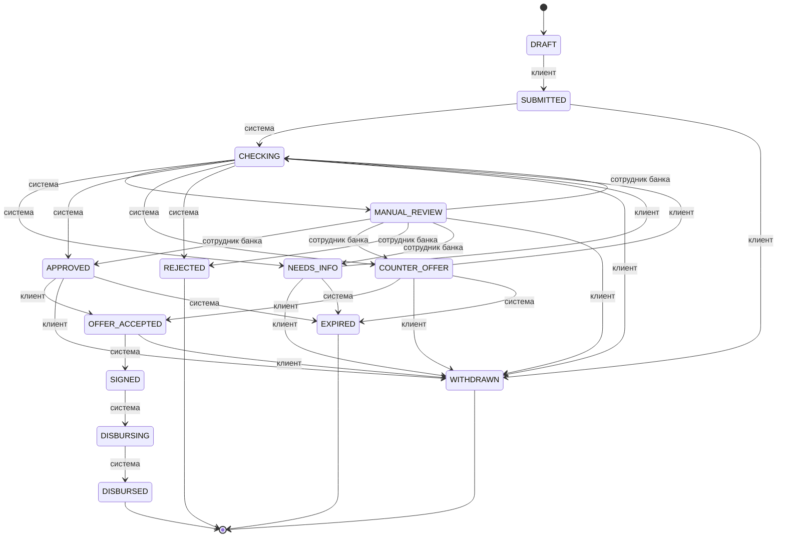

# Состояния заявки

Сверено с main `1114d1c` 24.10.2026. Все 14 статусов и 29 разрешённых переходов ниже выгружены из [states.py](../../api/app/modules/applications/states.py), а не из проектного эскиза. Актор обозначает роль, которая инициирует переход; проверка полномочий и условий остаётся в сервисах.

| Статус | Значение для проверки |
|---|---|
| DRAFT | Черновик; можно сохранить условия и подписать согласия |
| SUBMITTED | Заявка отправлена, зафиксирована версия |
| CHECKING | Конвейер собирает источники и считает решение |
| NEEDS_INFO | Запрошен ответ клиента |
| MANUAL_REVIEW | Решение принимает сотрудник банка |
| APPROVED | Одобрены условия запроса |
| COUNTER_OFFER | Предложены другие условия |
| OFFER_ACCEPTED | Клиент принял вариант, готов договор |
| SIGNED | Собраны необходимые подписи |
| DISBURSING | Идёт выдача через мок банка |
| DISBURSED | Выдача подтверждена, терминальный статус |
| REJECTED | Отказ, терминальный статус |
| WITHDRAWN | Клиент отозвал заявку, терминальный статус |
| EXPIRED | Истёк срок, терминальный статус |

## Что ограничивает переходы

- Недопустимая пара статусов или актор дают `409 INVALID_TRANSITION`. Разрешённая стрелка не означает наличие готовой кнопки: например, `COUNTER_OFFER → CHECKING` зарезервирована таблицей, но клиентский путь улучшения условий ещё не завершён.
- `NEEDS_INFO → CHECKING` выполняется после отправки полного раунда ответов: новая версия `INFO_PROVIDED` и новый запуск конвейера сохраняются вместе. Черновик текста не отправляет раунд и не заменяет банковскую выписку: для документной задачи проверяется файл, а для подтверждения выручки — PARSED и отдельное подтверждение поступлений.
- Сотрудник банка запрашивает информацию или перепроверку только из `MANUAL_REVIEW`, с актуальной `expectedVersion`. Ручные условия сначала проверяются сервером, затем сохраняются отдельной командой.
- Лимит запросов сведений — три раунда; четвёртый банк открыть не может. В данном снимке повторный `REVENUE_UNKNOWN` после лимита может оставить заявку в `NEEDS_INFO` без новой задачи. Правило обязательного ручного разбора ещё требует интеграции владельцем кода; бесконечный путь не объявляется завершённым.
- `OFFER_ACCEPTED → SIGNED` инициируется системой после проверки кода и всех необходимых подписей. `SIGNED → DISBURSING → DISBURSED` зависит от подтверждения выдачи; при ошибке доставки заявка может остаться в `DISBURSING`, банковская очередь outbox позволяет повтор.
- Переходы в `EXPIRED` есть в таблице, но таймер истечения по умолчанию выключен. Наличие стрелок не доказывает включённую обработку таймеров.
- Частичный уникальный индекс допускает не больше одной заявки в работе на компанию; черновики и терминальные заявки в него не входят.

Источник действий и сохранения событий: [service.py](../../api/app/modules/applications/service.py), [client_tasks.py](../../api/app/modules/applications/client_tasks.py), [банк](../../api/app/modules/backoffice/router.py), [подпись](../../api/app/modules/offers/signing.py). [Архитектура](architecture.md) · [модель данных](data_model.md).
