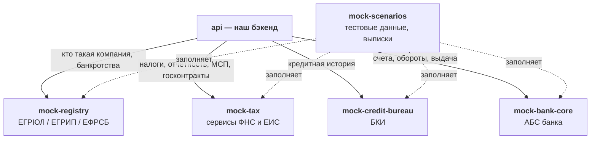

# Моки внешних систем: какие данные есть и как их получить

> **Зачем этот документ.** Это опись того, что у нас есть: какие внешние системы мы имитируем, что они принимают и что отдают. По нему проектируется алгоритм принятия решений. Самого алгоритма здесь нет.
>
> **Контракты** — что передать каждому эндпоинту, что вернётся и с какими кодами — в разделе 10. Устройство самих моков (их базы, админ-API, сервис сценариев) — в [specs/mocks.md](specs/mocks.md).
>
> Версия от 21.10.2026 (ред. 3). Все компании, люди и цифры синтетические.

## Содержание

1. [Какие моки есть](#1-какие-моки-есть)
2. [Каталог данных: что вообще можно узнать](#2-каталог-данных-что-вообще-можно-узнать)
3. [Госреестр компаний — `mock-registry`](#3-госреестр-компаний--mock-registry)
4. [Налоговая — `mock-tax`](#4-налоговая--mock-tax)
5. [Бюро кредитных историй — `mock-credit-bureau`](#5-бюро-кредитных-историй--mock-credit-bureau)
6. [Банковская система — `mock-bank-core`](#6-банковская-система--mock-bank-core)
7. [Общие правила для всех моков](#7-общие-правила-для-всех-моков)
8. [Задержки и сбои](#8-задержки-и-сбои)
9. [Тестовые данные](#9-тестовые-данные)
10. [Контракты](#10-контракты)
11. [Словарик](#11-словарик)

---

## 1. Какие моки есть

**Мок** — это наша программа, которая притворяется настоящей внешней системой. Она отвечает теми же по смыслу данными, с задержкой и может «упасть». Данные берёт не из реального мира, а из своей базы с синтетическими компаниями.



| Мок | Кого изображает | Простыми словами | Отвечает за |
|---|---|---|---|
| `mock-registry` | ЕГРЮЛ и ЕГРИП — госреестры ФНС; ЕФРСБ — реестр банкротств | «Паспорт» компании: существует ли, кто директор, чем занимается. И не банкрот ли она, её директор и учредители | 0,2–0,6 с |
| `mock-tax` | Открытые сервисы ФНС и ЕИС (госзакупки) | Налоги и долги перед государством, бухотчётность, категория МСП, самозанятость, госконтракты поставщика | 0,2–0,8 с |
| `mock-credit-bureau` | НБКИ, ОКБ, Эквифакс | Досье о кредитах: сколько должен, как платит, где ещё просил денег | 0,8–2,5 с |
| `mock-bank-core` | АБС банка + списки комплаенса | Клиент ли нашего банка, обороты по счёту, открытие счёта, выдача кредита | 0,05–0,2 с |
| `mock-scenarios` | Ничего, это тестовый «пульт» | Создаёт тестовые компании сразу во всех четырёх моках и делает файл выписки из другого банка | — |

Моки отдают **только факты**. Никаких выводов («рискованный клиент», «оборот растёт») они не делают: отдают обороты по месяцам, а не тренд. Единственное исключение — сводка в отчёте БКИ: она есть и в настоящих отчётах.

---

## 2. Каталог данных: что вообще можно узнать

Все данные, которые можно получить от моков, сгруппированные по смыслу. Подробности по каждому полю — в разделах 3–6.

### О компании или ИП

| Данные | Мок | Запрос | Поле |
|---|---|---|---|
| Существует ли, форма (ООО, АО, ИП) | registry | `GET companies/{inn}` | `type`, `legalForm` |
| Название / ФИО ИП | registry | `GET companies/{inn}` | `shortName`, `fullName`, `person` |
| Статус: действует, ликвидируется, банкрот… | registry | `GET companies/{inn}` | `status.code`, `status.since` |
| Дата регистрации | registry | `GET companies/{inn}` | `registrationDate` |
| Вид деятельности (ОКВЭД) | registry | `GET companies/{inn}` | `okvedMain`, `okvedAdditional` |
| Регион, адрес | registry | `GET companies/{inn}` | `address`, `region` (у ИП только регион) |
| Уставный капитал | registry | `GET companies/{inn}` | `authorizedCapitalRub` |
| Отметки о недостоверности адреса, директора, учредителя | registry | `GET companies/{inn}` | `*.unreliable` |
| Предстоящее исключение из реестра | registry | `GET companies/{inn}` | `pendingExclusion` |
| Банкротство компании или ИП: дела, этап, даты | registry | `GET bankruptcies/{inn}` | `bankruptcies[]` |
| Категория: микро, малое, среднее | tax | `GET sme-status/{inn}` | `category`, `isNewlyCreated` |
| Налоговый режим | tax | `GET tax-profile/{inn}` | `taxRegimes[]` |
| Число сотрудников | tax | `GET tax-profile/{inn}` | `avgHeadcount` |
| Признаки массовости (адрес, директор, учредитель) | tax | `GET tax-profile/{inn}` | `riskFlags` |
| Не сдаёт отчётность больше года | tax | `GET tax-profile/{inn}` | `riskFlags.noReportsOverYear` |
| Госконтракты поставщика: заказчик, цена, сроки, статус, оплачено | tax | `GET contracts?supplierInn=` | `contracts[]` |

### О людях

| Данные | Мок | Запрос | Поле |
|---|---|---|---|
| Директор: ФИО, ИНН, должность, с какой даты | registry | `GET companies/{inn}` | `director` |
| Учредители и их доли (у АО список пуст: акционеров реестр не показывает) | registry | `GET companies/{inn}` | `founders[]` |
| Где человек директор, учредитель или ИП | registry | `GET persons/{inn}/roles` | `roles[]` |
| Банкротство человека (директора, учредителя, ИП) | registry | `GET bankruptcies/{inn}` | `bankruptcies[]` |
| Самозанятый ли человек | tax | `POST self-employed/status` | `status` |
| Дисквалифицированные руководители | tax | `GET tax-profile/{inn}` | `riskFlags.disqualifiedManagement` |
| Личная кредитная история директора, владельца, ИП | БКИ | `POST credit-reports` (`PERSON`) | весь отчёт |

### Налоги и финансы

| Данные | Мок | Запрос | Поле |
|---|---|---|---|
| Долг по налогам, пени, штрафы | tax | `GET tax-profile/{inn}` | `debts` |
| Уплаченные налоги по годам | tax | `GET tax-profile/{inn}` | `taxesPaid[]` |
| Налоговые правонарушения | tax | `GET tax-profile/{inn}` | `taxOffenses` |
| Доходы и расходы за год (только организации; доход равен выручке в отчётности) | tax | `GET tax-profile/{inn}` | `incomeExpenses` |
| Выручка, прибыль, активы, капитал, обязательства за год и прошлый год | tax | `GET financials/{inn}` | `lines`, `summary` |
| Заблокированы ли счета налоговой | tax | `GET account-blocks/{inn}` | `decisions[]` |

### Кредиты и долги

| Данные | Мок | Запрос | Поле |
|---|---|---|---|
| Есть ли кредитная история | БКИ | `POST credit-reports` | `hasHistory` |
| Текущая просрочка: дни и сумма | БКИ | `POST credit-reports` | `summary.currentOverdueDays`, `currentOverdueRub` |
| Худшая просрочка за 2 года | БКИ | `POST credit-reports` | `summary.maxOverdueDays24m` |
| Весь долг и платежи в месяц по всем кредитам | БКИ | `POST credit-reports` | `summary.totalDebtRub`, `monthlyPaymentsRub` |
| За что клиент поручился или выдал гарантию (отдельно от его долга) | БКИ | `POST credit-reports` | `summary.contingentLiabilitiesRub` |
| Каждый кредит с помесячной историей платежей, лимиты линий и карт | БКИ | `POST credit-reports` | `obligations[]` |
| Реструктуризации, продажа долга коллекторам, списания | БКИ | `POST credit-reports` | `summary.restructurings24m`, `obligations[].status` |
| Кто и когда запрашивал историю | БКИ | `POST credit-reports` | `inquiries[]`, `summary.inquiries30d*` |
| Заявки в другие банки и их итог (наши заявки помечены) | БКИ | `POST credit-reports` | `applications[]`, `summary.rejectedApplications90d*` |
| Банкротства | БКИ | `POST credit-reports` | `bankruptcies[]` |
| Оценка самого бюро | БКИ | `POST credit-reports` | `bureauScore` |
| Кредиты, выданные нашим банком | bank-core | `GET customers/{inn}/loans` | весь ответ |

### Наш банк

| Данные | Мок | Запрос | Поле |
|---|---|---|---|
| Клиент ли нашего банка и с какой даты | bank-core | `GET customers/{inn}` | `customerSince` (`404` — не клиент) |
| Счета и остатки | bank-core | `GET customers/{inn}` | `accounts[]` |
| Поступления и списания по месяцам, число контрагентов | bank-core | `GET customers/{inn}/turnover` | `months[]` |
| Перечень Росфинмониторинга | bank-core | `POST compliance/screening` | `results[].amlList` |
| Уровень риска ЦБ «Знай своего клиента» | bank-core | `POST compliance/screening` | `results[].zsk` |
| Внутренний стоп-лист банка | bank-core | `POST compliance/screening` | `results[].internalStopList` |

### Документы

| Данные | Мок | Запрос |
|---|---|---|
| Выписка по счёту в другом банке (файл формата 1С) для тестовой компании | scenarios | `GET scenarios/{code}/documents/bank-statement` |
| Такая же выписка для любого ИНН (случайная) | scenarios | `POST documents/bank-statement` |

### Действия (меняют данные в моках)

| Действие | Мок | Запрос |
|---|---|---|
| Сообщить в БКИ о заявке, решении, выданном или закрытом кредите | БКИ | `POST submissions` |
| Открыть расчётный счёт | bank-core | `POST customers/{inn}/accounts` |
| Выдать кредит: зачислить деньги на счёт | bank-core | `POST disbursements` |

---

## 3. Госреестр компаний — `mock-registry`

### Что это в жизни

ФНС ведёт два реестра:

- **ЕГРЮЛ** — организации (ООО, АО). ИНН 10 цифр, номер регистрации ОГРН 13 цифр;
- **ЕГРИП** — индивидуальные предприниматели. ИНН 12 цифр (это личный ИНН человека), номер ОГРНИП 15 цифр.

**Самозанятых нет ни в одном из них.** Банки берут эти данные через государственный обмен (СМЭВ) или через сервисы вроде DaData. Мок по смыслу повторяет их, но отвечает простым JSON.

Третья часть мока — **ЕФРСБ** (Федресурс): открытый реестр, где публикуют сведения о банкротстве организаций и людей. Банк смотрит его бесплатно и по компании, и по людям, которые за ней стоят.

### Что принимает

| Запрос | Что передаём |
|---|---|
| `GET /api/v1/companies/{inn}` | ИНН компании или ИП. По длине мок сам понимает, где искать: 10 цифр — ЕГРЮЛ, 12 — ЕГРИП |
| `GET /api/v1/persons/{inn}/roles` | Личный ИНН человека (12 цифр) |
| `GET /api/v1/bankruptcies/{inn}` | ИНН компании (10 цифр) или человека/ИП (12 цифр) |

### Что отдаёт: организация (ООО, АО)

| Поле | Что это |
|---|---|
| `type` | `LEGAL_ENTITY` |
| `inn`, `kpp`, `ogrn` | Реквизиты |
| `shortName`, `fullName` | Название |
| `legalForm` | Организационно-правовая форма: код ОКОПФ и название |
| `status.code` | `ACTIVE` действует · `LIQUIDATING` ликвидируется · `LIQUIDATED` ликвидирована · `BANKRUPT` банкрот · `REORGANIZING` реорганизуется |
| `status.since` | С какой даты статус |
| `registrationDate` | Дата регистрации |
| `okvedMain`, `okvedAdditional[]` | Основной и дополнительные виды деятельности: код и название |
| `address` | Код и название региона, полный адрес |
| `authorizedCapitalRub` | Уставный капитал |
| `director` | ФИО, **ИНН**, должность, с какой даты |
| `founders[]` | Учредители: человек или компания, ИНН, доля в % и в рублях. **У АО список всегда пуст**: ЕГРЮЛ не показывает акционеров, их хранит отдельный реестр. Поэтому у АО нет «владельца-поручителя» |
| `address.unreliable`, `director.unreliable`, `founders[].unreliable` | **Отметка о недостоверности**: налоговая проверила сведения и не подтвердила. `null`, если отметки нет |
| `pendingExclusion` | ФНС решила исключить компанию из реестра как недействующую: дата решения и срок для возражений. `null`, если нет |
| `taxAuthority` | Налоговая, где компания на учёте. Код налоговой — это первые 4 цифры ИНН |
| `lastRecord` | Последняя запись в реестре: номер (ГРН) и дата |
| `meta.dataActualAt` | На какую дату актуальны сведения |

Пример: ООО «СтанкоПром»:

```json
{
  "type": "LEGAL_ENTITY",
  "inn": "0017654322",
  "kpp": "001701001",
  "ogrn": "1170000004569",
  "shortName": "ООО «СтанкоПром»",
  "registrationDate": "2017-03-14",
  "status": { "code": "ACTIVE", "name": "Действующее", "since": "2017-03-14" },
  "pendingExclusion": null,
  "director": { "fullName": "Кузнецов Игорь Петрович", "inn": "001310000115",
                "position": "Генеральный директор", "since": "2017-03-14", "unreliable": null },
  "founders": [ { "type": "PERSON", "fullName": "Кузнецов Игорь Петрович",
                  "inn": "001310000115", "sharePercent": 100, "unreliable": null } ],
  "okvedMain": { "code": "25.62", "name": "Обработка металлических изделий механическая" },
  "address": { "regionCode": "66", "regionName": "Свердловская область",
               "full": "620000, Свердловская обл., г. Екатеринбург, ул. Заводская, д. 1", "unreliable": null },
  "authorizedCapitalRub": 500000,
  "taxAuthority": { "code": "0017", "name": "Межрайонная ИФНС России № 17 (синтетическая)" }
}
```

### Что отдаёт: ИП

`type: INDIVIDUAL_ENTREPRENEUR`. То же, что у организации, но **без** КПП, директора, учредителей, уставного капитала и полного адреса: ИП сам себе директор и владелец.

- Вместо названия — ФИО (`person`).
- Вместо адреса — только регион: домашний адрес человека не раскрывают.
- Вместо ОГРН — `ogrnip`.
- Статусы: `ACTIVE`, `CEASED` (прекратил деятельность), `BANKRUPT`.

### Что отдаёт: роли человека

```json
{ "personInn": "001310000115",
  "roles": [ { "role": "DIRECTOR", "entityInn": "0017654322", "entityName": "ООО «СтанкоПром»",
               "entityStatus": "ACTIVE", "since": "2017-03-14", "sharePercent": null },
             { "role": "FOUNDER",  "entityInn": "0017654322", "entityName": "ООО «СтанкоПром»",
               "entityStatus": "ACTIVE", "since": "2017-03-14", "sharePercent": 100 } ] }
```

`role`: `INDIVIDUAL_ENTREPRENEUR`, `DIRECTOR`, `FOUNDER`.

### Что отдаёт: банкротства (ЕФРСБ)

Банку важно не только, не банкрот ли сама компания, но и её директор, и **каждый учредитель-человек**: поручительство человека, прошедшего банкротство, ничего не стоит. Поэтому конвейер запрашивает этот эндпоинт по компании, директору и всем учредителям-людям (для ИП — по самому предпринимателю).

```json
GET /api/v1/bankruptcies/001310000820
→ { "inn": "001310000820",
    "bankruptcies": [ { "caseNumber": "А00-45012/2022", "subjectType": "PERSON", "stage": "COMPLETED",
                        "startedAt": "2022-03-10", "completedAt": "2024-10-15" } ] }
```

| Поле | Что это |
|---|---|
| `caseNumber` | Номер дела в арбитражном суде |
| `subjectType` | `LEGAL_ENTITY` организация · `PERSON` человек (ИП банкротятся как люди) |
| `stage` | Этап: `OBSERVATION` наблюдение · `RESTRUCTURING` реструктуризация · `PROPERTY_REALIZATION` реализация имущества · `COMPLETED` завершено |
| `startedAt`, `completedAt` | Дата начала дела; дата завершения (только у завершённых, иначе `null`) |

Завершённые дела не пропадают из списка: насколько давнее банкротство ещё важно, решает ядро. То же дело всегда есть и в кредитном отчёте человека (раздел 5).

### Особенности

- **Компании нет в реестре → `404 ENTITY_NOT_FOUND`.** Так будет, например, у самозанятого.
- **Человек нигде не директор и не учредитель → `200` с `roles: []`**, а не `404`.
- **Банкротств нет → `200` с `bankruptcies: []`**, а не `404`.
- Неверная контрольная сумма ИНН → `400 INN_INVALID`.

---

## 4. Налоговая — `mock-tax`

### Что это в жизни

У ФНС несколько открытых сервисов. Мок объединяет пять из них, а шестой — государственные закупки (ЕИС). В каждом ответе поле `meta.source` показывает, какой именно сервис ответил.

| Запрос | Реальный сервис | Что узнаём |
|---|---|---|
| `GET /api/v1/tax-profile/{inn}` | **«Прозрачный бизнес»** (pb.nalog.ru) | Налоговый режим, сотрудники, долги, признаки риска |
| `GET /api/v1/financials/{inn}?year=2025` | **ГИР БО** (bo.nalog.ru) — бухотчётность | Выручка, прибыль, активы, обязательства за год |
| `GET /api/v1/sme-status/{inn}` | **Реестр МСП** (rmsp.nalog.ru) | Микро, малое или среднее предприятие |
| `POST /api/v1/self-employed/status` | **Проверка самозанятого** (statusnpd.nalog.ru) | Самозанятый ли человек |
| `GET /api/v1/account-blocks/{inn}` | **Сервис блокировок счетов** ФНС | Решения налоговой о блокировке счетов *(Should)* |
| `GET /api/v1/contracts?supplierInn=` | **ЕИС** (zakupki.gov.ru) — госзакупки | Госконтракты поставщика: цена, сроки, статус, оплата |

### Налоговый профиль

Принимает ИНН в пути. Отдаёт:

| Поле | Что это |
|---|---|
| `taxRegimes[]` | Режим и год: `OSNO` общий · `USN_INCOME` УСН «доходы» 6% · `USN_INCOME_MINUS_EXPENSES` УСН «доходы минус расходы» 15% · `PSN` патент · `ESHN` сельхозналог · `AUSN` автоУСН · `NPD` самозанятый |
| `avgHeadcount` | Среднее число сотрудников и год |
| `taxesPaid[]` | Сколько налогов уплачено, по годам |
| `debts.taxDebtRub` | Долг по налогам на дату `debts.asOf` (с 2023 года — минус на едином налоговом счёте) |
| `debts.penaltiesRub`, `debts.finesRub` | Пени и штрафы |
| `incomeExpenses` | Доходы и расходы за год по отчётности. У ИП `null`. **У организации доход равен выручке (строка 2110) из бухотчётности за тот же год** |
| `taxOffenses` | Налоговые правонарушения за год: количество и сумма штрафов |
| `riskFlags.massAddress` | Массовый адрес регистрации |
| `riskFlags.massDirector`, `riskFlags.massFounder` | Массовый руководитель / учредитель |
| `riskFlags.disqualifiedManagement` | В руководстве есть дисквалифицированный человек |
| `riskFlags.noReportsOverYear` | Не сдаёт налоговую отчётность больше года |

```json
{
  "inn": "0015557771",
  "taxRegimes": [ { "code": "USN_INCOME_MINUS_EXPENSES", "year": 2025 } ],
  "avgHeadcount": { "value": 12, "year": 2025 },
  "taxesPaid": [ { "year": 2025, "totalRub": 3410000 } ],
  "debts": { "asOf": "2026-10-01", "taxDebtRub": 1150000, "penaltiesRub": 42000, "finesRub": 0 },
  "incomeExpenses": { "year": 2025, "incomeRub": 95000000, "expensesRub": 91000000 },
  "taxOffenses": { "year": 2025, "count": 1, "finesRub": 5000 },
  "riskFlags": { "massAddress": false, "massDirector": false, "massFounder": false,
                 "disqualifiedManagement": false, "noReportsOverYear": false }
}
```

Это один «срез» на первое число текущего месяца. В настоящем «Прозрачном бизнесе» блоки обновляются в разные даты и часть данных запаздывает, у нас такой разницы нет.

### Бухотчётность

Принимает ИНН и необязательный `year` (по умолчанию последний доступный). Отчётность есть **только у организаций** (ООО, АО). «Последний» считается от сегодняшней даты: за год Y отчётность сдают до 31 марта следующего года, поэтому до 1 апреля последним считается позапрошлый год.

Мок отдаёт строки с **настоящими кодами** бухгалтерских форм (`lines`) и рядом сводку с понятными именами (`summary`). У каждой строки есть `current` (этот год) и `previous` (прошлый; если отчётности за прошлый год в базе нет, то `null`).

| Код | Поле в сводке | Что это |
|---|---|---|
| 2110 | `revenueRub` | Выручка за год (без НДС) |
| 2200 | `salesProfitRub` | Прибыль от продаж |
| 2330 | `interestPayableRub` | Проценты по кредитам за год |
| 2400 | `netProfitRub` | Чистая прибыль за год |
| 1100 / 1200 | — | Внеоборотные / оборотные активы |
| 1600 | `totalAssetsRub` | Всё имущество компании (итог баланса) |
| 1300 | `equityRub` | Собственный капитал. Может быть отрицательным |
| 1400 | `longTermLiabilitiesRub` | Долгосрочные обязательства |
| 1500 | `shortTermLiabilitiesRub` | Краткосрочные обязательства |

Ещё в ответе: `availableYears` (за какие годы отчётность лежит в базе), `formType` (`FULL` полная или `SIMPLIFIED` упрощённая), `submittedAt` (когда сдана).

```json
{ "inn": "0017654322", "year": 2025, "availableYears": [2025, 2024], "formType": "FULL",
  "lines": { "2110": { "current": 420000000, "previous": 388000000 },
             "2400": { "current": 30700000,  "previous": 27400000 }, "…": "…" },
  "summary": { "revenueRub": 420000000, "netProfitRub": 30700000, "totalAssetsRub": 323000000,
               "equityRub": 196000000, "…": "…" } }
```

**Как отчётность согласована с остальными данными.** Для организации на НДС сумма поступлений на её счёт за год (в нашем банке) примерно равна выручке × (1 + ставка НДС): выручка в отчётности без НДС, деньги на счёт приходят с НДС. Проценты (2330) и долгосрочные обязательства (1400) соответствуют кредитам в БКИ.

### Реестр МСП

```json
GET /api/v1/sme-status/0012221117
→ { "inn": "0012221117", "inRegistry": true, "category": "MICRO",
    "includedAt": "2026-08-10", "isNewlyCreated": true, "isSocialEnterprise": false }
```

`category`: `MICRO`, `SMALL`, `MEDIUM`. Реестр обновляется 10-го числа, поэтому новая компания попадает в него только в следующем месяце после регистрации. Категорию определяют выручка за год и число сотрудников:

| Категория | Выручка за год | Сотрудников |
|---|---|---|
| Микро | до 120 млн ₽ | до 15 |
| Малое | до 800 млн ₽ | до 100 |
| Среднее | до 2 млрд ₽ | до 250 |

Крупнее среднего предприятия в реестр не попадают (`inRegistry: false`).

### Самозанятый

```json
POST /api/v1/self-employed/status
{ "inn": "001211122200", "requestDate": "2026-10-20" }
→ { "status": true, "message": "001211122200 является плательщиком налога на профессиональный доход" }
```

Этот эндпоинт **повторяет настоящий API налоговой один в один**, поэтому формат у него отличается: нет блока `meta`.

### Блокировки счетов *(Should)*

```json
GET /api/v1/account-blocks/0015557771
→ { "inn": "0015557771", "checkedAt": "2026-10-20T09:12:03Z",
    "decisions": [ { "number": "4512", "date": "2026-09-15", "taxAuthorityCode": "0015",
                     "bik": "040000111", "reason": "TAX_DEBT_COLLECTION" } ] }
```

`reason`: `NON_SUBMISSION_OF_DECLARATION` (не сдана декларация), `TAX_DEBT_COLLECTION` (взыскание долга), `OTHER`. Без `bik` — решения по всем банкам; с `bik=040000999` (наш банк) для этой компании придёт пустой список, потому что решение вынесено по счёту в другом банке. Если решение выписано на наш банк, расчётный счёт клиента в `mock-bank-core` будет заблокирован.

### Госзакупки (ЕИС)

Для продукта «Кредит под контракт» нужно знать, что контракт настоящий, наш и когда по нему заплатят. ЕИС (zakupki.gov.ru) — реестр госконтрактов. Мок отдаёт по ИНН поставщика его контракты. В мастере заявки клиент выбирает контракт из этого списка, а не вводит номер вручную.

```json
GET /api/v1/contracts?supplierInn=0012345673
→ { "supplierInn": "0012345673",
    "contracts": [ { "registryNumber": "1001500002826000127",
                     "customer": { "name": "ГБУЗ «Городская больница № 5» (синтетическая)", "inn": "0015000028" },
                     "subject": "Поставка медицинских изделий и расходных материалов",
                     "priceRub": 12000000, "concludedAt": "2026-09-01",
                     "executionDeadline": "2026-12-15", "paymentDeadline": "2027-01-15",
                     "status": "IN_PROGRESS", "paidRub": 0 } ] }
```

| Поле | Что это |
|---|---|
| `registryNumber` | Реестровый номер контракта (19 цифр) |
| `customer` | Заказчик: название и ИНН |
| `subject` | Предмет контракта |
| `priceRub` | Цена |
| `concludedAt` | Дата заключения |
| `executionDeadline` | Срок исполнения (когда нужно поставить) |
| `paymentDeadline` | Срок оплаты: когда заказчик обязан заплатить. От него считается срок кредита под контракт |
| `status` | `IN_PROGRESS` исполняется · `EXECUTED` исполнен · `TERMINATED` расторгнут |
| `paidRub` | Сколько уже оплачено |

Необязательный `status` в запросе оставляет только контракты с этим статусом.

### Особенности

- **Отчётности нет → `404 STATEMENTS_NOT_FOUND`.** Так у ИП (по любому верному 12-значному ИНН), самозанятых, компаний моложе года и за неподанный год.
- **Не в реестре МСП → `200` с `inRegistry: false`**, а не `404`.
- **Не самозанятый → `200` с `status: false`.**
- **Блокировок нет → `200` с `decisions: []`.**
- **Контрактов нет → `200` с `contracts: []`.**

---

## 5. Бюро кредитных историй — `mock-credit-bureau`

### Что это в жизни

БКИ (НБКИ, ОКБ, Эквифакс) хранит **досье о долгах**: у кого брал, сколько, как возвращал, кто ещё интересовался. Банки обязаны передавать туда данные о своих кредитах, поэтому БКИ видит долги **во всех банках**.

Наш банк для БКИ одновременно:

- **пользователь** — запрашивает отчёты, но только с согласия субъекта;
- **источник** — сообщает о заявках и выданных кредитах.

Мок поддерживает обе роли.

### Чья кредитная история есть в БКИ

| Субъект | Как запрашивать | Что внутри |
|---|---|---|
| Организация (ООО, АО) | `type: LEGAL_ENTITY`, ИНН компании | Кредиты компании |
| Человек (директор, учредитель, владелец-поручитель) | `type: PERSON`, личный ИНН | Личные кредиты человека: ипотека, кредитки и т.п. |
| ИП | `type: PERSON`, ИНН ИП | История ИП **личная**: и кредиты на бизнес, и личные кредиты вместе |

У каждого субъекта своя история и отдельный запрос. Субъекта ищут **по ИНН**: ФИО и название нужны для формата, но на поиск не влияют.

### `POST /api/v1/credit-reports` — что принимает

```json
{
  "subject": { "type": "LEGAL_ENTITY", "inn": "0015557771", "ogrn": "1190000007890", "name": "ООО «Ромашка»" },
  "consent": {
    "consentId": "cns_01JAK8M2W7",
    "subjectInn": "0015557771",
    "signedAt": "2026-10-20T09:05:41Z",
    "validUntil": "2027-04-20",
    "purpose": "LOAN_APPLICATION",
    "signMethod": "SIMPLE_ESIGN",
    "signerInn": "001310000436",
    "textVersion": "bki-consent-v1"
  },
  "purpose": "LOAN_APPLICATION",
  "applicationRef": "APP-2026-000123"
}
```

Для человека в `subject` вместо названия передаются `lastName`, `firstName`, `middleName`, `birthDate`.

**Заголовок `Idempotency-Key` необязателен.** Если передать его, повтор запроса после таймаута вернёт тот же отчёт и не запишет в историю второй запрос. Без заголовка каждый вызов — новый запрос.

**Согласие обязательно.** Мок согласия не хранит: он принимает реквизиты согласия в каждом запросе и проверяет их. Если проверка не прошла, возвращает `403` с одним из кодов:

| `code` | Причина |
|---|---|
| `CONSENT_MISSING` | Блока `consent` нет |
| `CONSENT_SUBJECT_MISMATCH` | Согласие дано другим субъектом |
| `CONSENT_NOT_YET_VALID` | Дата подписания в будущем (допускается расхождение часов до 5 минут) |
| `CONSENT_EXPIRED` | Истекло. Согласие действует 6 месяцев |
| `CONSENT_PURPOSE_MISMATCH` | Дано для другой цели |

«Сегодня» для этой проверки берётся из переменной `APP_TODAY` (раздел 7).

### Что отдаёт: сводка (`summary`)

| Поле | Что это |
|---|---|
| `activeObligations`, `closedObligations` | Сколько кредитов сейчас и в прошлом |
| `totalDebtRub` | Весь текущий долг. Для линий, овердрафтов и карт — только использованная часть. Поручительства и гарантии сюда **не входят** |
| `monthlyPaymentsRub` | Сумма платежей по всем текущим кредитам в месяц. Для линий, овердрафтов и карт платёж — 5% от использованной части. Поручительства не входят |
| `contingentLiabilitiesRub` | За что субъект поручился или выдал гарантию. Это не его долг, а то, что он заплатит, если основной должник не заплатит. Показывается отдельно |
| `currentOverdueRub` | Сколько не заплачено прямо сейчас |
| `currentOverdueDays` | Сколько дней длится текущая просрочка (максимум по всем кредитам). Считается на сегодняшний день при каждом запросе |
| `maxOverdueDays24m` | Худшая просрочка за 2 года |
| `restructurings24m` | Сколько раз за 2 года меняли график, потому что не мог платить |
| `inquiries30d` | Сколько раз за 30 дней запрашивали историю (все пользователи) |
| `inquiries30dExcludingOwn` | То же, но без запросов нашего банка |
| `rejectedApplications90d` | Отказы других кредиторов за 90 дней, включая наши |
| `rejectedApplications90dExcludingOwn` | То же, но без отказов нашего банка |
| `historyLengthMonths` | Сколько месяцев ведётся история |

Версии «без своих» нужны, чтобы демо не портило само себя: иначе каждый прогон добавлял бы запрос и наш отказ, и через три прогона хорошая компания выглядела бы плохой.

### Что отдаёт: подробности

| Блок | Что внутри |
|---|---|
| `matchStatus` | `MATCHED` — субъект найден; `NOT_FOUND` — не найден (тогда `hasHistory: false`, в `summary` одни нули и всё остальное пусто) |
| `hasHistory` | Есть ли история. `false` — нормальный ответ: человек или компания кредитов не брали |
| `obligations[]` | Каждый кредит: вид, роль, даты, сумма или лимит, остаток, платёж, просрочка, статус, есть ли залог, УИд и **история платежей по месяцам** |
| `inquiries[]` | Кто и когда запрашивал историю: тип пользователя, цель, `isOwn` — это был наш банк |
| `applications[]` | Заявки в другие банки: дата, вид, сумма, итог, `isOwn` — заявка нашего банка |
| `bankruptcies[]` | Банкротства: номер дела, этап, даты. Те же дела, что в ЕФРСБ (раздел 3) |
| `bureauScore` | Собственная оценка бюро (300–850). Модель иллюстративная |

**Значения в `obligations[]`:**

| Поле | Значения |
|---|---|
| `kind` | `LOAN` кредит · `CREDIT_LINE` кредитная линия · `OVERDRAFT` · `CREDIT_CARD` · `LEASING` лизинг · `GUARANTEE` банковская гарантия · `SURETY` поручительство за чужой долг |
| `role` | `BORROWER` заёмщик · `CO_BORROWER` созаёмщик · `GUARANTOR` поручитель |
| `status` | `ACTIVE` · `CLOSED` · `RESTRUCTURED` график меняли · `SOLD_TO_COLLECTORS` продан коллекторам · `WRITTEN_OFF` списан как безнадёжный · `IN_COURT` в суде |
| `paymentHistory[].status` | `OK` вовремя · `D1_29` · `D30_59` · `D60_89` · `D90_119` · `D120_PLUS` (просрочка в днях) · `NO_DATA` |

**Как заполнены суммы у разных видов:**

| Вид | `amountRub` | `limitRub` | `balanceRub` | `monthlyPaymentRub` |
|---|---|---|---|---|
| Кредит, лизинг | Сумма выдачи | `null` | Остаток основного долга | Платёж по графику |
| Линия, овердрафт, карта | `null` | Лимит | Использованная часть | 5% от использованной части |
| Гарантия, поручительство | Сумма поручительства | `null` | Остаток обязательства | `null`: платит основной должник |

Пример: кредит Ромашки с нарастающей просрочкой (на 20.10.2026):

```json
{ "uid": "6f1c2a8e-4b7d-4f0a-9c3e-2d5b8a1f7e60-4", "kind": "LOAN", "role": "BORROWER",
  "openedAt": "2024-02-18", "plannedCloseAt": "2027-02-18", "closedAt": null,
  "amountRub": 3000000, "limitRub": null, "balanceRub": 837000, "monthlyPaymentRub": 113000,
  "overdueRub": 452000, "overdueDays": 94, "status": "ACTIVE", "secured": false,
  "paymentHistory": [ { "month": "2026-06", "status": "OK" }, { "month": "2026-07", "status": "D1_29" },
                      { "month": "2026-08", "status": "D30_59" }, { "month": "2026-09", "status": "D60_89" },
                      { "month": "2026-10", "status": "D90_119" } ] }
```

Как сходится арифметика: кредит 3 млн на 36 месяцев по 21%, платёж 18-го числа, 113 тыс. в месяц. Последний платёж внесён 18 июня, дальше четыре платежа (18 июля, августа, сентября, октября) не поступили. Просрочка идёт с 18 июля: на 20 октября это 94 дня, неоплачено 4 × 113 = 452 тыс. Остаток основного долга после 28 внесённых платежей — 837 тыс. Корзины считаются на конец каждого месяца: в июле просрочка 13 дней, в августе 44, в сентябре 74, в октябре 94.

**Дни просрочки не «приклеены» к данным.** В базе мока хранится дата начала просрочки; дни и корзины считаются заново при каждом запросе. Если подождать неделю, просрочка станет на 7 дней больше.

Название банка-кредитора в отчёте не видно никогда. Так и в жизни: это видит только сам субъект.

**Если субъекта нет.** Ответ `200`, `matchStatus: NOT_FOUND`, `hasHistory: false`, в `summary` нули. Запрос при этом всё равно записывается: когда у субъекта появится история, этот след будет виден.

### `GET /api/v1/credit-reports/{reportId}`

Возвращает ранее полученный отчёт. Новым запросом в историю это не считается.

### `POST /api/v1/submissions` — что принимает

Сообщения от нашего банка как от источника кредитной истории. Обязателен заголовок `Idempotency-Key`. Повтор события с тем же `eventId` возвращает исходный ответ, даже если ключ другой.

| `eventType` | Что передаём | Что меняется в БКИ |
|---|---|---|
| `APPLICATION_REGISTERED` | Субъект, номер заявки, вид, сумма, срок | В `applications[]` появляется заявка со статусом `PENDING`, помеченная `isOwn` |
| `APPLICATION_DECIDED` | Номер заявки, итог: `APPROVED` / `REJECTED` / `WITHDRAWN` | Итог заявки обновляется. Встречное предложение, которое клиент принял, — это `APPROVED` |
| `OBLIGATION_OPENED` | УИд, вид, сумма, даты, платёж, залог | В `obligations[]` появляется новый кредит |
| `OBLIGATION_CLOSED` *(Could)* | УИд, дата закрытия | Кредит закрывается, остаток 0 |

Ответ: `202 {"submissionId": "…", "status": "ACCEPTED"}`.

### Особенности

- **Каждый `POST /credit-reports` оставляет след**: запрос появляется в `inquiries[]` следующих отчётов по этому субъекту. Запросы нашего банка помечены `isOwn: true` и не входят в `inquiries30dExcludingOwn`.
- **После `OBLIGATION_OPENED` новый кредит виден в следующем отчёте**, вместе с ростом `totalDebtRub` и `monthlyPaymentsRub`.
- **Наш кредит виден и в БКИ, и в АБС** (раздел 6). У него один УИд: в БКИ он называется `uid`, в АБС `contractUid`. По совпадению УИд ядро понимает, что это один и тот же кредит, и не считает его дважды.
- БКИ — самый медленный мок: 0,8–2,5 с на ответ.

---

## 6. Банковская система — `mock-bank-core`

### Что это в жизни

**АБС** (автоматизированная банковская система) — сердце любого банка: клиенты, счета, остатки, проводки, кредиты. Плюс два источника, которые банк держит у себя по закону о противодействии отмыванию денег:

- **перечень Росфинмониторинга** — лица, причастные к терроризму и экстремизму;
- **оценка ЦБ «Знай своего клиента»** — уровень риска компании: зелёный, жёлтый, красный.

### Запросы

| Запрос | Что принимает | Что отдаёт |
|---|---|---|
| `GET /api/v1/customers/{inn}` | ИНН | Клиент ли, с какой даты, счета и остатки. `404` — не клиент |
| `GET /api/v1/customers/{inn}/turnover?months=12` | ИНН, число месяцев 1–24 | Обороты по месяцам |
| `GET /api/v1/customers/{inn}/loans` | ИНН | Кредиты, выданные нашим банком |
| `POST /api/v1/compliance/screening` | Список ИНН с ролями | Результат проверки по спискам |
| `POST /api/v1/customers/{inn}/accounts` | Тип счёта, данные клиента | Новый расчётный счёт *(Should)* |
| `POST /api/v1/disbursements` | Параметры кредита | Выданный кредит и проводка |
| `GET /api/v1/accounts/{number}` | Номер счёта | Остаток и последние проводки |
| `GET /api/v1/loans/{loanId}` | ID кредита | Сумма, остаток долга, статус |

### Клиент и счета

```json
GET /api/v1/customers/001234567887
→ { "customerId": "cus_000017", "inn": "001234567887", "type": "INDIVIDUAL_ENTREPRENEUR",
    "name": "ИП Соколова Анна Сергеевна", "customerSince": "2023-05-02",
    "accounts": [ { "number": "40802810800000001234", "type": "SETTLEMENT", "currency": "RUB",
                    "status": "OPEN", "openedAt": "2023-05-02", "balanceRub": 412300 } ] }
```

Номера счетов настоящие по структуре: `40702…` — расчётный счёт организации, `40802…` — ИП, `452…` / `454…` — ссудные счета, плюс контрольная цифра по БИК. БИК синтетический (`040000999`). Статус счёта: `OPEN`, `BLOCKED` (заблокирован) или `CLOSED`.

### Обороты

**Только суммы по месяцам и только по расчётному счёту бизнеса.** Отдельных операций и личных счетов в моке нет вообще: это осознанное решение про приватность.

| Поле | Что это |
|---|---|
| `month` | Месяц, `2026-09`. Только полные месяцы |
| `incomingRub` | Все поступления. У плательщиков НДС — с НДС |
| `incomingNetRub` | Чистые поступления: без переводов самому себе и без полученных кредитов |
| `outgoingRub` | Все списания |
| `counterpartiesIn` | Сколько разных плательщиков было за месяц. У кофейни, магазина, барбершопа деньги идут через эквайринг и СБП, поэтому плательщиков 1–3; у оптовика или производителя — десятки |
| `counterpartiesOut` | Скольким разным получателям платили |

```json
{ "inn": "001234567887", "accountNumbers": ["40802810800000001234"],
  "months": [ { "month": "2026-09", "incomingRub": 912000, "incomingNetRub": 905000,
                "outgoingRub": 790000, "counterpartiesIn": 2, "counterpartiesOut": 25 }, "…" ] }
```

Если клиент обслуживается меньше, чем просят, вернутся только месяцы с начала обслуживания: у «Быстрого старта» их три. Средние значения и тренды мок не считает. Согласие клиента на использование оборотов мок не проверяет: это внутренняя система банка.

### Кредиты нашего банка

`GET /api/v1/customers/{inn}/loans` отдаёт то, что наш банк уже выдал клиенту. Ядро учитывает это в долговой нагрузке, если БКИ ещё не узнал о кредите.

| Поле | Что это |
|---|---|
| `loanId`, `applicationRef` | ID кредита и номер заявки |
| `contractNumber`, `contractUid` | Номер договора и УИд. **`contractUid` — тот же идентификатор, что `uid` в БКИ**, по нему кредит не считается дважды |
| `productCode`, `kind` | Продукт и вид (`LOAN`, `CREDIT_LINE`, `OVERDRAFT`) |
| `amountRub`, `limitRub` | Сумма выдачи; лимит для линии и овердрафта |
| `outstandingRub` | Остаток долга. **Всегда равен `amountRub`**: погашения мок не моделирует |
| `termMonths`, `ratePercent`, `repaymentType` | Условия |
| `loanAccount`, `settlementAccount` | Ссудный и расчётный счета |
| `status`, `disbursedAt` | `ACTIVE` или `CLOSED`; дата выдачи |

```json
{ "inn": "001234567887",
  "loans": [ { "loanId": "loan_000041", "applicationRef": "APP-2026-000123", "contractNumber": "КД-2026-000123",
               "contractUid": "6f1c2a8e-4b7d-4f0a-9c3e-2d5b8a1f7e60-4", "productCode": "EXPRESS", "kind": "LOAN",
               "amountRub": 500000, "limitRub": null, "outstandingRub": 500000, "termMonths": 12,
               "ratePercent": 24.0, "repaymentType": "ANNUITY", "loanAccount": "45406810000000000041",
               "settlementAccount": "40802810800000001234", "status": "ACTIVE", "disbursedAt": "2026-10-20" } ] }
```

`GET /api/v1/loans/{loanId}` отдаёт один такой кредит (`404 LOAN_NOT_FOUND`, если нет).

### Счёт и проводки

`GET /api/v1/accounts/{number}` отдаёт `account` (поля как в `customers`: номер, тип, валюта, статус, дата открытия, остаток) и `recentPostings[]` — до 20 последних проводок, новые сверху: `debit`, `credit`, `amountRub`, `purpose`, `valueDate`. Только проводки, которые сделал сам мок (выдача кредита). Нет счёта — `404 ACCOUNT_NOT_FOUND`.

### Проверка по спискам

Одним запросом проверяются все переданные субъекты:

```json
POST /api/v1/compliance/screening
{ "subjects": [ { "inn": "0017654322", "role": "COMPANY" },
                { "inn": "001310000115", "role": "DIRECTOR" } ] }

→ { "screeningId": "scr_01JAKA9", "overall": "CLEAR",
    "results": [ { "inn": "0017654322", "role": "COMPANY",
                   "amlList": { "listed": false, "listName": null },
                   "zsk": { "riskLevel": "GREEN", "assessedAt": "2026-10-01" },
                   "internalStopList": { "listed": false, "reason": null } },
                 { "inn": "001310000115", "role": "DIRECTOR",
                   "amlList": { "listed": false, "listName": null }, "zsk": null,
                   "internalStopList": { "listed": false, "reason": null } } ] }
```

| Поле | Значения |
|---|---|
| `role` | `COMPANY`, `DIRECTOR`, `FOUNDER`, `IE` (ИП) |
| `overall` | `CLEAR` — совпадений нет; `HIT` — хоть одно совпадение |
| `amlList.listName` | `ROSFINMONITORING_TERRORISM_EXTREMISM`, `MVK_FREEZE` (заморозка решением межведомственной комиссии) |
| `zsk.riskLevel` | `GREEN`, `YELLOW`, `RED`. Есть только у компаний и ИП, у людей `null` |

### Открытие счёта *(Should)*

Нужен, чтобы выдать кредит тому, кто ещё не клиент. Обязателен `Idempotency-Key`.

```json
POST /api/v1/customers/001298765490/accounts
{ "type": "SETTLEMENT", "currency": "RUB",
  "customer": { "type": "INDIVIDUAL_ENTREPRENEUR", "name": "ИП Гарипов Рустам Ильдарович" } }
```

`201` → новый счёт. Если клиента не было, он создаётся. `409 ACCOUNT_ALREADY_EXISTS`, если расчётный счёт уже есть.

### Выдача кредита

Обязателен `Idempotency-Key`: повтор с тем же ключом вернёт тот же ответ и деньги второй раз не зачислит.

```json
POST /api/v1/disbursements
{
  "applicationRef": "APP-2026-000123",
  "customerInn": "001234567887",
  "contract": { "number": "КД-2026-000123", "uid": "6f1c2a8e-…-4", "signedAt": "2026-10-20T10:01:00Z" },
  "product": { "code": "EXPRESS", "name": "Экспресс-кредит" },
  "kind": "LOAN",
  "amountRub": 500000,
  "limitRub": null,
  "termMonths": 12,
  "ratePercent": 24.0,
  "repaymentType": "ANNUITY",
  "settlementAccount": "40802810800000001234"
}
```

| Поле | Значения |
|---|---|
| `kind` | `LOAN` — разовая выдача · `CREDIT_LINE` — открывается лимит `limitRub`, `amountRub` — первый транш (может быть 0) · `OVERDRAFT` — только лимит |
| `repaymentType` | `ANNUITY` — равные платежи · `BULLET` — проценты каждый месяц, долг в конце · `REVOLVING` — возобновляемый лимит |

Ответ `201`:

```json
{ "disbursementId": "dsb_01JAKB7", "status": "COMPLETED", "loanId": "loan_000041",
  "loanAccount": "45406810000000000041", "settlementAccount": "40802810800000001234",
  "amountRub": 500000, "valueDate": "2026-10-20",
  "postings": [ { "debit": "45406810000000000041", "credit": "40802810800000001234", "amountRub": 500000,
                  "purpose": "Выдача кредита по договору № КД-2026-000123 от 20.10.2026. НДС не облагается" } ],
  "settlementBalanceRub": 912300 }
```

Ошибки: `404 CUSTOMER_NOT_FOUND` — не клиент; `409 ACCOUNT_NOT_OWNED` — указанного счёта нет среди счетов этого клиента; `409 ACCOUNT_BLOCKED` — счёт заблокирован; `409 ALREADY_DISBURSED` — по этой заявке уже выдавали с другим ключом; `409 IDEMPOTENCY_IN_PROGRESS` — тот же запрос ещё выполняется.

### Особенности

- **Без счёта выдать нельзя.** Не-клиенту сначала нужно открыть счёт.
- Мок **не считает график платежей**: он только открывает ссудный счёт и зачисляет деньги.
- Выданный кредит появляется в `customers/{inn}/loans` и в остатке счёта. В `turnover` он **не** попадает как выручка (`incomingNetRub`).

---

## 7. Общие правила для всех моков

### Как открыть моки в браузере

Все пять сервисов проброшены на ваш компьютер, но только на `127.0.0.1` (снаружи они не видны). В каждом есть Swagger UI: страница, где запросы можно собирать и отправлять мышкой.

| Сервис | Swagger UI |
|---|---|
| `mock-registry` | http://localhost:8101/docs |
| `mock-tax` | http://localhost:8102/docs |
| `mock-credit-bureau` | http://localhost:8103/docs |
| `mock-bank-core` | http://localhost:8104/docs |
| `mock-scenarios` | http://localhost:8105/docs |

Кнопка **Authorize** вверху страницы: вставьте ключ один раз, и все «Try it out» пойдут с нужным заголовком. Ключи для локального запуска (значения по умолчанию, `.env` не нужен):

| Для чего | Заголовок | Ключ по умолчанию |
|---|---|---|
| Бизнес-запросы `mock-registry` | `X-Api-Key` | `dev-registry-key` |
| Бизнес-запросы `mock-tax` | `X-Api-Key` | `dev-tax-key` |
| Бизнес-запросы `mock-credit-bureau` | `X-Api-Key` | `dev-bki-key` |
| Бизнес-запросы `mock-bank-core` | `X-Api-Key` | `dev-bank-core-key` |
| Админ-запросы (`/admin/*` всех моков и весь `mock-scenarios`) | `X-Admin-Key` | `dev-admin-key` |

На облачном стенде порты моков закрыты, ключи без значений по умолчанию, а админ-ключ обязателен. Изнутри docker-сети (так обращается `api`) адреса другие: `http://mock-registry:8000/api/v1/...`.

### Таблица правил

| Что | Правило |
|---|---|
| Доступ | Заголовок `X-Api-Key`, ключ **свой у каждой системы** (ключ реестра не откроет налоговую). Админ-запросы: `X-Admin-Key` |
| Сквозной ID | Заголовок `X-Request-Id`: мок вернёт его в ответе и запишет в лог |
| Идемпотентность | `Idempotency-Key` обязателен для выдачи, открытия счёта и сообщений в БКИ; необязателен для отчёта БКИ и для создания сценария. Подробности ниже |
| Деньги | Целые рубли, поля с суффиксом `Rub` |
| Даты | `2026-10-20`; моменты времени в UTC: `2026-10-20T09:12:00Z` |
| Поля | `camelCase`. Если значения нет, приходит `null`: поле не пропадает |
| Метаданные | В каждом ответе бизнес-запроса блок `meta`: `source` (какая система ответила: `EGRUL`, `EGRIP`, `FEDRESURS`, `FNS_*`, `EIS`, `CREDIT_BUREAU`, `BANK_CORE`, `COMPLIANCE`), `simulated: true`, `requestId`, `retrievedAt`, `dataActualAt` (на какую дату данные). У служебных ответов (`/admin`, `/health`, `mock-scenarios`) блока `meta` нет |
| «Сегодня» | Одна переменная `APP_TODAY` на весь стенд: моки, `mock-scenarios` и `api`. Пусто — реальная дата. Задана дата — «сейчас» равно ей плюс реальное время суток. Границы суток и месяцев по Москве |
| Тест одного запроса | Заголовок `X-Mock-Scenario` ломает только этот запрос: `ERROR`, `SLOW`, `SLOW:3000` (мс), `TIMEOUT`, `LOST_RESPONSE` |

### Идемпотентность

Повтор запроса после таймаута не должен выдать деньги дважды или оставить двойной след в БКИ. Ключ записывается в самом начале: если в этот момент приходит такой же запрос, он получает `409 IDEMPOTENCY_IN_PROGRESS` с заголовком `Retry-After` (подождать секунду и повторить). Когда первый запрос закончен, повтор получает тот же ответ. Другое тело с тем же ключом — `409 IDEMPOTENCY_KEY_REUSED`. Ключи живут 24 часа. События в БКИ дополнительно различаются по `eventId`: повтор того же события возвращает исходный `202`.

### Ошибки

Все ошибки приходят в одном формате (RFC 7807). Машинное поле — `code`:

```json
{ "status": 403, "code": "CONSENT_EXPIRED", "title": "Consent expired",
  "detail": "Срок действия согласия истёк 2026-04-01", "requestId": "req_01JAK9Z3F0Q8" }
```

| HTTP | Значение | Временная? |
|---|---|---|
| `400` | Неверный ИНН (`INN_INVALID`). Только он | Нет |
| `401` | Нет ключа или он не опознан (в том числе ключ другого мока) | Нет |
| `403` | `FORBIDDEN` — ключ верный, но не для этого раздела (админ-ключ на бизнес-запросе и наоборот). У БКИ — проблема с согласием (`CONSENT_*`) | Нет |
| `404` | Нет такой компании, клиента, отчётности, отчёта | Нет |
| `409` | Конфликт: повтор с другим телом, запрос ещё выполняется (`IDEMPOTENCY_IN_PROGRESS`), уже выдано, счёт заблокирован или чужой | Только `IN_PROGRESS` |
| `422` | Тело запроса не прошло проверку (`VALIDATION_ERROR`), в `errors[]` — какие поля. Везде `422`, не `400` | Нет |
| `429` | Слишком частые запросы, есть заголовок `Retry-After` | Да |
| `503` | Система недоступна | Да |

### Когда «нет» приходит не ошибкой

| Ответ | Значит |
|---|---|
| registry `404` на 12-значный ИНН | Такого ИП нет (возможно, это самозанятый или просто человек) |
| registry `bankruptcies` → пустой список | Банкротств нет |
| tax `financials` `404` | Отчётности нет (в том числе у любого ИП) |
| tax `sme-status` → `inRegistry: false` | Нет в реестре МСП |
| tax `self-employed/status` → `status: false` | Не самозанятый |
| tax `contracts` → пустой список | Госконтрактов нет |
| БКИ → `hasHistory: false` | Кредитов не было |
| bank-core `customers` `404` | Не клиент нашего банка |
| Пустые списки `[]` | Ничего не найдено |

---

## 8. Задержки и сбои

Каждый мок отвечает с задержкой, как настоящая система через сеть (раздел 1). Любой мок можно сломать управляемо (нужен `X-Admin-Key`):

```
PUT http://localhost:8103/admin/chaos
{ "mode": "DOWN", "paths": ["/api/v1/credit-reports"], "until": "2026-10-20T10:00:00Z" }
```

| `mode` | Что делает мок |
|---|---|
| `OK` | Работает нормально |
| `SLOW` | Отвечает правильно, но с задержкой `latencyMs` |
| `ERROR` | Возвращает `503` с вероятностью `errorRate` |
| `DOWN` | Всегда `503` |
| `TIMEOUT` | Зависает на 60 секунд |
| `LOST_RESPONSE` | Выполняет запрос до конца (деньги выданы, запрос в БКИ записан), но обрывает соединение и ответ не отправляет. Клиент не знает, получилось ли. Показывает, зачем нужна идемпотентность: повтор с тем же ключом вернёт результат и ничего не задвоит |

- Режимы пишутся прописными.
- Сбои `ERROR`, `DOWN`, `SLOW`, `TIMEOUT` и `429` срабатывают **до** обработки запроса: данные не меняются. Только `LOST_RESPONSE` срабатывает после.
- `paths` — сломать только часть эндпоинтов; без него ломаются все.
- `rateLimitPerMinute` — начать отвечать `429`, как реальный API ФНС при частых запросах.
- `until` — когда вернуться в норму автоматически.
- Перезапуск мока тоже возвращает `OK`. Сброс сценариев (раздел 9) возвращает `OK` у всех четырёх моков сразу.

Моки падают **независимо**: БКИ может лежать, пока реестр работает.

---

## 9. Тестовые данные

### Как проверять: порядок действий для жюри

1. Откройте Swagger нужного мока (раздел 7: `http://localhost:8101/docs` … `8105/docs`) и нажмите **Authorize**.
2. **Перед прогоном любой компании верните её в исходное состояние:** `POST http://localhost:8105/api/v1/scenarios/{code}/apply` (например, `sokolova`). Иначе прошлые прогоны (выданный кредит, запросы в БКИ, наши отказы) остаются и компания уже не та.
3. Прогоните компанию в кабинете или вызовите нужные запросы.
4. Чтобы вернуть **всё** как было: `POST /demo/reset` в `api`. Он сбрасывает и тестовые данные в моках, и заявки в самом кабинете. Сброс только моков (`POST /api/v1/scenarios/reset` в `mock-scenarios`) оставил бы в кабинете заявки и кредиты, которых в моках уже нет.

### Встроенные компании

Создаются автоматически при первом `docker compose up`. После долгого простоя они «обновляются» сами в начале нового месяца, чтобы возраст, обороты и просрочки не устарели.

| Компания | ИНН | registry | tax | БКИ | bank-core |
|---|---|---|---|---|---|
| **ИП Соколова**, кофейня | `001234567887` | Действует, 3 года, ОКВЭД 56.10 | УСН 6%, долгов нет | Чистая: 1 закрытый кредит, кредитка (платёж ~3 тыс./мес) | Клиент, поступления ~900 тыс./мес (1–3 плательщика), «поступления − списания» не меньше 110 тыс./мес |
| **ООО «СнабКонтракт»**, госзаказ | `0012345673` | Действует, 6 лет, 46.46 | ОСНО; отчётность: выручка 180 млн, прибыль ~14,4 млн. **ЕИС: действующий контракт на поставку медтоваров ≈ 12 млн, оплата через 2–3 месяца** | 2 активных кредита, платежи ~600 тыс./мес, без просрочек | Клиент, ~18 млн/мес поступлений (15 млн выручки + НДС) |
| **ООО «СтанкоПром»**, металлообработка | `0017654322` | Действует, 9 лет, 25.62; директор и владелец Кузнецов | ОСНО; выручка 420 млн, прибыль 30,7 млн (отчётность за 2025 и 2024) | Компания: два закрытых кредита (22 млн закрыт в 2026, 9 млн в 2025); Кузнецов: кредитка | Не клиент |
| **ИП Гарипов**, барбершоп | `001298765490` | Действует, 5 лет, 96.02 | Патент, отчётности нет | 1 закрытый кредит 3 года назад | Не клиент. Выписка из другого банка — ниже |
| **ООО «Ромашка»**, опт | `0015557771` | Действует, 7 лет, 46.73 | УСН 15%, налоговый долг 1,15 млн; отчётность: выручка 95 млн | 2 активных кредита, просрочка 94 дня, 6 чужих запросов за 30 дней, 2 отказа | Не клиент |
| **ООО «Вектор»**, торговля | `0018889990` | **Ликвидируется**, недостоверный адрес | УСН 6% | Есть история | Не клиент |
| **Орлов**, фотограф | `001211122200` | Нет в реестре | Самозанятый | — | — |
| **АО «Агрохолдинг Заря»** | `0014443330` | Действует, 24 года, 01.11; акционеры реестром не показываются | ЕСХН; выручка 650 млн, 90 сотрудников — малое предприятие | Много кредитных линий за 10 лет, всё вовремя | Клиент, сезонные обороты |
| **ООО «Быстрый старт»**, IT | `0012221117` | Действует, **3 месяца**, 62.01 | АУСН, отчётности нет | У компании истории нет; у владельца-поручителя чистая личная история | **Клиент 3 месяца**, обороты за эти 3 месяца |

**Что каждая компания просит и что должно получиться:**

| Компания | Что просит | Ожидаемый исход |
|---|---|---|
| Соколова | Экспресс-кредит 500 тыс. на 12 мес | **Одобрено** автоматически, деньги на счёте |
| СнабКонтракт | Оборотный кредит 8 млн на 12 мес | **Встречное предложение** (тот же кредит на 36 мес, меньшая сумма или кредит под контракт из ЕИС). Причина: `DSCR_LOW` |
| СтанкоПром | Инвестиционный кредит 15 млн на 60 мес, залог — оборудование | **Ручное рассмотрение** → банк просит договор поставщика → одобрено. Причины: `AMOUNT_ABOVE_AUTO_LIMIT`, `COLLATERAL_REVIEW` |
| Гарипов | Экспресс-кредит 1,5 млн на 36 мес | **Нужна информация** (`REVENUE_UNKNOWN`) → загружает выписку → одобрено → открытие счёта → выдача |
| Ромашка | Оборотный кредит 3 млн на 6 мес | **Отказ** после получения БКИ (D-090/Q-111). Причина: `TAX_ARREARS_HIGH` |
| Вектор | Экспресс-кредит 2 млн на 12 мес | **Отказ** по данным реестра (БКИ запрашивается до расчёта, D-090). Причина: `COMPANY_NOT_ACTIVE` |
| Орлов | Хочет 300 тыс. на технику | **Не подходит**: до заявки не доходит, кабинет объясняет, как стать ИП |
| Заря | Кредитная линия 20 млн на 12 мес, залог — техника | **Ручное рассмотрение** → одобрено. Причины: `AMOUNT_ABOVE_AUTO_LIMIT`, `COLLATERAL_REVIEW` |
| Быстрый старт | Экспресс-кредит 1 млн на 24 мес, поручитель — владелец | **Встречное предложение с поручительством**. Причина: `BUSINESS_TOO_YOUNG` |

**Технические компании** нужны, чтобы каждый стоп-фактор сработал хотя бы на одной компании. Учётных записей для входа в кабинет у них нет. Их ИНН — в `GET /api/v1/scenarios` сервиса `mock-scenarios`.

| Код | Что внутри | Исход |
|---|---|---|
| `t-aml` | Директор в перечне Росфинмониторинга | Отказ, `AML_LIST` |
| `t-gambling` | ОКВЭД 92.xx (азартные игры) | Отказ, `FORBIDDEN_INDUSTRY` |
| `t-mass` | Массовый адрес регистрации | Ручное, `MASS_REGISTRATION` |
| `t-overdue-45` | Текущая просрочка 45 дней | Ручное, `OVERDUE_30_89` |
| `t-overdue-95` | Просрочка 95 дней, налоговых долгов нет | Отказ, `CURRENT_OVERDUE_90` |
| `t-tax-debt` | Налоговый долг 15% месячной выручки, кредитная история чистая | Отказ, `TAX_ARREARS_HIGH` |
| `t-mismatch` | Клиент банка; обороты и отчётность расходятся на 40% | Ручное, `DATA_MISMATCH` |
| `t-young-collateral` | Компании 5 месяцев, в заявке есть залог | Ручное, `BUSINESS_TOO_YOUNG` |
| `t-bankrupt` | У ООО два учредителя; один из них (не директор) прошёл банкротство, оно завершилось 2 года назад. Дело есть в ЕФРСБ и в БКИ | Отказ, `BANKRUPTCY` |

### Создать свою компанию

Один запрос в `mock-scenarios` (Swagger: `http://localhost:8105/docs`). Всё, что не указано, берётся из пресета. Сервис сам генерирует ИНН, ОГРН, директора, обороты по месяцам, отчётность и историю платежей и раскладывает их по всем четырём мокам согласованно.

```json
POST /api/v1/scenarios
{
  "title": "ООО 2 года, выручка 5 млн/мес, просрочка 40 дней",
  "preset": "LLC_HEALTHY",
  "company": { "ageMonths": 24 },
  "finance": { "avgMonthlyRevenueRub": 5000000 },
  "bki": { "company": { "currentOverdueDays": 40 } }
}
```

| Пресет | Что получится без уточнений |
|---|---|
| `IP_HEALTHY` | ИП 3 года, 800 тыс./мес, чистая история, клиент банка |
| `LLC_HEALTHY` | ООО 5 лет, 10 млн/мес, отчётность, 1 кредит без просрочек |
| `LLC_HIGH_DEBT_LOAD` | Как выше, но большие платежи по кредитам |
| `STARTUP` | ООО 3 месяца, без истории и отчётности |
| `SELF_EMPLOYED` | Только самозанятый |
| `PROBLEM_DEBTOR` | Просрочка 90+ и налоговый долг |

Данные согласованы между системами (выручка в отчётности ≈ обороты по счёту с учётом НДС, директор в реестре и в БКИ — один человек, категория МСП — по выручке и числу сотрудников, банкротство в реестре — то же дело в БКИ). Если параметры противоречат друг другу, сервис ответит ошибкой `422` с объяснением. Все параметры сценария описаны в [specs/mocks.md](specs/mocks.md), раздел 10.2.

### Выписка из другого банка

Если компания не клиент нашего банка, а выручку по отчётности узнать нельзя (как у ИП Гарипова), кабинет просит загрузить выписку по счёту в другом банке. Настоящего банка у нас нет, поэтому `mock-scenarios` **генерирует файл выписки сам** в формате обмена с 1С (`1CClientBankExchange`, обычный текстовый файл в кодировке Windows-1251). Суммы в нём согласованы с данными компании.

| Что нужно | Запрос в `mock-scenarios` |
|---|---|
| Выписка для тестовой компании | `GET http://localhost:8105/api/v1/scenarios/garipov/documents/bank-statement?months=12` |
| Выписка для любого ИНН (случайная) | `POST http://localhost:8105/api/v1/documents/bank-statement` с телом `{ "inn": "001298765490", "months": 12, "avgMonthlyRevenueRub": 700000 }` |

Первая выписка по одной и той же компании всегда одинакова. Вторая, по произвольному ИНН, каждый раз новая (можно зафиксировать полем `seed`). В файле: заголовок с периодом и счётом, остатки на начало и конец, затем по одному платёжному поручению на операцию (дата, сумма, плательщик и получатель с ИНН и счётами, назначение). Период — последние полные месяцы. Скачанный файл загружается в кабинете вместо выписки из настоящего банка. ИНН владельца в файле должен совпадать с ИНН заявителя.

### Поправить данные вручную

У каждого мока есть админ-API (нужен `X-Admin-Key`). Например, сменить статус Соколовой на «банкрот»:

```
PATCH http://localhost:8101/admin/subjects/001234567887
{ "entity": { "status": { "code": "BANKRUPT" } } }
```

Правка массива (например, списка кредитов) заменяет его целиком, а не добавляет к старому.

### Вернуть всё как было

| Что | Запрос |
|---|---|
| **Всё: моки и кабинет** (для жюри) | `POST /demo/reset` в `api` |
| Все тестовые компании в моках (и режим сбоев `OK` у всех моков) | `POST http://localhost:8105/api/v1/scenarios/reset` |
| Одну компанию (перед прогоном) | `POST http://localhost:8105/api/v1/scenarios/{code}/apply` |
| Досоздать данные, если базу одного мока пересоздали | `POST http://localhost:8105/api/v1/scenarios/sync` |

---

## 10. Контракты

Сводка по всем эндпоинтам: что передать, что вернётся и с какими кодами. Смысл полей ответа расписан в разделах 3–6.

Типы: `string`, `int`, `bool`, `date` (`2026-10-20`), `datetime` (`2026-10-20T09:12:00Z`). Во всех бизнес-запросах нужен заголовок `X-Api-Key` (свой у каждого мока), у всех ответов (кроме проверки самозанятого) есть блок `meta`. Ошибки приходят в формате из раздела 7: `400` только `INN_INVALID`, а тело запроса, не прошедшее проверку, — `422 VALIDATION_ERROR`.

### 10.1. `mock-registry`

#### `GET /api/v1/companies/{inn}` — карточка компании или ИП

| Вход | Тип | Обяз. | Описание |
|---|---|---|---|
| `inn` (в пути) | string, 10 или 12 цифр | да | ИНН организации или ИП |

| Код | Что вернётся |
|---|---|
| `200` | Карточка организации (`type: LEGAL_ENTITY`) или ИП (`type: INDIVIDUAL_ENTREPRENEUR`), поля — раздел 3 |
| `400 INN_INVALID` | Неверная длина или контрольная сумма |
| `404 ENTITY_NOT_FOUND` | Нет в реестре |

#### `GET /api/v1/persons/{inn}/roles` — роли человека

| Вход | Тип | Обяз. | Описание |
|---|---|---|---|
| `inn` (в пути) | string, 12 цифр | да | Личный ИНН человека |

| Код | Что вернётся |
|---|---|
| `200` | `personInn`, `roles[]`: `role`, `entityInn`, `entityName`, `entityStatus`, `since`, `sharePercent`. Ничего не найдено — пустой список |
| `400 INN_INVALID` | Не 12 цифр или неверная контрольная сумма |

#### `GET /api/v1/bankruptcies/{inn}` — банкротства (ЕФРСБ)

| Вход | Тип | Обяз. | Описание |
|---|---|---|---|
| `inn` (в пути) | string, 10 или 12 цифр | да | ИНН компании или человека/ИП |

| Код | Что вернётся |
|---|---|
| `200` | `inn`, `bankruptcies[]`: `caseNumber`, `subjectType` (`LEGAL_ENTITY` / `PERSON`), `stage` (`OBSERVATION` / `RESTRUCTURING` / `PROPERTY_REALIZATION` / `COMPLETED`), `startedAt`, `completedAt`. Банкротств нет — пустой список |
| `400 INN_INVALID` | Неверная длина или контрольная сумма |

### 10.2. `mock-tax`

#### `GET /api/v1/tax-profile/{inn}` — налоговый профиль

| Вход | Тип | Обяз. | Описание |
|---|---|---|---|
| `inn` (в пути) | string | да | ИНН организации или ИП |

| Код | Что вернётся |
|---|---|
| `200` | `taxRegimes[]`, `avgHeadcount`, `taxesPaid[]`, `debts`, `incomeExpenses`, `taxOffenses`, `riskFlags` (раздел 4) |
| `400 INN_INVALID` | Неверный ИНН |
| `404 ENTITY_NOT_FOUND` | Нет такого налогоплательщика-бизнеса |

#### `GET /api/v1/financials/{inn}` — бухотчётность

| Вход | Тип | Обяз. | Описание |
|---|---|---|---|
| `inn` (в пути) | string, 10 цифр | да | ИНН организации |
| `year` (query) | int | нет | Год отчётности. Не указан — последний доступный |

| Код | Что вернётся |
|---|---|
| `200` | `year`, `availableYears[]`, `formType`, `submittedAt`, `lines` (код строки → `current`, `previous`), `summary` |
| `400 INN_INVALID` | Неверная контрольная сумма ИНН |
| `404 STATEMENTS_NOT_FOUND` | Отчётности нет: ИП (любой верный 12-значный ИНН), самозанятый, компания моложе года, год не сдан |

#### `GET /api/v1/sme-status/{inn}` — реестр МСП

| Вход | Тип | Обяз. | Описание |
|---|---|---|---|
| `inn` (в пути) | string | да | ИНН организации или ИП |

| Код | Что вернётся |
|---|---|
| `200` | `inRegistry`, `category` (`MICRO` / `SMALL` / `MEDIUM` или `null`), `includedAt`, `isNewlyCreated`, `isSocialEnterprise` |
| `400 INN_INVALID` | Неверный ИНН |

#### `POST /api/v1/self-employed/status` — статус самозанятого

| Вход (тело) | Тип | Обяз. | Описание |
|---|---|---|---|
| `inn` | string, 12 цифр | да | ИНН человека |
| `requestDate` | date | да | На какую дату проверить |

| Код | Что вернётся |
|---|---|
| `200` | `status` (bool), `message` (string). Без блока `meta`, как у реального API ФНС |
| `400 INN_INVALID` | Неверный ИНН |
| `422 VALIDATION_ERROR` | Нет `requestDate` или она не дата |
| `429 RATE_LIMITED` | Если включено ограничение частоты (раздел 8) |

#### `GET /api/v1/account-blocks/{inn}` — блокировки счетов *(Should)*

| Вход | Тип | Обяз. | Описание |
|---|---|---|---|
| `inn` (в пути) | string | да | ИНН организации или ИП |
| `bik` (query) | string, 9 цифр | нет | БИК банка. Не указан — по всем банкам |

| Код | Что вернётся |
|---|---|
| `200` | `checkedAt`, `decisions[]`: `number`, `date`, `taxAuthorityCode`, `bik`, `reason`. Блокировок нет — пустой список |
| `400 INN_INVALID` | Неверный ИНН |

#### `GET /api/v1/contracts` — госконтракты поставщика (ЕИС)

| Вход | Тип | Обяз. | Описание |
|---|---|---|---|
| `supplierInn` (query) | string, 10 или 12 цифр | да | ИНН поставщика |
| `status` (query) | `IN_PROGRESS` / `EXECUTED` / `TERMINATED` | нет | Оставить только контракты с этим статусом |

| Код | Что вернётся |
|---|---|
| `200` | `supplierInn`, `contracts[]`: `registryNumber`, `customer` (`name`, `inn`), `subject`, `priceRub`, `concludedAt`, `executionDeadline`, `paymentDeadline`, `status`, `paidRub`. Контрактов нет — пустой список |
| `400 INN_INVALID` | Неверный ИНН |
| `422 VALIDATION_ERROR` | Нет `supplierInn` или неизвестный `status` |

### 10.3. `mock-credit-bureau`

#### `POST /api/v1/credit-reports` — запросить кредитный отчёт

Заголовок `Idempotency-Key` необязателен: с ним повтор вернёт тот же отчёт и не запишет второй запрос в историю.

| Вход (тело) | Тип | Обяз. | Описание |
|---|---|---|---|
| `subject.type` | `LEGAL_ENTITY` / `PERSON` | да | Чья история. Должен подходить к ИНН: 10 цифр — организация, 12 — человек |
| `subject.inn` | string | да | ИНН: 10 цифр у организации, 12 у человека и ИП. По нему ищется субъект |
| `subject.ogrn`, `subject.name` | string | нет | Для организации |
| `subject.lastName`, `firstName` | string | для `PERSON` | ФИО человека |
| `subject.middleName`, `birthDate` | string, date | нет | Отчество, дата рождения |
| `consent.consentId` | string | да | ID согласия у нас |
| `consent.subjectInn` | string | да | Кто дал согласие, должен совпадать с `subject.inn` |
| `consent.signedAt` | datetime | да | Когда подписано |
| `consent.validUntil` | date | да | До какого числа действует |
| `consent.purpose` | `LOAN_APPLICATION` | да | Цель |
| `consent.signMethod` | `SIMPLE_ESIGN` | да | Чем подписано |
| `consent.signerInn` | string, 12 цифр | да | Кто подписал (директор, ИП) |
| `consent.textVersion` | string | да | Версия текста согласия |
| `purpose` | `LOAN_APPLICATION` | да | Цель запроса |
| `applicationRef` | string | нет | Номер нашей заявки |

| Код | Что вернётся |
|---|---|
| `200` | `reportId`, `generatedAt`, `matchStatus`, `subject`, `hasHistory`, `summary`, `obligations[]`, `inquiries[]`, `applications[]`, `bankruptcies[]`, `bureauScore` (раздел 5). Истории нет — тоже `200` |
| `400 INN_INVALID` | Неверный ИНН |
| `422 VALIDATION_ERROR` | Не хватает полей или тип субъекта не подходит к ИНН |
| `403 CONSENT_*` | Проблема с согласием: `MISSING`, `SUBJECT_MISMATCH`, `NOT_YET_VALID`, `EXPIRED`, `PURPOSE_MISMATCH` |
| `409 IDEMPOTENCY_KEY_REUSED` / `IDEMPOTENCY_IN_PROGRESS` | Ключ уже был с другим телом / запрос с этим ключом ещё выполняется |

Побочный эффект: запрос записывается в историю запросов субъекта (в том числе когда субъекта в БКИ нет).

#### `GET /api/v1/credit-reports/{reportId}` — получить выданный отчёт повторно

| Вход | Тип | Обяз. | Описание |
|---|---|---|---|
| `reportId` (в пути) | string | да | ID из ответа на `POST /credit-reports` |

| Код | Что вернётся |
|---|---|
| `200` | Тот же отчёт, что был выдан. В историю запросов не пишется |
| `404 REPORT_NOT_FOUND` | Нет такого отчёта |

#### `POST /api/v1/submissions` — сообщить в БКИ

Заголовок `Idempotency-Key` обязателен.

| Вход (тело) | Тип | Обяз. | Описание |
|---|---|---|---|
| `eventId` | string | да | ID события у нас. Повтор того же `eventId` возвращает исходный ответ |
| `eventType` | `APPLICATION_REGISTERED` / `APPLICATION_DECIDED` / `OBLIGATION_OPENED` / `OBLIGATION_CLOSED` | да | Что сообщаем |
| `occurredAt` | datetime | да | Когда произошло |
| `subject.type`, `subject.inn` | `LEGAL_ENTITY` / `PERSON`, string | да | О ком |
| `application.ref` | string | для заявок | Номер заявки |
| `application.kind`, `amountRub`, `termMonths` | string, int, int | для `REGISTERED` | Вид, сумма, срок |
| `application.decision` | `APPROVED` / `REJECTED` / `WITHDRAWN` | для `DECIDED` | Итог |
| `obligation.uid` | string | для `OPENED` и `CLOSED` | УИд договора |
| `obligation.kind`, `role`, `openedAt`, `plannedCloseAt`, `amountRub`, `monthlyPaymentRub`, `secured` | значения как в `obligations[]` отчёта (раздел 5); даты — date, суммы — int, `secured` — bool | для `OPENED` (`role` по умолчанию `BORROWER`) | Параметры кредита |
| `obligation.closedAt` | date | для `CLOSED` | Когда закрыт |

| Код | Что вернётся |
|---|---|
| `202` | `submissionId`, `status: ACCEPTED` |
| `422 VALIDATION_ERROR` | Не хватает полей для этого `eventType` |
| `404 APPLICATION_NOT_FOUND` | Решение по заявке, о которой не сообщали |
| `404 OBLIGATION_NOT_FOUND` | Закрытие кредита, который не открывали |
| `409 IDEMPOTENCY_KEY_REUSED` / `IDEMPOTENCY_IN_PROGRESS` | Ключ уже был с другим телом / запрос ещё выполняется |

### 10.4. `mock-bank-core`

#### `GET /api/v1/customers/{inn}` — клиент и счета

| Вход | Тип | Обяз. | Описание |
|---|---|---|---|
| `inn` (в пути) | string | да | ИНН организации или ИП |

| Код | Что вернётся |
|---|---|
| `200` | `customerId`, `type`, `name`, `customerSince`, `accounts[]`: `number`, `type`, `currency`, `status` (`OPEN` / `BLOCKED` / `CLOSED`), `openedAt`, `balanceRub` |
| `404 CUSTOMER_NOT_FOUND` | Не клиент банка |

#### `GET /api/v1/customers/{inn}/turnover` — обороты по месяцам

| Вход | Тип | Обяз. | Описание |
|---|---|---|---|
| `inn` (в пути) | string | да | ИНН клиента |
| `months` (query) | int, 1–24 | нет | Сколько последних полных месяцев. По умолчанию 12. Если клиент обслуживается меньше — вернутся только месяцы обслуживания |

| Код | Что вернётся |
|---|---|
| `200` | `accountNumbers[]`, `months[]`: `month`, `incomingRub`, `incomingNetRub`, `outgoingRub`, `counterpartiesIn`, `counterpartiesOut` (от старого к новому) |
| `404 CUSTOMER_NOT_FOUND` | Не клиент банка |
| `422 VALIDATION_ERROR` | `months` вне диапазона 1–24 |

#### `GET /api/v1/customers/{inn}/loans` — кредиты нашего банка

| Вход | Тип | Обяз. | Описание |
|---|---|---|---|
| `inn` (в пути) | string | да | ИНН клиента |

| Код | Что вернётся |
|---|---|
| `200` | `loans[]`: `loanId`, `applicationRef`, `contractNumber`, `contractUid`, `productCode`, `kind`, `amountRub`, `limitRub`, `outstandingRub` (равен `amountRub`), `termMonths`, `ratePercent`, `repaymentType`, `loanAccount`, `settlementAccount`, `status`, `disbursedAt`. Нет кредитов — пустой список |
| `404 CUSTOMER_NOT_FOUND` | Не клиент банка |

#### `POST /api/v1/compliance/screening` — проверка по спискам

| Вход (тело) | Тип | Обяз. | Описание |
|---|---|---|---|
| `subjects[]` | список, 1–50 | да | Кого проверить |
| `subjects[].inn` | string | да | ИНН |
| `subjects[].role` | `COMPANY` / `DIRECTOR` / `FOUNDER` / `IE` | да | Роль в заявке |

| Код | Что вернётся |
|---|---|
| `200` | `screeningId`, `overall` (`CLEAR` / `HIT`), `results[]`: `inn`, `role`, `amlList`, `zsk` (у людей `null`), `internalStopList` |
| `400 INN_INVALID` | Неверный ИНН |
| `422 VALIDATION_ERROR` | Пустой список или неизвестная роль |

#### `POST /api/v1/customers/{inn}/accounts` — открыть расчётный счёт *(Should)*

Заголовок `Idempotency-Key` обязателен.

| Вход | Тип | Обяз. | Описание |
|---|---|---|---|
| `inn` (в пути) | string | да | ИНН будущего клиента |
| `type` | `SETTLEMENT` | нет | По умолчанию `SETTLEMENT` |
| `currency` | `RUB` | нет | По умолчанию `RUB` |
| `customer.type` | `LEGAL_ENTITY` / `INDIVIDUAL_ENTREPRENEUR` | обяз., если клиента ещё нет | Форма |
| `customer.name` | string | обяз., если клиента ещё нет | Название или «ИП ФИО» |

| Код | Что вернётся |
|---|---|
| `201` | Счёт: `number`, `type`, `currency`, `status`, `openedAt`, `balanceRub` |
| `409 ACCOUNT_ALREADY_EXISTS` | Расчётный счёт уже есть |
| `409 IDEMPOTENCY_KEY_REUSED` / `IDEMPOTENCY_IN_PROGRESS` | Ключ уже был с другим телом / запрос ещё выполняется |

#### `POST /api/v1/disbursements` — выдать кредит

Заголовок `Idempotency-Key` обязателен.

| Вход (тело) | Тип | Обяз. | Описание |
|---|---|---|---|
| `applicationRef` | string | да | Номер заявки. По одной заявке выдача одна |
| `customerInn` | string | да | ИНН клиента |
| `contract.number`, `contract.uid`, `contract.signedAt` | string, string, datetime | да | Номер договора, УИд, дата подписания |
| `product.code`, `product.name` | string | да | Продукт |
| `kind` | `LOAN` / `CREDIT_LINE` / `OVERDRAFT` | да | Вид |
| `amountRub` | int ≥ 0 | да | Сумма выдачи. Для `LOAN` больше 0; для линии — первый транш, может быть 0 |
| `limitRub` | int > 0 | для `CREDIT_LINE` и `OVERDRAFT` | Лимит. `amountRub` не больше лимита |
| `termMonths` | int > 0 | да | Срок |
| `ratePercent` | число > 0 | да | Ставка, % годовых |
| `repaymentType` | `ANNUITY` / `BULLET` / `REVOLVING` | да | Как гасится |
| `settlementAccount` | string, 20 цифр | да | Счёт клиента для зачисления |

| Код | Что вернётся |
|---|---|
| `201` | `disbursementId`, `status: COMPLETED`, `loanId`, `loanAccount`, `settlementAccount`, `amountRub`, `valueDate`, `postings[]`, `settlementBalanceRub` |
| `404 CUSTOMER_NOT_FOUND` | Не клиент банка |
| `409 ACCOUNT_NOT_OWNED` | Указанного счёта нет среди счетов этого клиента |
| `409 ACCOUNT_BLOCKED` | Счёт заблокирован |
| `409 ALREADY_DISBURSED` | По этой заявке уже выдавали с другим ключом |
| `409 IDEMPOTENCY_KEY_REUSED` / `IDEMPOTENCY_IN_PROGRESS` | Ключ уже был с другим телом / запрос ещё выполняется |
| `422 VALIDATION_ERROR` | Нарушены правила полей выше |

Повтор с тем же ключом и тем же телом возвращает сохранённый ответ, деньги второй раз не зачисляются.

#### `GET /api/v1/accounts/{number}` — счёт и проводки

| Вход | Тип | Обяз. | Описание |
|---|---|---|---|
| `number` (в пути) | string, 20 цифр | да | Номер счёта |

| Код | Что вернётся |
|---|---|
| `200` | `account` (как в `customers`), `recentPostings[]` (до 20): `debit`, `credit`, `amountRub`, `purpose`, `valueDate` |
| `404 ACCOUNT_NOT_FOUND` | Нет такого счёта |

#### `GET /api/v1/loans/{loanId}` — один кредит

| Вход | Тип | Обяз. | Описание |
|---|---|---|---|
| `loanId` (в пути) | string | да | ID из ответа выдачи |

| Код | Что вернётся |
|---|---|
| `200` | Кредит с полями как в `customers/{inn}/loans` |
| `404 LOAN_NOT_FOUND` | Нет такого кредита |

### 10.5. Управление сбоями (у всех четырёх моков)

Заголовок `X-Admin-Key` вместо `X-Api-Key`.

#### `GET /admin/chaos` — текущий режим · `PUT /admin/chaos` — задать режим

| Вход (тело `PUT`) | Тип | Обяз. | Описание |
|---|---|---|---|
| `mode` | `OK` / `SLOW` / `ERROR` / `DOWN` / `TIMEOUT` / `LOST_RESPONSE` | да | Режим (раздел 8) |
| `errorRate` | число 0–1 | нет | Доля запросов для `ERROR` и `LOST_RESPONSE`, по умолчанию 1 |
| `latencyMs` | int | нет | Задержка для `SLOW` |
| `paths` | список строк | нет | Какие эндпоинты ломать. Не указан — все `/api/v1/*` |
| `rateLimitPerMinute` | int | нет | Включить `429` при превышении |
| `until` | datetime | нет | Когда вернуться в `OK` |

Ответ `200` — действующий режим в том же формате.

### 10.6. `mock-scenarios` — сценарии и выписки

Все запросы требуют `X-Admin-Key`. Порт на хосте — `8105`. Полное описание параметров сценария — в [specs/mocks.md](specs/mocks.md), раздел 10.

| Запрос | Что делает | Ответы |
|---|---|---|
| `GET /api/v1/presets` | Пресеты и их параметры по умолчанию | `200` |
| `POST /api/v1/scenarios` | Создать компанию и разложить по моками. Тело — параметры сценария. Необязательный `Idempotency-Key` | `201` (ИНН, реквизиты, что записано в каждый мок); `422` при противоречивых данных; `502 APPLY_FAILED`, если мок не ответил (ничего не остаётся) |
| `GET /api/v1/scenarios` | Список сценариев (`?origin=BUILTIN` или `CUSTOM`) | `200` |
| `GET /api/v1/scenarios/{code}` | Параметры, что просит компания (`application`), ожидаемый исход, данные, учётки | `200`; `404 SCENARIO_NOT_FOUND` |
| `POST /api/v1/scenarios/{code}/apply` | Вернуть компанию в исходное состояние: стереть всё по ней и создать заново. **Делать перед каждым прогоном** | `200`; `404`; `502 APPLY_FAILED` |
| `POST /api/v1/scenarios/reset` | Тело `{"mode": "KEEP_CUSTOM"}` или `{"mode": "BUILTIN_ONLY"}`. Очистить все моки, применить сценарии заново, вернуть режим сбоев в `OK` | `200` |
| `POST /api/v1/scenarios/sync` | Досоздать данные там, где мок пересоздали, и переприменить устаревшее | `200` (что проверено, что досоздано, что не удалось) |
| `DELETE /api/v1/scenarios/{code}` | Удалить пользовательский сценарий вместе с данными | `204`; `409 BUILTIN_SCENARIO` для встроенных |

#### Выписка из другого банка

| Запрос | Вход | Ответ |
|---|---|---|
| `GET /api/v1/scenarios/{code}/documents/bank-statement` | `code` (в пути); `months` (query, 1–24, по умолчанию 12) | `200`: текстовый файл формата 1С (Windows-1251, `Content-Disposition: attachment`). `404 SCENARIO_NOT_FOUND`; `422`, если у сценария нет расчётного счёта (самозанятый) |
| `POST /api/v1/documents/bank-statement` | Тело — таблица ниже | `200`: такой же файл. `400 INN_INVALID`, `422 VALIDATION_ERROR` |

| Вход (тело `POST`) | Тип | Обяз. | Описание |
|---|---|---|---|
| `inn` | string | да | ИНН владельца счёта (10 или 12 цифр) |
| `months` | int, 1–24 | нет | Сколько последних полных месяцев. По умолчанию 12 |
| `avgMonthlyRevenueRub` | int | да | Средняя месячная выручка без НДС |
| `holderName` | string | нет | Название или ФИО. Не задано — придумается |
| `okved` | string | нет | Вид деятельности (влияет на число плательщиков). По умолчанию `47.19` |
| `vatRatePercent` | число | нет | Ставка НДС в поступлениях, по умолчанию 0 |
| `revenueTrend`, `trendPercent`, `seasonality`, `netMarginPercent`, `minMonthlySurplusRub` | | нет | Как в параметрах сценария |
| `seed` | int | нет | Чтобы получить тот же файл ещё раз |

Блока `meta` в файле нет. Выписка всегда «из другого банка» (вымышленный БИК `040000111`).

---

## 11. Словарик

| Термин | Что это |
|---|---|
| **ИНН** | Номер налогоплательщика. У компании 10 цифр, у человека и ИП 12. У ИП нет отдельного «бизнес-ИНН» — это его личный |
| **ОГРН / ОГРНИП** | Номер регистрации компании (13 цифр) / ИП (15 цифр) |
| **ГРН** | Номер записи в реестре (13 цифр у организации, 15 у ИП) |
| **КПП** | Код причины постановки на учёт. Есть только у организаций |
| **ОКВЭД** | Код вида деятельности: `56.10` — кафе, `47.19` — розница |
| **ОКОПФ** | Код организационно-правовой формы: ООО, АО и т.д. |
| **ЕГРЮЛ / ЕГРИП** | Госреестры организаций / ИП |
| **ЕФРСБ (Федресурс)** | Единый реестр сведений о банкротстве: открытый, бесплатный. Показывает дела о банкротстве компаний и людей |
| **ЕИС** | Единая информационная система в сфере закупок (zakupki.gov.ru): реестр госконтрактов |
| **Самозанятый, НПД** | Человек на налоге на профессиональный доход. Не ИП, в реестрах бизнеса его нет |
| **МСП** | Малое и среднее предпринимательство: микро, малое, среднее |
| **ГИР БО** | Госресурс бухгалтерской отчётности: годовая отчётность организаций |
| **НДС** | Налог на добавленную стоимость. Деньги от покупателей приходят на счёт вместе с ним, а выручка в отчётности считается без него |
| **ЕНС** | Единый налоговый счёт. С 2023 года налоговый долг — это минус на нём |
| **Массовый адрес / директор** | На одном адресе или у одного человека зарегистрированы десятки компаний |
| **Отметка о недостоверности** | Налоговая проверила данные в реестре и не подтвердила |
| **БКИ** | Бюро кредитных историй |
| **Согласие на запрос в БКИ** | Без него отчёт не выдают. Действует 6 месяцев |
| **УИд** | Уникальный идентификатор договора: UUID + контрольный символ. Один и тот же кредит нашего банка в БКИ и в АБС имеет один УИд |
| **Реструктуризация** | Изменение графика платежей, потому что заёмщик не справлялся |
| **Лимит (линия, овердрафт, карта)** | Максимум, который можно занять. Долгом считается только использованная часть |
| **Поручительство, гарантия** | Обязательство ответить за чужой долг. Не долг самого поручителя, пока основной должник платит |
| **АБС** | Автоматизированная банковская система: счета, проводки, кредиты |
| **Расчётный счёт** | Счёт бизнеса: `40702…` у организации, `40802…` у ИП |
| **Ссудный счёт** | Счёт, на котором учитывается долг по кредиту: `452…`, `454…` |
| **Проводка** | Запись «списать отсюда, зачислить туда» |
| **Перечень Росфинмониторинга** | Список лиц, причастных к терроризму и экстремизму |
| **ЗСК** | Платформа ЦБ «Знай своего клиента»: уровень риска компании |
| **Выписка в формате 1С** | Текстовый файл со всеми операциями по счёту за период (`1CClientBankExchange`), который банк выгружает для бухгалтерской программы 1С |
| **Идемпотентность** | Повтор того же запроса не меняет результат |
| **`APP_TODAY`** | Переменная окружения: «сегодняшняя» дата для всего стенда. Пусто — реальная дата |
| **Swagger UI** | Страница `/docs` у каждого мока, где запросы можно отправлять мышкой |
| **Мок** | Наша программа, которая изображает внешнюю систему |
