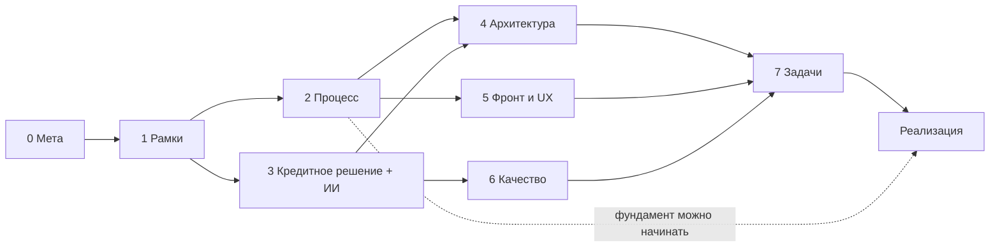

# Как мы составляем план

| | |
|---|---|
| Статус | REVIEW: ждёт одобрения пользователя |
| Владелец | Агент A |
| Зависит от | — |
| Обновлено | 20.10.2026 (ред. 2: ответы раундов 1–2) |

## Зачем этот документ

Здесь описан **процесс** планирования: этапы, результат каждого этапа и кто когда принимает решения. Сам план продукта лежит в остальных папках.

## Исходные условия

- **Дедлайн сдачи 26.10.2026.** Точное время уточняется (Q-009). Сегодня вечер 20.10, впереди около 5,5 дня.
- **Реализуют ИИ-агенты «под ключ»**: агент A (Claude Code) и его сменщик B (Codex), D-005. Люди команды заданий не имеют (D-007). Пользователь принимает решения и утверждает.
- **Моки делаем сами** (D-006) строго по утверждённому [docs/specs/mocks.md](../../specs/mocks.md), не перепроектируя. Наш бэкенд работает с ними только по контракту.
- **Цель — первое место.** Минимум второе. Каждое решение проверяем по 6 критериям кейса и по чек-листу сдачи (стр. 7).

## Принципы

1. **Сначала решения и контракты, потом код.** Код пишется по одобренному документу, а не по памяти агента.
2. **Сначала продумываем всё** (решение пользователя, Q-004 / D-008). Сроки фаз ниже — ориентир, а не ворота. Если план начнёт угрожать дедлайну, агент об этом прямо скажет и предложит, что начать кодить раньше. Решение остаётся за пользователем.
3. **Атомарность.** Один документ отвечает на один вопрос. Правила — в [02-doc-standard.md](02-doc-standard.md).
4. **Развилка → документ вариантов → выбор пользователя → решение → спецификация.** Если задачу можно решить по-разному, агент не выбирает молча. Он пишет документ вариантов (минимум 2 варианта, плюсы и минусы, цена в часах, риск, ценность для жюри и своя рекомендация), а пользователь выбирает.
5. **Принятые решения не пересматриваем.** Они в [05-decisions-index.md](05-decisions-index.md). Если агент считает решение ошибочным, он открывает вопрос с аргументом, но сам решение не меняет.
6. **Каждое требование кейса привязано к документу и к тесту** (матрица требований, `10-01`). Так ни один пункт чек-листа сдачи не потеряется.
7. **Кредитное решение прорабатываем глубже всего.** Это приоритет пользователя: варианты по каждой подзадаче, математика, ML, NLP. Карта подзадач — в [30-decisioning/00-problem-map.md](../30-decisioning/00-problem-map.md).
8. **Время пользователя — самый дефицитный ресурс.** Читать ему нужно только документы вариантов и короткие сводки. Вопросы приходят пачками, до 4 за раз, у каждого есть рекомендованный ответ.

## Фазы

| # | Фаза | Цель | Результат | Ворота: «готово», когда | Срок |
|---|---|---|---|---|---|
| 0 | Мета | Договориться, как планируем | `00-meta/` | Пользователь одобрил процесс и ответил на раунды 1–2 | 20.10 вечер |
| 1 | Инвентаризация и рамки | Собрать уже решённое, требования кейса, персоны, роли, MVP | `10-product/` (01–07) | В матрице требований нет пустых строк, MVP одобрен | 21.10, 11:00 |
| 2 | Процесс | Модель процесса, статусы, задачи клиенту, согласия, выдача | `20-process/` | Диаграмма состояний одобрена | 21.10, 13:00 |
| 3 | Кредитное решение и ИИ | Варианты по каждой подзадаче → выбор → спецификации | `30-decisioning/`, `40-ai/` | Все варианты выбраны, прогон персон сходится с ожидаемыми исходами | Варианты 21.10 к 14:00, выбор 21.10 вечером, спецификации 22.10 утром |
| 4 | Архитектура и контракты | Стек, модули, данные, API, очереди, безопасность, деплой | `50-architecture/` | Одобрены OpenAPI v1 и модель данных | 21.10 вечер |
| 5 | Фронт и UX | Структура, дизайн-система, экраны, макеты | `60-frontend/` | Выбраны макеты ключевых экранов | Структура 21.10, макеты 22.10 |
| 6 | Качество | Стратегия тестов, синтетика, CI | `70-quality/` | Есть каталог тестовых сценариев | 21.10–22.10 |
| 7 | Поставка | Атомарные задачи, график, распределение, DoD, сдача, демо | `80-delivery/` | У каждой задачи есть владелец и критерии приёмки | Фундамент 21.10, остальное по мере одобрения |

Фазы идут **внахлёст**. Пока пользователь выбирает варианты кредитного решения (фаза 3), можно писать архитектуру (4) и стратегию тестов (6).

## Когда начинается код

По решению пользователя код начинается, когда план продуман (D-008). Таблица ниже — **ориентир** для расчёта: если планирование уйдёт дальше этих дат, агент предупредит.

| Когда | Что начинаем | Почему уже можно |
|---|---|---|
| 21.10 после ворот фаз 1–2 | Каркас репо, docker-compose, CI, вход и роли, заявка и её статусы | Это не зависит от выбора по скорингу |
| 21.10 вечер — 22.10 | Ядро решения, адаптеры к мокам, конвейер | Варианты выбраны, контракты моков есть |
| 22.10 | Экраны по выбранным макетам | Выбрана дизайн-система, есть OpenAPI |
| 22.10–24.10 | Всё остальное по бэклогу задач | — |
| 25.10, 14:00 | **Заморозка функций**, дальше только баги, документация и проверка на чистой машине | Предложено в сессии «Стратегия первого места», ждёт подтверждения |
| 26.10 | Тег версии, сверка с чек-листом сдачи | — |

## Как участвует пользователь

- **Раунды опроса.** До 4 вопросов за раз, у каждого рекомендованный вариант и пояснение, что изменится от ответа.
- **Документы вариантов.** Достаточно прочитать «Сравнение» и «Рекомендацию» и выбрать.
- **Одобрение.** Статус `APPROVED` агент ставит только после явного «да» в чате и записывает это в журнал.
- Ответы записываются в [06-open-questions.md](06-open-questions.md), решения — в [05-decisions-index.md](05-decisions-index.md).
- Работа, которая от ответа не зависит, **не простаивает** в ожидании. Работа, которая зависит, без ответа не начинается: молчание не считаем согласием.

## Риски самого планирования

| Риск | Что делаем |
|---|---|
| План съест время на код | Сроки фаз выше, скользящее планирование, фундамент стартует 21.10 |
| Пользователь не успевает решать | Пачки вопросов, готовые рекомендации, читать только варианты |
| Два агента расходятся в допущениях | [Протокол](03-collaboration-protocol.md), единый журнал, решения в одном месте |
| Моки не готовы, когда нужен конвейер | Адаптеры пишем по контракту из спецификации моков, в тестах свои заглушки |
| Слишком много документов | Документ пишется, только если по нему потом пишут код или тест. Остальное в бэклоге помечено «по остатку времени» |
