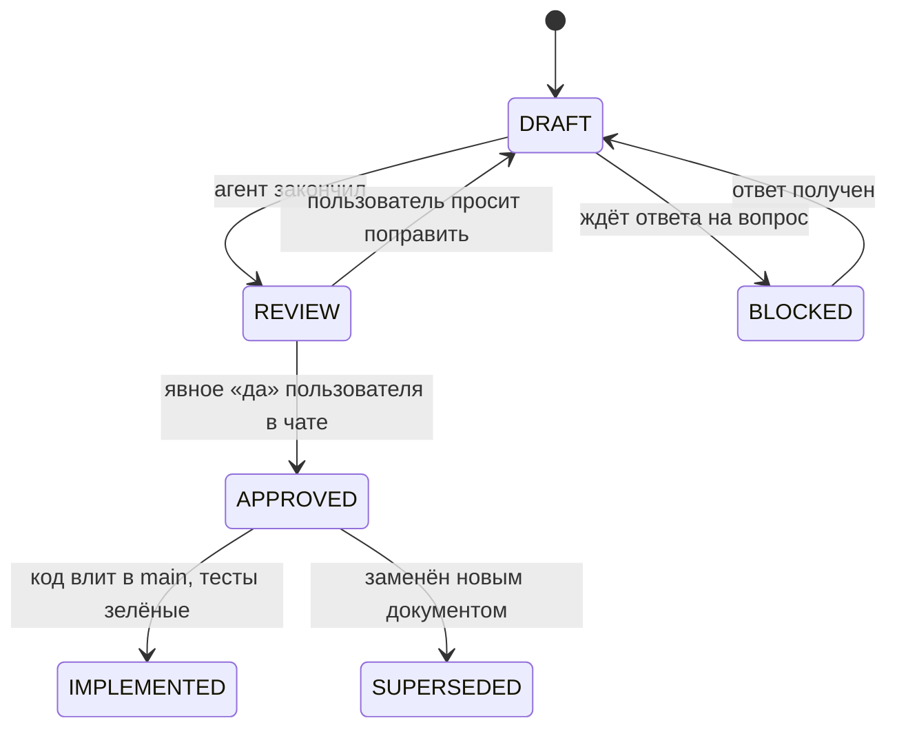

# Стандарт документов плана

| | |
|---|---|
| Статус | REVIEW |
| Владелец | Агент A |
| Зависит от | [01-planning-process.md](01-planning-process.md) |
| Обновлено | 20.10.2026 |

## Атомарный документ

- **Отвечает на один вопрос или описывает одну вещь.** Проверка: суть документа называется одной фразой без «и».
- **Не больше ~200 строк.** Если вышло больше, документ делится на части.
- **Каждый факт живёт в одном месте.** Остальные документы на него ссылаются и не копируют.
- **Пишется, только если по нему потом пишут код, тест или текст для сдачи.** Документов «для красоты» не делаем.

## Четыре типа документов

| Тип | Зачем | Шаблон |
|---|---|---|
| **План / спецификация** | Как устроена вещь: процесс, модуль, экран, правило | [templates/plan.md](templates/plan.md) |
| **Варианты** | Развилка: несколько способов, сравнение, рекомендация, вопрос пользователю | [templates/options.md](templates/options.md) |
| **Решение** | Что выбрали, почему и что из этого следует | [templates/decision.md](templates/decision.md) |
| **Задача** | Атомарная единица реализации с критериями приёмки | [templates/task.md](templates/task.md) |

## Имена и места

- Папки по зонам: `NN-zone/`. Файлы: `NN-kebab-case.md`. **ID документа** — номер папки и номер файла: `30-05` — это `30-decisioning/05-…`.
- Решения: `decisions/D-NNN-kebab-case.md`. Задачи: `80-delivery/tasks/T-NNN-kebab-case.md`. Вопросы: `Q-NNN` внутри [06-open-questions.md](06-open-questions.md).
- **Язык.** Документы пишем по-русски, простыми словами: пользователь не из банковской сферы. Коды, поля, статусы и имена сервисов — на английском, так же, как в коде (`MANUAL_REVIEW`, `mock-registry`).
- Ссылки только относительные, чтобы они работали на GitHub.

## Обязательная шапка

Таблица в начале каждого документа:

| Поле | Что писать |
|---|---|
| Статус | См. ниже |
| Владелец | Агент A / агент B / имя человека |
| Зависит от | Документы и решения, без которых этот не имеет смысла |
| Решения | Какие `D-NNN` он реализует или порождает |
| Обновлено | Дата последней правки |

## Статусы

- `APPROVED` ставит агент только после явного согласия пользователя. В журнал пишется дата и что именно одобрено.
- Документ в статусе `SUPERSEDED` не удаляем. Вверху пишем ссылку на замену.
- `BLOCKED` всегда со ссылкой на вопрос `Q-NNN`.

## Чего не делать

- **Не вставлять код** (Pydantic, SQL, TypeScript, YAML-конфиги целиком) в документы плана. Контракты и модели описываем таблицами: поле, тип, обязательность, смысл. Короткий пример JSON до ~15 строк можно, если без него непонятно. *(Пожелание пользователя из сессии про моки.)*
- **Не писать расплывчато** («как-нибудь», «по ситуации»). Если ответа нет, это открытый вопрос с ID.
- **Не менять одобренный документ молча.** Правка = отметка «Ред. N» в шапке + запись в журнал. Если меняется суть решения, оформляется новое решение.
- **Не дублировать кейс и спецификацию моков.** На них ссылаемся.

## Экономические документы: обязательно

У каждого экономического параметра (порог, ставка, доля, коэффициент) — **источник**: норматив ЦБ, подход Базеля, данные Росстата или ФНС, закон. Если источника нет, параметр явно помечается как **допущение** с объяснением, почему такое значение разумно. Все параметры сводятся в реестр [30-18](../30-decisioning/18-economic-assumptions.md).

## Документ вариантов: обязательные разделы

1. **Задача.** Что решаем и почему это важно для кейса или жюри.
2. **Ограничения и критерии выбора.** Например: работает на CPU жюри, без платных ресурсов, объяснимо, уложится в N часов.
3. **Варианты, минимум два.** У каждого: суть, как работает простыми словами, плюсы, минусы, цена в часах, риски, ценность на демо, какие данные нужны.
4. **Сравнительная таблица** по критериям.
5. **Рекомендация агента** и чем за неё платим.
6. **Вопрос пользователю** с ID `Q-NNN`.

## Задача реализации: обязательные разделы

Цель · что входит и что не входит · входные документы · критерии приёмки (проверяемые) · какие тесты пишутся · зависимости · оценка в часах · владелец · ветка.

## Диаграммы

Mermaid прямо в markdown: GitHub его рисует. Для сдачи нужные диаграммы (архитектура, состояния, модель данных) потом дополнительно выгружаются в картинки.
