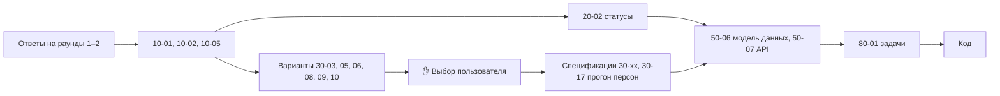

# Бэклог документов плана

| | |
|---|---|
| Статус | REVIEW. Сам список живой и обновляется постоянно |
| Владелец | Агент A |
| Зависит от | [01-planning-process.md](01-planning-process.md) |
| Обновлено | 20.10.2026 |

Это «план плана»: какие документы нужны, на какой вопрос отвечает каждый, в каком порядке они пишутся и где без пользователя не обойтись. **Статусы документов ведутся только здесь.**

**Обозначения.**
- Тип: **П** — план или спецификация, **В** — варианты (нужен выбор), **Р** — реестр или таблица.
- «Выбор»: ✋ — без решения пользователя дальше не идём; 👁 — достаточно одобрить.
- Кто: зон нет, агенты A и B — сменщики (D-005). Работу берёт тот, кто сейчас активен. 🧠 — сложная инженерная задача, кандидат для GPT-6 Astra.
- ⏸ — тема отложена пользователем, документ не пишем, пока он не вернётся к ней.
- Приоритет: **M** — до старта кода своей зоны, **S** — параллельно с кодом, **C** — по остатку времени.

---

## Фаза 0. Мета — `00-meta/`

| ID | Документ | На какой вопрос отвечает | Тип | Выбор | Кто | Пр. | Статус |
|---|---|---|---|---|---|---|---|
| 00-01 | [planning-process](01-planning-process.md) | Как и в каком порядке планируем | П | 👁 | A/B | M | REVIEW |
| 00-02 | [doc-standard](02-doc-standard.md) | Как пишем документы | П | 👁 | A/B | M | REVIEW |
| 00-03 | [collaboration-protocol](03-collaboration-protocol.md) | Как агенты-сменщики передают работу без потерь | П | 👁 | A/B | M | REVIEW |
| 00-04 | planning-backlog (этот) | Какие документы нужны | Р | 👁 | A/B | M | REVIEW |
| 00-05 | [decisions-index](05-decisions-index.md) | Что уже решено | Р | 👁 | A/B | M | REVIEW |
| 00-06 | [open-questions](06-open-questions.md) | Что спросить у пользователя | Р | — | A/B | M | живой |
| 00-07 | [journal](07-journal.md) | Что происходило, подсказки | Р | — | все | M | живой |
| 00-08 | [handoff](08-handoff.md) | Что делается прямо сейчас и какой следующий шаг | Р | — | все | M | живой |

## Фаза 1. Рамки — `10-product/`

| ID | Документ | На какой вопрос отвечает | Тип | Выбор | Кто | Пр. | Статус |
|---|---|---|---|---|---|---|---|
| 10-00 | [organizer-clarifications](../10-product/00-organizer-clarifications.md) | Что организаторы уточнили в чате хакатона | Р | — | A/B | M | DRAFT |
| 10-01 | [requirements-matrix](../10-product/01-requirements-matrix.md) | Каждое требование, критерий, ограничение и артефакт сдачи из кейса → где закрыто и каким тестом проверено | Р | 👁 | A/B | M | REVIEW |
| 10-02 | [personas](../10-product/02-personas.md) | 9 персон + 10 технических: запрос, ожидаемый исход, что показывает (из спецификации моков, раздел 10.5) | Р | 👁 | A/B | M | REVIEW |
| 10-03 | [users-and-roles](../10-product/03-users-and-roles.md) | Роли клиента (директор, бухгалтер с доверенностью) и банка. Матрица прав. Способ входа | П | ✋ | A/B | M | DRAFT |
| 10-04 | [research-jtbd](../10-product/04-research-jtbd.md) | Боли → JTBD → фичи. План CustDev и юзабилити-теста, разбор конкурентов | П | 👁 | A/B | S | DRAFT |
| 10-05 | [mvp-scope](../10-product/05-mvp-scope.md) | MoSCoW: что входит, что вырезали и почему | П | ✋ | A/B | M | APPROVED |
| 10-06 | [product-catalog](../10-product/06-product-catalog.md) | Продукты, их параметры и требования к клиенту (черновик из прошлой сессии) | П | ✋ | A/B | M | APPROVED |
| 10-07 | [need-wizard](../10-product/07-need-wizard.md) | Вопросы мастера подбора, ветвление, таблица «ответы → продукт» (черновик из прошлой сессии) | П | 👁 | A/B | M | REVIEW |
| ~~10-08~~ | ~~news-feed-concept~~ | Лента к кейсу не относится (D-019) | — | — | — | — | ❌ |
| 10-09 | [client-journey](../10-product/09-client-journey.md) | Путь клиента по шагам: что видит, что делает, какие задачи получает | П | 👁 | A/B | M | DRAFT |
| 10-10 | [bank-journey](../10-product/10-bank-journey.md) | Путь андеррайтера: очередь → карточка → решение → запрос информации | П | 👁 | A/B | M | DRAFT |

## Фаза 2. Процесс — `20-process/`

| ID | Документ | На какой вопрос отвечает | Тип | Выбор | Кто | Пр. | Статус |
|---|---|---|---|---|---|---|---|
| 20-01 | [process-model](../20-process/01-process-model.md) | Этапы, участники, данные на входе и выходе, возможные результаты (п. 2 постановки задачи) | П | 👁 | A/B | M | REVIEW |
| 20-02 | [application-states](../20-process/02-application-states.md) | Статусы заявки, переходы, кто их вызывает, что видит клиент. Источник для диаграммы состояний | П | ✋ | A/B | M | APPROVED |
| 20-03 | [tasks-and-info-requests](../20-process/03-tasks-and-info-requests.md) | «Что нужно от вас»: задачи клиенту, цикл запроса информации, сроки | П | 👁 | A/B | M | DRAFT |
| 20-04 | [consents-and-signing](../20-process/04-consents-and-signing.md) | Согласия (БКИ, обороты, ПДн), оферта, имитация подписи без SMS, документы | П | 👁 | A/B | M | DRAFT |
| 20-05 | [disbursement-and-after](../20-process/05-disbursement-and-after.md) | Открытие счёта, выдача, сообщения в БКИ, «Мои кредиты», график | П | 👁 | A/B | M | DRAFT |
| 20-06 | [notifications](../20-process/06-notifications.md) | Уведомления внутри продукта: какие события, кому, какой текст | П | 👁 | A/B | S | DRAFT |

## Фаза 3а. Кредитное решение — `30-decisioning/` ⭐ приоритет пользователя

Карта всех подзадач и подходов-кандидатов: [30-decisioning/00-problem-map.md](../30-decisioning/00-problem-map.md).

| ID | Документ | На какой вопрос отвечает | Тип | Выбор | Кто | Пр. | Статус |
|---|---|---|---|---|---|---|---|
| 30-00 | [problem-map](../30-decisioning/00-problem-map.md) | Из каких подзадач состоит решение и какие есть подходы | Р | 👁 | A/B | M | REVIEW |
| 30-01 | [pipeline-overview](../30-decisioning/01-pipeline-overview.md) | Порядок шагов конвейера, режимы preview/decision, снимок решения | П | 👁 | A/B | M | DRAFT |
| 30-02 | [features-catalog](../30-decisioning/02-features-catalog.md) | Каждый признак: формула, источник, приоритет источников, что делать без данных | П | 👁 | A/B | M | DRAFT |
| 30-03 | [revenue-cashflow-options](../30-decisioning/03-revenue-cashflow-options.md) | Как оценить выручку и свободный денежный поток по оборотам, отчётности и выписке | В | ✋ | A/B | M | REVIEW |
| 30-04 | [stop-factors-and-flags](../30-decisioning/04-stop-factors-and-flags.md) | Финальный список стоп-факторов, флагов и ограничений (MVP уже согласован) | П | 👁 | A/B | M | DRAFT |
| 30-05 | [scoring-options](../30-decisioning/05-scoring-options.md) | Чем считаем риск: экспертная скоркарта / логистическая скоркарта / бустинг / EBM / гибрид | В | ✋ | A/B | M | REVIEW |
| 30-06 | [synthetic-training-data](../30-decisioning/06-synthetic-data-options.md) | Как получить «историю дефолтов» для обучения и проверки модели честно | В | ✋ | A/B 🧠 | M | REVIEW |
| 30-07 | [pd-and-grades](../30-decisioning/07-pd-and-grades.md) | Калибровка вероятности дефолта и шкала грейдов | П | 👁 | A/B | M | DRAFT |
| 30-08 | [affordability-and-limits](../30-decisioning/08-affordability-options.md) | DSCR, долговая нагрузка, максимальная сумма, формулы по каждому продукту, стресс-тест | В | ✋ | A/B | M | REVIEW |
| 30-09 | [pricing-options](../30-decisioning/09-pricing-options.md) | Как назначаем ставку: таблица надбавок / по ожидаемым потерям / по целевой доходности | В | ✋ | A/B | M | REVIEW |
| 30-10 | [counter-offer-options](../30-decisioning/10-counter-offer-options.md) | Как строим встречные предложения: перебор правил / оптимизация / набор компромиссов | В | ✋ | A/B 🧠 | M | REVIEW |
| 30-11 | [routing-and-authority](../30-decisioning/11-routing-and-authority.md) | Авто или ручное, матрица полномочий, переопределение андеррайтером, «серые зоны» | П | 👁 | A/B | M | DRAFT |
| 30-12 | [explainability](../30-decisioning/12-explainability.md) | Коды причин, вклад факторов, тексты клиенту и андеррайтеру, «что изменить, чтобы одобрили» | П | 👁 | A/B | M | DRAFT; получен от A в b98f403 |
| 30-13 | [policy-config-and-versioning](../30-decisioning/13-policy-config-and-versioning.md) | Структура конфига правил, версии, воспроизведение решения, песочница «а что если» | П | 👁 | A/B | M | DRAFT; получен от A в b98f403 |
| 30-14 | [model-validation-monitoring](../30-decisioning/14-model-validation-monitoring.md) | Gini, KS, PSI, калибровка, доля одобрений: отчёт валидации и мониторинг | П | 👁 | A/B | S | DRAFT; получен от A в b98f403 |
| 30-15 | [consistency-and-fraud-options](../30-decisioning/15-consistency-and-fraud-options.md) | Сверка анкеты с источниками, аномалии в оборотах: правила или ML | В | ✋ | A/B | S | REVIEW |
| 30-16 | [loan-math](../30-decisioning/16-loan-math.md) | Аннуитет, проценты при погашении в конце срока, линия, график, ПСК, досрочное погашение | П | 👁 | A/B | M | DRAFT; получен от A в b98f403 |
| 30-17 | persona-walkthrough | Прогон всех персон через выбранный дизайн с числами. Это тестовый оракул | Р | 👁 | A/B | M | — |
| 30-18 | [economic-assumptions](../30-decisioning/18-economic-assumptions.md) | Реестр экономических параметров: значение, источник (ЦБ, Базель, Росстат, закон) или пометка «допущение» (D-073) | Р | — | A/B | M | APPROVED |

## Фаза 3б. ИИ и NLP — `40-ai/`

Карта: [40-ai/00-problem-map.md](../40-ai/00-problem-map.md).

| ID | Документ | На какой вопрос отвечает | Тип | Выбор | Кто | Пр. | Статус |
|---|---|---|---|---|---|---|---|
| 40-00 | [problem-map](../40-ai/00-problem-map.md) | Где ИИ даёт понятную ценность, а где нет | Р | 👁 | A/B | M | REVIEW |
| 40-01 | [ai-principles](../40-ai/01-ai-principles.md) | ИИ не решает по кредиту, у каждой функции есть запасной путь, только открытые веса, работа на CPU | П | 👁 | A/B | M | DRAFT |
| 40-02 | [free-text-wizard-spec](../40-ai/02-free-text-wizard-spec.md) | Спецификация гибридной схемы (D-060): слоты, пороги, парсер суммы, путь без модели. Модель — по итогам T-001 | П | 👁 | A/B | S | DRAFT |
| 40-03 | [document-ingestion-options](../40-ai/03-document-ingestion-options.md) | Выписка 1С, PDF отчётности, сканы: парсер, OCR или LLM | В | ✋ | A/B | S | REVIEW; выбор Q-018/Q-140 ещё не задан |
| ~~40-04~~ | ~~news-ranking-options~~ | Лента не делается (D-019) | — | — | — | — | ❌ |
| 40-05 | texts-generation-options | Объяснения клиенту и записка андеррайтеру: шаблоны или LLM | В | ✋ | A/B | S | ⏸ Q-007 |
| 40-06 | [model-packaging-and-licenses](../40-ai/06-model-packaging-and-licenses.md) | Как модели попадают в образ, CPU-инференс, размеры, лицензии для THIRD_PARTY_NOTICES | П | 👁 | A/B | S | DRAFT |
| 40-07 | [ai-evaluation](../40-ai/07-ai-evaluation.md) | Тестовые наборы, метрики, таблица результатов | П | 👁 | A/B | S | REVIEW; T-001 завершён, PR №3; human validation ещё нет |

## Моки внешних систем — `docs/specs/mocks.md`

Спецификация уже утверждена (D-053) и реализуется агентом A (D-006). Ревью спецификации нашло 50+ проблем: [reviews/R-001-mocks-spec.md](../reviews/R-001-mocks-spec.md). Правки вносятся в спецификацию после согласования. Задачи на реализацию нарезаются в фазе 7 прямо по разделам спецификации. Открытые вопросы по мокам — Q-020…Q-023.

## Фаза 4. Архитектура — `50-architecture/`

| ID | Документ | На какой вопрос отвечает | Тип | Выбор | Кто | Пр. | Статус |
|---|---|---|---|---|---|---|---|
| 50-01 | [overview](../50-architecture/01-overview.md) | Контейнеры, связи, потоки данных. Источник архитектурной схемы для сдачи | П | 👁 | A/B | M | APPROVED |
| 50-02 | [tech-stack](../50-architecture/02-tech-stack.md) | Языки, фреймворки, версии, lock-файлы | П | 👁 | A/B | M | APPROVED |
| 50-03 | [repo-and-conventions](../50-architecture/03-repo-and-conventions.md) | Структура монорепо, нейминг, стиль кода, `AGENTS.md` | П | 👁 | A/B | M | APPROVED |
| 50-04 | [modules-and-boundaries](../50-architecture/04-modules-and-boundaries.md) | Модули `api` и правила зависимостей между ними | П | 👁 | A/B | M | APPROVED |
| 50-05 | [async-processing](../50-architecture/05-async-processing.md) | Фоновые задачи на Celery + Redis (D-056): очереди, outbox, повторы, плановые задачи | П | 👁 | A/B | M | APPROVED |
| 50-06 | [data-model](../50-architecture/06-data-model.md) | Модель данных `api` (ER). Источник для артефакта сдачи | П | ✋ | A/B | M | APPROVED |
| 50-07 | [api-design](../50-architecture/07-api-design.md) | Соглашения API, ошибки, идемпотентность, OpenAPI-first, генерация TS-клиента | П | 👁 | A/B | M | APPROVED |
| 50-08 | [integration-adapters](../50-architecture/08-integration-adapters.md) | Адаптеры к мокам: таймауты, повторы, circuit breaker, кэш, снимки (основа — раздел 9 спецификации моков) | П | 👁 | A/B | M | APPROVED |
| 50-09 | [security](../50-architecture/09-security.md) | Вход, роли, ПДн, секреты, согласия, OWASP, проверка зависимостей | П | 👁 | A/B | M | APPROVED |
| 50-10 | [audit-and-observability](../50-architecture/10-audit-and-observability.md) | Аудит-лог, логи, метрики, трассировка, дашборды | П | 👁 | A/B | S | APPROVED |
| 50-11 | [realtime](../50-architecture/11-realtime.md) | Живые статусы: SSE и доставка событий между процессами | П | 👁 | A/B | M | APPROVED |
| 50-12 | [files-and-documents](../50-architecture/12-files-and-documents.md) | Где храним загрузки и сгенерированные договоры, генерация PDF | В | 👁 | A/B | S | APPROVED |
| 50-13 | [config-and-profiles](../50-architecture/13-config-and-profiles.md) | Переменные окружения, `.env.example`, профили compose (основной / ИИ / наблюдаемость) | П | 👁 | A/B | M | APPROVED |
| 50-14 | [deployment](../50-architecture/14-deployment.md) | Запуск на ПК жюри (бюджет памяти), облачный стенд (Q-008) | П | ✋ | A/B | S | APPROVED |
| 50-15 | [reliability-and-scaling](../50-architecture/15-reliability-and-scaling.md) | Отказы, деградация, масштабирование: история для критерия «enterprise» | П | 👁 | A/B | S | APPROVED |

## Фаза 5. Фронт и UX — `60-frontend/`

| ID | Документ | На какой вопрос отвечает | Тип | Выбор | Кто | Пр. | Статус |
|---|---|---|---|---|---|---|---|
| 60-01 | [app-structure](../60-frontend/01-app-structure.md) | Одно приложение с двумя зонами, роутинг, состояние, API-клиент | П | 👁 | A/B | M | REVIEW; Q-085/086 приняты D-085 |
| 60-02 | [design-system-options](../60-frontend/02-design-system-options.md) | Готовая библиотека компонентов: варианты и выбор | В | ✋ | A/B | M | DRAFT |
| 60-03 | [client-screens](../60-frontend/03-client-screens.md) | Все экраны клиента и их состояния (загрузка, пусто, ошибка) | П | 👁 | A/B | M | DRAFT |
| 60-04 | [backoffice-screens](../60-frontend/04-backoffice-screens.md) | Экраны банка | П | 👁 | A/B | M | DRAFT |
| 60-05 | [demo-panel](../60-frontend/05-demo-panel.md) | Демо-управление: сброс, «уронить БКИ», переключение персон | П | 👁 | A/B | S | DRAFT |
| 60-06 | [ux-writing](../60-frontend/06-ux-writing.md) | Словарь «как говорим с клиентом», тексты статусов и ошибок | П | 👁 | A/B | S | DRAFT |
| 60-07 | [mockups](../60-frontend/07-mockups.md) | 2–3 визуальных направления, макеты ключевых экранов, выбор | В | ✋ | A/B | M | DRAFT |
| ~~60-08~~ | ~~responsive~~ | Адаптив не делаем (D-063). Базовая доступность — в 60-03 | — | — | — | — | ❌ |

## Фаза 6. Качество — `70-quality/`

| ID | Документ | На какой вопрос отвечает | Тип | Выбор | Кто | Пр. | Статус |
|---|---|---|---|---|---|---|---|
| 70-01 | [test-strategy](../70-quality/01-test-strategy.md) | Пирамида тестов, что где проверяем, пороги покрытия | П | 👁 | A/B | M | DRAFT |
| 70-02 | [unit-and-property-tests](../70-quality/02-unit-and-property-tests.md) | pytest и инварианты на свойства: например, «рост просрочки никогда не улучшает решение» | П | 👁 | A/B | M | DRAFT |
| 70-03 | [synthetic-population-tests](../70-quality/03-synthetic-population-tests.md) | Массовые прогоны тысяч синтетических компаний: распределения, монотонность, отсутствие падений | П | 👁 | A/B | M | DRAFT |
| 70-04 | [contract-and-api-tests](../70-quality/04-contract-and-api-tests.md) | Контракты OpenAPI, фаззинг API, адаптеры против моков | П | 👁 | A/B | S | DRAFT |
| 70-05 | [integration-and-e2e](../70-quality/05-integration-and-e2e.md) | Тесты с настоящими Postgres/Redis, e2e Playwright по персонам, прогон коллекции запросов | П | 👁 | A/B | M | DRAFT |
| 70-06 | [resilience-and-load](../70-quality/06-resilience-and-load.md) | Хаос-сценарии и нагрузочный тест | П | 👁 | A/B | S | DRAFT |
| 70-07 | [frontend-tests](../70-quality/07-frontend-tests.md) | Тесты компонентов | П | 👁 | A/B | S | DRAFT |
| 70-08 | [ci-pipeline](../70-quality/08-ci-pipeline.md) | GitHub Actions: линтеры, тесты, сборка, сканы безопасности, бейджи | П | 👁 | A/B | M | DRAFT |
| 70-09 | [test-scenarios-catalog](../70-quality/09-test-scenarios-catalog.md) | Человекочитаемые тестовые сценарии: артефакт сдачи | Р | 👁 | A/B | M | DRAFT |

## Фаза 7. Поставка — `80-delivery/`

| ID | Документ | На какой вопрос отвечает | Тип | Выбор | Кто | Пр. | Статус |
|---|---|---|---|---|---|---|---|
| 80-01 | work-breakdown | Список атомарных задач `T-NNN` и их статусы | Р | 👁 | A/B | M | — |
| 80-02 | schedule | График по дням до 26.10, вехи, заморозка | П | ✋ | A/B | M | — |
| 80-03 | agent-split | Кто что делает: агенты и люди | П | ✋ | A/B | M | — |
| 80-04 | definition-of-done | Когда задача считается сделанной | П | 👁 | A/B | M | — |
| 80-05 | submission-checklist | Каждый пункт стр. 7 кейса → файл в репо | Р | 👁 | A/B | M | — |
| 80-06 | readme-plan | Структура итогового README | П | 👁 | A/B | S | — |
| 80-07 | jury-self-check | **Сценарий самопроверки жюри** (D-064): по шагам, какие демо-компании, какой исход ждать, где что видно | П | ✋ | A/B | M | — |
| ~~80-08~~ | ~~pitch-outline~~ | Презентация не нужна (D-064) | — | — | — | — | ❌ |
| 80-09 | risks | Риски реализации и что делаем с каждым | Р | 👁 | A/B | S | — |
| T-NNN | `tasks/*` | Атомарные задачи реализации | — | — | A/B | — | — |

---

## Критический путь

Узкое место — **выбор пользователя по вариантам кредитного решения**. Поэтому эти документы пишутся первыми, сразу после рамок.

## Что читать пользователю

Только документы с ✋. Их около 20, но у каждого достаточно прочитать два раздела: «Сравнение» и «Рекомендация». Остальное агенты согласуют сами и покажут короткой сводкой.

**Смена B 21.10:** 30-19 получен от A: [simulator-spec](../30-decisioning/19-simulator-spec.md), DRAFT. 30-17, макеты и вся фаза 7 ещё не готовы. Ответы на отдельные развилки D-085…D-092 не означают одобрение всего плана.
