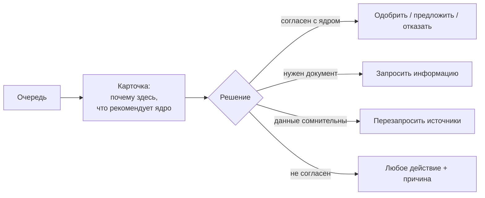

# Путь андеррайтера (минимальный объём)

| | |
|---|---|
| Статус | DRAFT |
| Владелец | Агент A (черновик субагента) |
| Зависит от | [10-02](02-personas.md), [20-01](../20-process/01-process-model.md), [20-02](../20-process/02-application-states.md), [60-04](../60-frontend/04-backoffice-screens.md), [09-client-journey](09-client-journey.md) |
| Решения | D-010, D-014, D-034, D-035, D-077, D-082 |
| Обновлено | 21.10.2026 |

## Зачем

Банковская сторона минимальна (D-010), но жюри должно увидеть, что ручной исход чем-то заканчивается, а решение человека опирается на данные. Документ описывает три пути, по которым андеррайтер проходит очередь, и показывает, зачем каждому нужны блоки карточки ([60-04](../60-frontend/04-backoffice-screens.md)). Со стороны клиента те же заявки — в [10-09](09-client-journey.md) (общие участки) и 60-03.

**Кто он:** сотрудник банка, который смотрит только то, что автомат не решил. **Задача (JTBD):** *«когда в очереди заявка, которую автомат не решил, я хочу быстро увидеть, почему, на каких данных, и что рекомендует ядро, чтобы принять решение и не пересчитывать руками»*. Вход — демо-кнопка «Войти как андеррайтер».

## Общий порядок работы

Эмоции: 🙂 спокойно · 🤔 нужно разобраться · 😟 не хватает данных.

## Путь 1. СтанкоПром — запрос договора поставщика → одобрение

Инвестиционный кредит 15 млн на 60 мес на линию оборудования, залог — покупаемое оборудование. Подготовила бухгалтер Белова, подписывает директор Кузнецов (D-014). Коды: `AMOUNT_ABOVE_AUTO_LIMIT`, `COLLATERAL_REVIEW`.

| # | Шаг | Что видит андеррайтер | Что делает | Эмоция / задача | Результат у клиента |
|---|---|---|---|---|---|
| 1 | Заявка попала в очередь | Строка вспыхнула сама. «Почему здесь»: «Сумма выше лимита автоматики; нужно оценить залог». Рекомендация ядра: «Запросить документ о залоге» | Открывает карточку | 🙂 «Понятно, почему ко мне» | Таймлайн: «Заявку смотрит специалист» |
| 2 | Разбор | Блоки: данные компании (9 лет, отчётность за 2 года с прибылью), БКИ (закрытые кредиты, нет просрочек), баллы и грейд, платёж и устойчивость (запас по DSCR и стресс-тесту), ставка по слагаемым, документы пока нет | Сверяет: бизнес устойчив, но объект залога подтверждён только словами заявки | 🤔 Проверяет, не пересчитывая | — |
| 3 | Запрос информации | Форма: что просим («Договор или счёт от продавца оборудования»), зачем («Подтвердить стоимость и объект залога»), срок | Заполняет и отправляет. Согласен с рекомендацией ядра: причина не нужна | 🙂 | У Беловой и Кузнецова на главной задача, колокольчик, таймлайн «Нужна ваша помощь» |
| 4 | Ожидание | Заявка уходит из очереди «Ждут решения» (статус `NEEDS_INFO`) | Работает с другими | — | Белова загружает договор |
| 5 | Возврат | Через проверку заявка снова в очереди (отметка «получен документ»). Рекомендация ядра теперь: «Одобрить» | Открывает документ в блоке «История и документы», сверяет стоимость | 🙂 | Таймлайн: снова «Оцениваем» |
| 6 | Решение | Кнопка «Одобрить» | Подтверждает. Не отклоняется от рекомендации, поэтому комментарий необязателен | 🙂 | Одобрено; Кузнецов подписывает; деньги на счёте |

**Что показывает:** цикл «запросить информацию», два пользователя компании, залог как причина ручного рассмотрения.

## Путь 2. «Быстрый старт» — молодой бизнес с поручителем

ООО, IT, 3 месяца, клиент банка 3 мес. Просит экспресс-кредит 1 млн на 24 мес. Ядро **автоматически** предложило встречное «с поручительством владельца» (`BUSINESS_TOO_YOUNG`, D-077). Клиент принял, владелец-директор подписал согласие поручителя (D-082), и заявка пришла к андеррайтеру.

| # | Шаг | Что видит андеррайтер | Что делает | Эмоция / задача | Результат у клиента |
|---|---|---|---|---|---|
| 1 | Заявка в очереди | Метка «Молодой бизнес: только вручную». Рекомендация ядра: «Одобрить с поручительством» | Открывает | 🤔 «Рискованный клиент, смотрим внимательно» | «Заявку смотрит специалист» |
| 2 | Разбор | Возраст бизнеса 3 мес; обороты за 3 месяца (~700 тыс./мес), отчётности нет; БКИ компании «не найдено» (новая), БКИ владельца: чистая личная история; согласие поручителя с датой и версией текста | Оценивает: фактов о компании мало, о поручителе достаточно | 😟 Мало данных о компании → 🙂 поручитель закрывает вопрос | — |
| 3 | Решение | «Одобрить» с рекомендованными условиями | Подтверждает. При решении отказать вопреки ядру пришлось бы выбрать категорию причины и написать текст (≥ 20 символов) | 🙂 | Одобрено; подпись; деньги |

**Что показывает:** небинарность (встречное → ручное), правило «причина при отклонении от ядра», согласие третьего лица.

## Путь 3. «Заря» — крупная линия, сезонный бизнес

АО, растениеводство, 24 года, клиент банка. Просит кредитную линию 20 млн на 12 мес на посевную, залог — сельхозтехника. Коды: `AMOUNT_ABOVE_AUTO_LIMIT`, `COLLATERAL_REVIEW`. Учредителей-людей в реестре нет, поручителя нет (Q-043).

| # | Шаг | Что видит андеррайтер | Что делает | Эмоция / задача | Результат у клиента |
|---|---|---|---|---|---|
| 1 | Заявка в очереди | «Сумма выше лимита; залог — техника». Рекомендация ядра: «Одобрить» | Открывает | 🙂 | «Заявку смотрит специалист» |
| 2 | Разбор | Выручка для расчёта — годовая, разделённая на 12 (сезонный бизнес, поэтому обороты по месяцам сильно скачут, это не флаг); линия: проценты на весь лимит покрываются, лимит не больше половины месячной выручки; стресс-тест пройден; грейд высокий; залог — документ о технике | Проверяет сезонность и описание техники. Информации хватает, запрашивать нечего | 🤔 Нужно понять, что скачки оборотов — норма | — |
| 3 | Решение | «Одобрить» | Подтверждает | 🙂 | Одобрено; подпись руководителя; линия открыта |

**Что показывает:** другой продукт (линия), сезонность в расчёте, ручное решение без запроса документов.

## Что общее и что пока вне объёма

| Тема | Как в минимуме |
|---|---|
| Поведение при сбое источника | Заявка приходит с плашкой «Источник не получен»; андеррайтер жмёт «Перезапросить» и ждёт новую рекомендацию. Показывается через демо-панель ([60-05](../60-frontend/05-demo-panel.md)) |
| Автоотказы | В очередь не попадают, человек их не переопределяет (D-034). Записать в README как граница |
| Несколько андеррайтеров, назначение, лимиты полномочий | Не моделируем |
| Скорость | Цель демо: решение по любой из трёх заявок за 1–2 минуты |

## Как проверяем

- e2e на каждый из трёх путей: от отправки клиентом до решения (статусы по [20-02](../20-process/02-application-states.md)).
- Юзабилити (на роли андеррайтера, 1–2 человека из команды): находит ли в карточке причину ручного рассмотрения за 10 секунд.
- В материалах сдачи — скриншоты очереди и карточки на СтанкоПроме.

## Заметки для реализации

- Для цикла СтанкоПрома важно: после ответа клиента заявка снова проходит конвейер и **снова** попадает в ручное рассмотрение (инвестиционный кредит «всегда вручную», 10-06). Это нужно показать в очереди отметкой «получен документ», иначе кажется, что заявка зациклилась.
- Рекомендации ядра на шагах (запрос документа → одобрение) — ожидаемое поведение для сценария; точные формулировки появятся в 30-17 и 30-12. Если ядро решит иначе, поправить таблицу.
- Числа (баллы, DSCR) здесь не приводятся: источник правды — 30-17.
