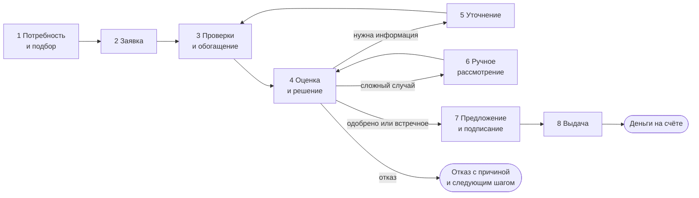

# Модель кредитного процесса

| | |
|---|---|
| Статус | DRAFT |
| Владелец | Агент A |
| Зависит от | [10-01](../10-product/01-requirements-matrix.md) (RQ-02), [10-02](../10-product/02-personas.md), D-030…D-036 |
| Обновлено | 21.10.2026 |

Кейс, п. 2 постановки задачи: определить границы процесса, этапы, действия участников, нужные данные и возможные результаты. Статусы заявки и переходы между ними описаны в [20-02](02-application-states.md).

## Границы

- **Начало:** у предпринимателя возникла потребность в деньгах, и он зашёл в кабинет.
- **Конец:** деньги на счёте, или клиент получил отказ с причиной и следующим шагом, или сам отозвал заявку.
- **Не входит:** обслуживание кредита после выдачи (платежи, просрочки, досрочное погашение — только график и просмотр), взыскание, реальные подписи и платежи.

## Участники

| Участник | Кто это | Что делает |
|---|---|---|
| Клиент: руководитель | Директор ООО или сам ИП | Всё, включая подписание |
| Клиент: сотрудник с доверенностью | Бухгалтер, финансист | Готовит заявку, отвечает на запросы банка. Не подписывает (D-014) |
| Конвейер | Наша автоматика | Проверки, скоринг, решение, выдача |
| Андеррайтер | Сотрудник банка | Ручное рассмотрение, запрос информации, решение по сложным заявкам. Интерфейс — Q-034 |
| Внешние системы | Моки: реестр, ФНС, ЕФРСБ, ЕИС, БКИ, АБС | Отдают факты, принимают сообщения и выдачу |

## Этапы

| # | Этап | Кто | Вход | Что происходит | Выход |
|---|---|---|---|---|---|
| 1 | Потребность и подбор | Клиент | Задача бизнеса своими словами или кнопками | Мастер (10-07) → продукт и альтернатива → калькулятор. Для клиентов банка — предодобренная сумма | Выбранный продукт, сумма, срок, цель |
| 2 | Заявка | Клиент | Ответы мастера, ИНН | Автозаполнение из реестра и ФНС с источником у каждого поля. Клиент дополняет то, чего мы знать не можем. Согласия. Черновик сохраняется на каждом шаге | Отправленная заявка, согласия |
| 3 | Проверки и обогащение | Конвейер | Заявка, согласия | Полнота → бесплатные источники (реестр, ФНС, ЕФРСБ, комплаенс, обороты, ЕИС для контракта) → стоп-факторы → БКИ компании и директора/ИП/поручителя → стоп-факторы | Снимки источников, признаки |
| 4 | Оценка и решение | Конвейер | Признаки | Скоринг → лимиты → ставка → правила продукта → маршрут (авто или вручную) → решение с кодами причин | Решение: одобрено / встречное / нужна информация / ручное / отказ |
| 5 | Уточнение | Клиент | Задача от банка: документ, пояснение | Клиент отвечает в той же заявке (например, загружает выписку) | Новые данные → повтор этапа 3 |
| 6 | Ручное рассмотрение | Андеррайтер | Заявка, все данные, рекомендация ядра | Соглашается с рекомендацией или меняет её с обязательной причиной. Может запросить информацию | Решение андеррайтера |
| 7 | Предложение и подписание | Клиент | Оферта или варианты | Выбирает вариант, смотрит документы, подписывает (имитация простой ЭП без SMS, 20-04) | Подписанный договор |
| 8 | Выдача | Конвейер | Договор | Если нет счёта — открытие. Выдача в АБС с идемпотентностью. Сообщения в БКИ | Деньги на счёте, кредит в «Моих кредитах», график |

## Данные по этапам

| Данные | Откуда | Где используются |
|---|---|---|
| Параметры запроса | Мастер, заявка | 4, 7 |
| Реквизиты, статус, руководитель, учредители, ОКВЭД | `mock-registry` | 2 (автозаполнение), 3 (стоп-факторы) |
| Налоги, долги, флаги риска, отчётность, МСП | `mock-tax` | 3, 4 |
| Банкротства | ЕФРСБ в `mock-registry` | 3 |
| Госконтракт | ЕИС в `mock-tax` | 1 (выбор контракта), 4 (продукт «под контракт») |
| Кредитная история компании и людей | `mock-credit-bureau` (только с согласием) | 3, 4 |
| Обороты, счета, наши кредиты, комплаенс | `mock-bank-core` | 1 (предодобрение), 3, 4, 8 |
| Выписка из другого банка | Клиент загружает или генерирует в демо-режиме (D-068) | 5 → 4 |
| Решение, коды причин, версия правил, снимки источников | Наша база | 4, 6, аудит |

## Сообщения во внешние системы

| Когда | Что | Как |
|---|---|---|
| Заявка отправлена | БКИ: `APPLICATION_REGISTERED` | Outbox, не задерживает заявку |
| Итоговое решение | БКИ: `APPLICATION_DECIDED`. Встречное → `APPROVED`, когда клиент принял, `WITHDRAWN`, если отказался (Q-022) | Outbox |
| Выдача | АБС: открытие счёта (если нужно), `disbursements`. БКИ: `OBLIGATION_OPENED` | Outbox, `Idempotency-Key` |

## Где процесс может сломаться и что тогда

| Сбой | Поведение |
|---|---|
| Реестр или ФНС недоступны на этапе 2 | Клиент вводит вручную, поля помечены «не подтверждено» |
| Любой источник недоступен на этапе 3 | Повторы → ручное рассмотрение с флагом `SOURCE_UNAVAILABLE`. Андеррайтер может перезапросить |
| АБС недоступна на выдаче | «Выдача в обработке», outbox повторяет, повтор безопасен |
| Клиент не ответил на запрос | Срок → заявка закрывается с понятным сообщением |

## Открытые вопросы

- Q-034 — какой интерфейс у андеррайтера на этапе 6.

## Заметки для реализации

- Этапы 3–4 выполняет фоновый воркер (Celery, D-056). Клиент видит прогресс через SSE.
- Ядро `decide()` не ходит в сеть: этап 3 собирает данные, этап 4 только считает (D-030).
