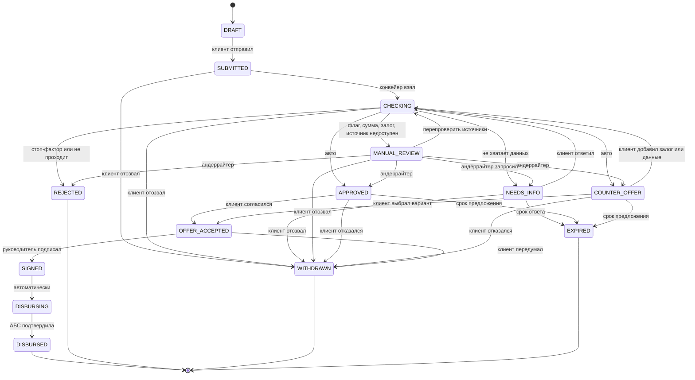

# Статусы заявки и переходы

| | |
|---|---|
| Статус | APPROVED 21.10.2026 |
| Владелец | Агент A |
| Зависит от | [20-01](01-process-model.md), D-012, D-055 |
| Обновлено | 21.10.2026 |

Источник для артефакта сдачи «диаграмма состояний заявки». В коде это таблица переходов. Недопустимый переход возвращает `409`, а диаграмма для документации генерируется из этой же таблицы (D-055).

## Статусы

| Статус | Смысл | Конечный? |
|---|---|---|
| `DRAFT` | Черновик, клиент заполняет | — |
| `SUBMITTED` | Отправлена, ждёт обработки | — |
| `CHECKING` | Идут проверки и оценка. Шаги видны в таймлайне | — |
| `NEEDS_INFO` | Ждём от клиента документ или пояснение | — |
| `MANUAL_REVIEW` | Рассматривает специалист | — |
| `APPROVED` | Одобрено на запрошенных условиях, ждём согласия клиента | — |
| `COUNTER_OFFER` | Предложены другие условия или продукт, ждём выбора клиента | — |
| `OFFER_ACCEPTED` | Клиент выбрал условия, документы сформированы, ждём подписи | — |
| `SIGNED` | Договор подписан | — |
| `DISBURSING` | Идёт выдача | — |
| `DISBURSED` | Деньги на счёте | ✅ |
| `REJECTED` | Отказ | ✅ |
| `WITHDRAWN` | Клиент отозвал или отказался от предложения | ✅ |
| `EXPIRED` | Истёк срок ответа на запрос или срок предложения | ✅ |

## Диаграмма

## Кто вызывает переходы

| Переход | Кто | Условия и проверки |
|---|---|---|
| `DRAFT → SUBMITTED` | Клиент (руководитель или сотрудник) | Обязательные поля, согласия подписаны, нет другой заявки в работе (`DUPLICATE_APPLICATION`) |
| `SUBMITTED → CHECKING` | Конвейер | — |
| `CHECKING → *` | Конвейер (`decide()`) | Снимок решения сохраняется до перехода |
| `NEEDS_INFO → CHECKING` | Клиент | Ответил на все задачи |
| `MANUAL_REVIEW → *` | Андеррайтер | Отклонение от рекомендации ядра — только с причиной |
| `APPROVED / COUNTER_OFFER → OFFER_ACCEPTED` | Клиент | Предложение не истекло |
| `COUNTER_OFFER → CHECKING` | Клиент | Добавил залог, поручителя или подтвердил выручку *(Should)* |
| `OFFER_ACCEPTED → SIGNED` | **Только руководитель** | Сотрудник с доверенностью видит «Передать руководителю на подпись» |
| `SIGNED → DISBURSING → DISBURSED` | Конвейер | Открытие счёта при необходимости, идемпотентная выдача, повторы через outbox |
| `* → WITHDRAWN` | Клиент | До подписания |
| `* → EXPIRED` | Таймер | Сроки: ответ на запрос — 5 дней, предложение — 10 дней (демо-значения, в конфиге) |

**Важное правило:** после `SIGNED` отозвать заявку нельзя. Выдача доводится до конца, даже если АБС временно недоступна.

## Что видит клиент

Внутренних статусов много. Клиенту показываем 6 понятных шагов:

| Шаг в таймлайне | Внутренние статусы | Текст для клиента (черновик) |
|---|---|---|
| 1. Заявка отправлена | `SUBMITTED` | «Заявка у нас. Сейчас начнём проверку» |
| 2. Проверяем данные | `CHECKING` (подшаги: реестр, налоговая, БКИ…) | «Проверяем данные компании и кредитную историю. Обычно до 1 минуты» |
| ⏸ Нужна ваша помощь | `NEEDS_INFO` | «Специалист просит: … Зачем: … Срок: …» |
| 3. Оцениваем | `MANUAL_REVIEW` | «Заявку смотрит специалист. Обычно до 1 рабочего дня» |
| 4. Решение готово | `APPROVED`, `COUNTER_OFFER`, `REJECTED` | Свой экран на каждый исход |
| 5. Подписание | `OFFER_ACCEPTED`, `SIGNED` | «Проверьте документы и подпишите» |
| 6. Деньги на счёте | `DISBURSING`, `DISBURSED` | «Зачисляем…» → «500 000 ₽ на счёте 4080…» |

## Как проверяем

- Unit-тест на каждый разрешённый переход и **на все запрещённые пары** (`409`).
- Тест: диаграмма в документации совпадает с таблицей переходов в коде.
- Property-тест: из любого статуса по разрешённым переходам достижим конечный.
- e2e: каждая персона проходит свою цепочку статусов (10-02).

## Открытые вопросы

- Q-034: если банковского интерфейса не будет, переходы из `MANUAL_REVIEW` вызываются через API.
- Решено: таймер истечения сроков настраивается и **по умолчанию выключен** на демо-стенде, чтобы заявки жюри не истекали во время проверки. Тест включает его явно.

## Заметки для реализации

- Каждый переход — событие в журнале заявки: кто, когда, откуда, куда, причина. Это и есть аудит и таймлайн клиента.
- Переход и запись в outbox делаются в одной транзакции.
