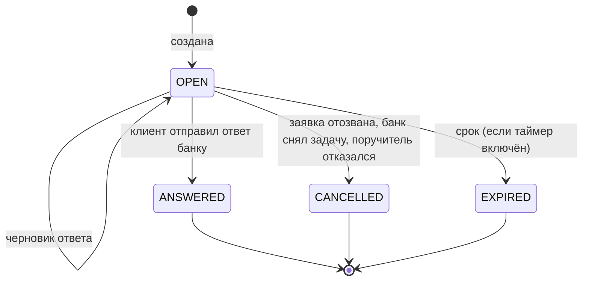
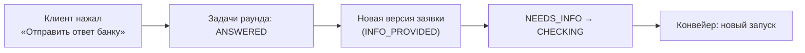

# Задачи клиенту: «Что нужно от вас»

| | |
|---|---|
| Статус | DRAFT |
| Владелец | Агент A (черновик субагента) |
| Зависит от | [20-01](01-process-model.md), [20-02](02-application-states.md), [10-03](../10-product/03-users-and-roles.md), [50-06](../50-architecture/06-data-model.md) (`tasks`), [50-12](../50-architecture/12-files-and-documents.md) |
| Решения | D-012, D-020, D-055 (таймер выключен по умолчанию), D-068, D-082 |
| Вопросы пользователю | Q-127 |
| Обновлено | 21.10.2026 |

Клиент не должен гадать, чего хочет банк. Всё, что нужно от клиента, оформляется **задачей**: коротко сказано, что, зачем и до какого срока. Задачи собраны на одном экране «Что нужно от вас» и в таймлайне заявки.

## Типы задач

| Тип клиенту | Значение в `tasks.kind` | Что просим | Пример |
|---|---|---|---|
| **Документ** | `DOCUMENT` | Загрузить файл | Выписка из другого банка (формат 1С), договор с поставщиком, отчётность |
| **Пояснение** | `EXPLANATION` | Ответ текстом или выбором | «Почему выручка упала в марте?» |
| **Подпись** | `SIGNATURE` *(новое значение)* | Подписать документ или согласие тем же кодом ([20-04](04-consents-and-signing.md)) | Директору: «Подпишите согласия и передайте заявку» |
| **Поручитель** | `GUARANTOR` *(новое значение)* | Назвать поручителя или подтвердить своё согласие | `quick-start`: «Добавьте владельца поручителем» |
| Залог | `COLLATERAL` | Описать залог и стоимость | `stankoprom`: оборудование |
| Подтвердить выручку | `CONFIRM_REVENUE` *(Should)* | Подтвердить расчётную выручку | Встречное «с подтверждением» |

Задача всегда имеет **исполнителя**: «любой участник компании» или конкретный человек (поручитель по личному ИНН). Для этого в `tasks` нужно поле исполнителя (см. заметки).

## Кто создаёт задачи

| Кто | Когда | Как |
|---|---|---|
| Конвейер | Нет выручки ни в оборотах, ни в отчётности (`REVENUE_UNKNOWN`) → задача «выписка». Нужен поручитель → задача «поручитель» | По коду причины, из шаблона |
| Андеррайтер | Ручное рассмотрение: нужен документ или пояснение | Выбирает шаблон, при желании дописывает «зачем» своими словами |
| Система подписания | Нужна подпись руководителя или поручителя | При подготовке документов |

Шаблоны живут в конфиге правил (30-13): код, тип, заголовок, «зачем», подсказка «где взять». Новая задача = новая запись.

## Что видит клиент

| Элемент | Правило |
|---|---|
| Заголовок | Действие простыми словами: «Загрузите выписку по счёту в другом банке» |
| Зачем | Одна фраза причины: «Нам нужно подтвердить вашу выручку: у нас нет ваших оборотов» |
| Что именно | Формат, период, ограничения: «Файл 1С, не меньше 3 месяцев, не больше 5 МБ» |
| Где взять | «В интернет-банке: Выписка → Выгрузка в 1С» |
| Срок | «Срок: до 26.10» только когда таймер включён. Иначе «Срок не ограничен» |
| Кто может ответить | Любой участник компании; для подписи — только руководитель |
| Демо-помощь | В демо-режиме рядом с «Загрузить» кнопка «Сгенерировать тестовую выписку» (D-068) |

Ошибки файла показываются понятно, с причиной из [50-12](../50-architecture/12-files-and-documents.md): «Это выписка другой компании (ИНН не совпал)», «Период короче 3 месяцев», «Суммы в файле не сходятся». Задача остаётся открытой, файл не потерян.

## Жизненный цикл

- **Черновик ответа.** Файл или текст сохраняется в задаче, но банк его ещё не видит. Клиент может заменить файл (старый помечается недействительным, но не удаляется: файлы неизменяемы).
- **«Отправить ответ банку»** отправляет **все** задачи раунда разом. Пока не отправлено, ответы можно менять. Так «ответил на все задачи» (20-02) понятно и клиенту, и коду.
- **Отказ поручителя.** Задача `CANCELLED` с причиной `GUARANTOR_DECLINED`, у заявителя новая задача «Укажите другого поручителя» (или отзыв заявки). Заявка не меняет статус.
- **Отзыв заявки** закрывает все открытые задачи (`CANCELLED`).

## Сроки

| Что | Значение | Правило |
|---|---|---|
| Срок ответа на запрос | 5 дней (демо-значение, в конфиге, 20-02) | Заполняется в `expires_at`, только если включён таймер |
| Таймер | **Выключен по умолчанию** (D-055) | Жюри не должно терять заявку во время проверки. Включается настройкой стенда; тест включает его явно |
| Напоминание | За 1 день до срока (только при включённом таймере) | Уведомление в колокольчик ([20-06](06-notifications.md)) |
| Истечение | `OPEN → EXPIRED` для задач, затем `NEEDS_INFO → EXPIRED` заявки | Клиент видит: «Срок вышел. Можно подать новую заявку» с кнопкой |

## Как ответ возвращает заявку в CHECKING

1. Все задачи раунда `ANSWERED`, создаётся неизменяемая копия заявки `INFO_PROVIDED` ([50-06](../50-architecture/06-data-model.md)).
2. Статус `NEEDS_INFO → CHECKING` и запуск конвейера в **одной транзакции**. Ключ запуска (версия + событие) не даёт запустить дважды при двойном нажатии.
3. Конвейер идёт заново на свежих данных (Q-038). Платный отчёт БКИ внутри заявки переиспользуется до 30 дней, второго платного запроса нет ([моки, 9.2](../../specs/mocks.md)).
4. Документ разбирает фоновая задача (парсер выписки). Если разбор не удался, клиент видит ошибку в задаче **до** отправки раунда, а не после.
5. Если запрос исходил от андеррайтера и флаги остались, заявка снова придёт в `MANUAL_REVIEW` с пометкой «клиент ответил».

Раундов не бесконечно: Q-127.

## Что видит андеррайтер

В карточке заявки раздел «Запросы клиенту»:

| Что | Содержание |
|---|---|
| Список раундов | Задачи, кто создал, когда, статус, срок |
| Ответ | Для документа: файл, результат разбора (период, месячные обороты), ошибки проверок. Для пояснения: текст. Для поручителя: кто, подписал ли согласие |
| «Новое с прошлого раза» | Что изменилось в данных после ответа |
| Действия | Создать задачу по шаблону с поясняющим текстом, снять ненужную (с причиной), принять решение |

Пока раунд не отправлен клиентом, андеррайтер видит задачи как «ждём клиента» и не может вынести решение по заявке в `NEEDS_INFO` (статус не `MANUAL_REVIEW`).

## Покрытие персон

| Персона | Задача | Ожидание |
|---|---|---|
| `garipov` | `DOCUMENT` выписка 1С (создал конвейер) | Ответ → `CHECKING` → `APPROVED` |
| `stankoprom` | `DOCUMENT` договор с поставщиком (андеррайтер) | Ответ → `CHECKING` → `MANUAL_REVIEW` → одобрено |
| `quick-start` | `GUARANTOR` (владелец-поручитель) | Принял встречное → добавил поручителя → `CHECKING` → `MANUAL_REVIEW` |

## Развилки для пользователя

**Q-127. Сколько раундов запроса информации допустимо по одной заявке.**

| Вариант | Плюсы | Минусы |
|---|---|---|
| А. Не больше 3 раундов, потом андеррайтер обязан решить (одобрить, отказать) | Нет бесконечной переписки; видно в тестах | Нужен счётчик и экран «решить» |
| Б. Без ограничений | Проще | Заявка может «болтаться», на демо можно застрять |

**Рекомендация: А.** Счётчик в `application_versions` уже есть (версии `INFO_PROVIDED`), платим одним правилом.

## Заметки для реализации

- В `50-06` добавить: значения `tasks.kind` = `SIGNATURE`, `GUARANTOR`; поле исполнителя (`assignee_user_id` или `assignee_person_inn`); поле `round` (номер раунда); причина закрытия.
- Единственное место, где меняется статус, — модуль `applications` ([50-04](../50-architecture/04-modules-and-boundaries.md)); задачи — его же таблица.
- События: `TASK_CREATED`, `TASK_ANSWERED`, `TASK_CANCELLED`, `TASK_EXPIRED` в `application_events`, SSE `task_created` ([50-11](../50-architecture/11-realtime.md)).
- Тесты: двойное нажатие «Отправить» (один запуск), ответ не на все задачи (нельзя), чужой файл (ИНН не совпал), отказ поручителя, включённый таймер на 1 секунду.
