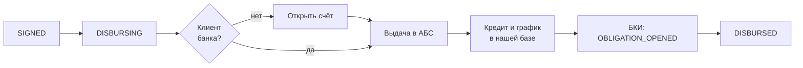

# Выдача и жизнь кредита после неё

| | |
|---|---|
| Статус | REVIEW |
| Владелец | Агент A (черновик субагента) |
| Зависит от | [20-01](01-process-model.md), [20-02](02-application-states.md), [20-04](04-consents-and-signing.md), [50-05](../50-architecture/05-async-processing.md), [50-06](../50-architecture/06-data-model.md), [моки, 6.3, 7.3–7.5, 9](../../specs/mocks.md) |
| Решения | D-010, D-012, D-054 (outbox, `Idempotency-Key`), D-055, D-068, D-093 (счёт автоматически, линия и овердрафт без траншей); Q-021 и Q-022 в редакции предложений моков |
| Вопросы пользователю | Нет: Q-132, Q-133 решены (D-093) |
| Обновлено | 21.10.2026, ред. 2: сведение R-002 после D-093 |

Что происходит после `SIGNED`: открытие счёта не-клиенту, выдача, сообщения в БКИ, раздел «Мои кредиты». Главное требование: **деньги выдаются ровно один раз**, даже если АБС моргнула или клиент нажал дважды.

## Порядок шагов

| № | Шаг | Что делает | Если не получилось |
|---|---|---|---|
| 1 | Проверка | Все подписи на месте, хеш договора сходится, предложение не истекло | Ошибка кода: заявка на ручное с флагом, клиенту «Выдача в обработке» |
| 2 | Открытие счёта | Только не-клиенту, автоматически по заявлению, которое клиент подписал в пакете документов договора (D-093): `POST accounts`, ключ идемпотентности по заявке. `409 ACCOUNT_ALREADY_EXISTS` считаем успехом и читаем клиента | Повтор через outbox |
| 3 | Выдача | `POST disbursements` со счётом клиента, номером и `contractUid` договора. Для линии и овердрафта открывается только лимит (`CREDIT_LINE` с `amountRub` = 0, `OVERDRAFT` — только лимит); транша и снятия денег нет (D-093) | См. таблицу ошибок |
| 4 | Кредит у нас | Запись `loans` и `payment_schedule` по числам предложения (график считает `api`, не АБС) | Повтор, шаг безопасен |
| 5 | БКИ | `OBLIGATION_OPENED` через outbox, не задерживает клиента | Повтор до успеха |
| 6 | Финал | `DISBURSING → DISBURSED`, уведомление «Деньги на счёте» | — |

Открытие счёта (Q-021, оба «Should» берём): без него `garipov` не дойдёт до выдачи. Заявление на открытие счёта лежит в пакете документов вместе с договором и подписывается тем же кодом (D-093, [20-04](04-consents-and-signing.md)); отдельных экранов и кодов нет. Клиент видит шаг «Открываем вам расчётный счёт» и номер счёта, реквизитов не вводит.

## Идемпотентность

| Что | Ключ | Почему |
|---|---|---|
| Открытие счёта | `acc:{номер заявки}` | Повтор не создаёт второй счёт |
| Выдача | `dsb:{номер заявки}` | Повтор после таймаута не выдаёт второй раз. `disbursements.application_id` уникален |
| Сообщение в БКИ | Постоянный `eventId` от (заявка, тип события) | Тот же `eventId` возвращает исходный `202` |
| Запись `loans` | `application_id` | Не создаст двойника |

Ключ строится **по заявке, а не по попытке**. Тот же ключ уходит при каждом повторе, в том числе после `LOST_RESPONSE`. Повторяем только запросы с ключом ([моки, 9.2](../../specs/mocks.md)).

| Ответ АБС | Что делаем |
|---|---|
| `201`, повтор `Idempotent-Replayed` | Успех |
| `404 CUSTOMER_NOT_FOUND` | Сначала открыть счёт (шаг 2), потом выдача |
| `409 ACCOUNT_NOT_OWNED` / `ACCOUNT_BLOCKED` | Остаётся `DISBURSING`, клиенту «Выдача задерживается», задача андеррайтеру. Автоповторов нет |
| `409 ALREADY_DISBURSED` (другой ключ) | Читаем `customers/{inn}/loans` по `applicationRef`; нашли — считаем выдачу выполненной и сверяем сумму, иначе тревога |
| `409 IDEMPOTENCY_IN_PROGRESS` | Подождать и повторить |
| `422 VALIDATION_ERROR` | Наш дефект: остановка, ошибка в аудит, ручной разбор |
| Таймаут, `503`, обрыв | Повтор через outbox с тем же ключом |

После `SIGNED` заявку не отозвать: выдача доводится до конца, даже если АБС недоступна ([20-02](02-application-states.md)). Клиент видит «Выдача в обработке», это не ошибка.

## Сообщения в БКИ

Все идут через outbox в одной транзакции со сменой статуса. Заявку не блокируют ([моки, 6.3](../../specs/mocks.md)).

| Когда | Событие | Заметка |
|---|---|---|
| Заявка отправлена | `APPLICATION_REGISTERED` | Заявка в БКИ запоминает **запрошенные** сумму и срок |
| Отказ (авто или андеррайтер) | `APPLICATION_DECIDED` = `REJECTED` | |
| Одобрено как запрошено | `APPLICATION_DECIDED` = `APPROVED` | Сразу после решения (схема 9.1) |
| Встречное предложение | **Ничего** до решения клиента | Q-022: `APPROVED` после принятия |
| Клиент принял встречное | `APPLICATION_DECIDED` = `APPROVED` | Условия кредита уже иные, чем в заявке: так и в моках |
| Отозвал, отказался от предложения, истёк срок | `APPLICATION_DECIDED` = `WITHDRAWN` | После `REGISTERED` и если итог ещё не отправлен |
| Деньги выданы | `OBLIGATION_OPENED` | `uid` = `contractUid` в АБС. Сумма, платёж, срок, залог: из договора. Для линии и овердрафта лимит |

- `ручное рассмотрение` и `NEEDS_INFO` ничего в БКИ не меняют.
- Отозвал **после** `APPROVED` как запрошено — второе `DECIDED` = `WITHDRAWN`. Мок описывает `decision` как состояние; **уточнить у реализатора моков**, что повторное событие по той же заявке допустимо.
- Обязательство поручителя (`SURETY`, роль `GUARANTOR`) в БКИ: *Could*, проверить, умеет ли мок.
- Чтобы кредит не считался дважды, ядро объединяет АБС и БКИ по `contractUid` = `uid` ([моки, 7.5](../../specs/mocks.md)).

## Как кредит выглядит в продукте: «Мои кредиты»

| Что | Содержание |
|---|---|
| Список | Продукт, сумма (у линии и овердрафта — лимит), ставка, срок, номер договора, дата открытия, статус `ACTIVE` |
| Карточка | Расчётный и ссудный счета, **ближайший платёж**, график, документы (договор, график, поручительство) |
| График | Таблица: дата, основной долг, проценты, итого. Совпадает с графиком оферты до рубля (одно вычисление) |
| Кто видит | Руководитель и сотрудник; поручитель — только своё поручительство, просмотр |
| Банк | Андеррайтер видит кредит в карточке заявки |

Разные виды:

| Продукт | Что в карточке |
|---|---|
| Равные платежи (`EXPRESS`, `WORKING_CAPITAL`, `INVESTMENT`) | Полный график |
| Под контракт | Проценты каждый месяц, весь долг одной суммой в конце (`BULLET`) |
| Кредитная линия, овердрафт | Только лимит и ставка; кнопки «Взять транш» нет, графика и «использовано» нет (D-093) |

«Ближайший платёж» считается по календарю: оплату мы **не отслеживаем**. Остаток долга равен выданной сумме, как и в АБС ([моки, 7.5](../../specs/mocks.md)).

## Что не моделируем

Приём платежей и списание, просрочки и штрафы, досрочное погашение, реструктуризацию, комиссии и страхование, закрытие кредита и `OBLIGATION_CLOSED` (*Could*), напоминания о платеже, взыскание, ПСК. Все они упоминаются в README в разделе «Что не входит».

## Решённые развилки

**Q-132. Открытие счёта не-клиенту.** Решено 21.10 (D-093): вариант А. Автоматически как шаг выдачи; заявление на открытие счёта входит в пакет документов договора и подписывается одним кодом; шаг виден в таймлайне.

**Q-133. Линия и овердрафт после выдачи.** Решено 21.10 (D-093): вариант А. Показываем только лимит: «Берёте деньги, когда нужно», без кнопки «Взять транш». В README сказать «не моделируем».

## Заметки для реализации

- Модуль `disbursement` создаёт `disbursements` и шаги outbox в одной транзакции со сменой статуса `SIGNED → DISBURSING`. Завершает `DISBURSED` обработчик подтверждения, а не HTTP-ответ клиенту.
- Сквозной тест «ровно один раз»: режим `LOST_RESPONSE` в `mock-bank-core` + повтор → один кредит, один `Idempotent-Replayed`, один `OBLIGATION_OPENED`.
- Тесты: `garipov` (счёт открыт, выдача, кредит в списке); АБС «упала» и поднялась; два параллельных «Подписать» не дают двух выдач.
- `contractUid` создаётся при формировании договора и хранится в `contracts`; убедиться, что в 50-06 для него есть поле.
- График и ближайший платёж — функция из `30-16` (кредитная математика); `payment_schedule.status` в MVP только `SCHEDULED`.
