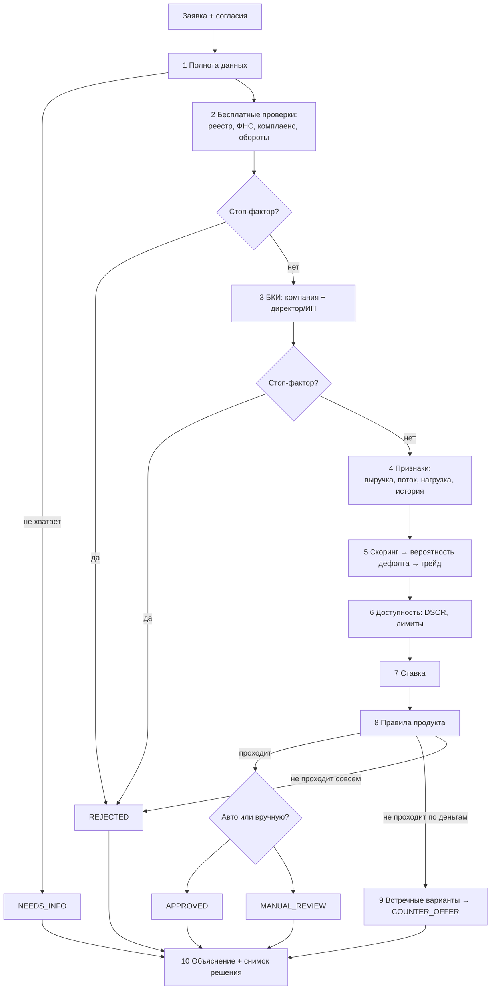

# Карта задач: как банк решает, давать ли кредит

| | |
|---|---|
| Статус | REVIEW |
| Владелец | Агент A |
| Зависит от | [D-030…D-039](../00-meta/05-decisions-index.md#кредитное-решение), [моки](../../mocks-guide.md) |
| Обновлено | 20.10.2026 |

Документ раскладывает кредитное решение на подзадачи и для каждой перечисляет **кандидатов**: какими способами её можно решить. Это ещё не выбор. По каждой подзадаче с развилкой будет отдельный документ вариантов (тип «В» в [бэклоге](../00-meta/04-planning-backlog.md)) с плюсами, минусами, ценой и рекомендацией, и выбор сделаешь ты.

## Как устроен конвейер

**Уже решено** (не пересматриваем): детерминированный `decide()`, правила в конфиге, скоринг отдельно от решения, ИИ не решает, сбор БКИ до расчёта (D-090, прежний D-033 заменён), список стоп-факторов и флагов MVP.

## Подзадачи и кандидаты

### 1. Признаки и источники → `30-02`

**Вопрос:** откуда берём каждое число и что делаем, если источник молчит или источники противоречат друг другу.

| Кандидат | Суть |
|---|---|
| Жёсткий приоритет источников | Обороты → отчётность → выписка (D-039). Просто и объяснимо |
| Сверка с доверием | Берём несколько источников, считаем расхождение. Если оно больше порога — флаг `DATA_MISMATCH`, и андеррайтер видит оба числа |

Здесь развилка небольшая, поэтому тип «П». Рекомендация: приоритет плюс сверка.

### 2. Выручка и свободный денежный поток → `30-03` (В) ✋

**Вопрос:** сколько бизнес реально зарабатывает в месяц и сколько может отдавать на кредиты. Это главное число для суммы.

| Кандидат | Суть | Сильная сторона | Слабая сторона |
|---|---|---|---|
| Среднее за 12 мес | Сумма / 12 | Проще всего | Один аномальный месяц всё искажает |
| Медиана или усечённое среднее | Отбрасываем крайние месяцы | Устойчиво к выбросам | Плохо видит рост и падение |
| Взвешенное по свежести (EWMA) | Свежие месяцы весят больше | Ловит тренд | Нужно обосновать вес |
| Сезонная декомпозиция | Отделяем сезонность (агро, ритейл в Q4) от тренда | Честно для «Зари» | Нужно 24 мес данных, сложнее объяснить |
| + тренд (Theil–Sen) и волатильность (CV) | Отдельные признаки: растёт ли бизнес и насколько стабильно | Идут в скоринг и стресс-тест | — |

**Денежный поток:** прибыль из отчётности / выручка × маржа отрасли (D-038) / «поступления − списания» по счёту.

### 3. Стоп-факторы и флаги → `30-04` (П)

Решено (D-035). Остаётся описать конфиг и тест на каждый фактор.

### 4. Скоринговая модель → `30-05` (В) ✋ — **главная развилка**

**Вопрос:** чем оцениваем риск заёмщика.

| Кандидат | Суть | Сильная сторона | Слабая сторона |
|---|---|---|---|
| **A. Экспертная скоркарта** | Баллы за факторы, сумма → грейд (черновик D-037) | Полностью прозрачно, делается за часы | «Цифры взяты с потолка», нет метрик качества |
| **B. Логистическая скоркарта (WoE/IV)** | Классика банков: факторы бьются на интервалы, модель обучается, коэффициенты превращаются в баллы | Банковский стандарт, есть Gini/KS, баллы остаются баллами | Нужны данные для обучения (см. п. 5) |
| **C. Градиентный бустинг + SHAP** | CatBoost/LightGBM, объяснение через вклад факторов | Самая высокая точность, модно | Чёрный ящик для регулятора, на синтетике выигрыш сомнителен |
| **D. EBM (Explainable Boosting Machine)** | «Стеклянный» бустинг: точность близка к бустингу, но модель — сумма понятных графиков по каждому фактору | Объяснимо и точно, хорошо звучит на защите | Менее известна, ещё одна библиотека |
| **E. Гибрид champion / challenger** | Решает A или B (champion), ML-модель считается рядом в тени (challenger), андеррайтер видит обе оценки | Показывает зрелый процесс внедрения моделей в банке | Больше работы |

### 5. Данные для обучения модели → `30-06` (В) ✋

**Вопрос:** откуда взять «историю», кто вернул кредит, а кто нет, если всё синтетическое. Без этого B–E не обучить.

| Кандидат | Суть | Сильная сторона | Слабая сторона |
|---|---|---|---|
| Генератор по формуле | Задаём «истинную» формулу риска + шум, модель её восстанавливает | Быстро | Модель находит то, что мы заложили. На защите это легко разоблачить |
| Генератор с нелинейностью и взаимодействиями | Логнормальная выручка, отраслевые доли, пропуски, нелинейные эффекты | Модели есть что учить | Всё равно «наша формула» |
| **Имитация бизнеса по месяцам (Монте-Карло)** | Симулируем выручку с трендом, сезонностью и шоками, вычитаем расходы и платежи. Дефолт наступает **сам**, когда денег нет N месяцев | Дефолт возникает из механики денежного потока, а не из формулы. Тот же симулятор даёт стресс-тест (п. 7) | Больше работы, нужна аккуратная калибровка |

Отдельно честно пишем в README: модель на синтетике показывает **механику** конвейера и MLOps, а не реальную предсказательную силу.

### 6. Вероятность дефолта и грейды → `30-07` (П)

Калибровка (Platt / изотоническая / по корзинам), шкала грейдов (A–E или 10 ступеней), какая вероятность дефолта у каждого грейда. Агент предложит, пользователю достаточно одобрить.

### 7. Сколько можно дать → `30-08` (В) ✋

**Вопрос:** какую сумму бизнес потянет без риска разориться.

| Кандидат | Суть |
|---|---|
| DSCR-порог | `поток / (текущие платежи + новый) ≥ 1,25` (черновик). Максимальная сумма — обратная формула аннуитета |
| Лимит от оборотов | Например, овердрафт ≤ 30% средних чистых поступлений, экспресс ≤ N месячных выручек |
| Долговая нагрузка | Весь долг / годовая выручка ≤ порога |
| **Стресс-тест** | DSCR пересчитывается при выручке −20% / −30%. Или Монте-Карло по симулятору из п. 5: «вероятность, что платёж не покроется хотя бы раз за срок» |
| Формулы по продуктам | Аннуитет; под контракт — проценты ежемесячно, долг в конце, покрытие суммой контракта; линия — лимит и предполагаемое использование |

Это не «или-или», а набор ограничений. Выбираем, какие включаем и с какими порогами.

### 8. Ставка → `30-09` (В) ✋

| Кандидат | Суть | Сильная сторона | Слабая сторона |
|---|---|---|---|
| Таблица надбавок | База продукта + надбавка за грейд − скидка за залог (черновик) | Понятно клиенту и жюри | «Почему +2 п.п.?» — ответа нет |
| **По ожидаемым потерям** | Ставка = стоимость денег для банка + ожидаемые потери (PD × LGD) + расходы + маржа на капитал. LGD зависит от залога | Каждая цифра объяснима, так считают банки (risk-based pricing) | Нужно задать допущения (стоимость фондирования и т.д.) |
| По целевой доходности (RAROC) | Подбираем ставку, при которой доходность на капитал не ниже цели | Самый «банковский» | Сложно объяснить за минуту |

### 9. Встречные предложения → `30-10` (В) ✋

| Кандидат | Суть | Сильная сторона | Слабая сторона |
|---|---|---|---|
| Перебор правил | Дольше срок → меньше сумма → другой продукт → с залогом | Просто | Варианты могут быть далеки от того, что хотел клиент |
| **Оптимизация** | Ищем сумму, срок, продукт и обеспечение, максимально близкие к запросу, при всех ограничениях (DSCR, лимиты, грейд, стресс-тест). Перебор по сетке за миллисекунды | Лучший вариант для клиента, математически обоснован | Нужно задать «близость» к запросу |
| Набор компромиссов (Парето) | 2–3 варианта с разными компромиссами: «больше сумма, но дольше» / «быстрее, но меньше» / «с залогом дешевле» | Клиент сам выбирает, хорошо смотрится в UX | Нужно не завалить клиента вариантами |

### 10. Авто или вручную → `30-11` (П)

Матрица полномочий (сумма × грейд × залог), «серые зоны» (результат близко к порогу → человеку), переопределение андеррайтером только с причиной и записью в аудит.

### 11. Объяснения → `30-12` (П)

Коды причин (уже есть). Вклад каждого фактора: баллы для скоркарты или SHAP для ML. Разные тексты клиенту и андеррайтеру. Блок «что изменить, чтобы одобрили» связан с встречными предложениями.

### 12. Правила как конфиг → `30-13` (П)

Версии правил, воспроизведение любого решения по снимку. **Песочница «а что если»** для риск-менеджера: поменял порог DSCR и сразу видишь, как меняется доля одобрений на синтетическом портфеле. Это сильный ход на демо.

### 13. Валидация модели → `30-14` (П)

Gini/AUC, KS, PSI (стабильность), калибровка, доля одобрений. Отчёт валидации генерируется автоматически в CI. Кейс прямо упоминает проверку моделей «по способности различать заёмщиков, точности и стабильности» (стр. 14).

### 14. Сверка и антифрод → `30-15` (В) ✋

| Кандидат | Суть |
|---|---|
| Правила сверки | Анкета ↔ реестр (ФИО директора с учётом ё/е и инициалов), заявленная выручка ↔ обороты ↔ отчётность |
| Поиск аномалий в оборотах | Всплеск перед заявкой («накачка оборотов»), транзит (поступления ≈ списания), один-два контрагента. Робастный z-score или Isolation Forest. Только флаг, не отказ |

### 15. Кредитная математика → `30-16` (П)

Аннуитет, погашение в конце срока, линия, график платежей, полная стоимость кредита, досрочное погашение. Для бизнес-кредитов ПСК законом не требуется, но показать её клиенту честно.

### 16. Прогон персон → `30-17` (Р)

Все персоны через выбранный дизайн, с числами. Это тестовый оракул для e2e и самопроверки жюри.

## Порядок работы

1. Сначала документы с ✋: 30-03, 30-05, 30-06, 30-08, 30-09, 30-10, 30-15. Они нужны тебе для выбора.
2. Потом спецификации по выбранному. 30-17 пишется последним и сверяет всё числами.
