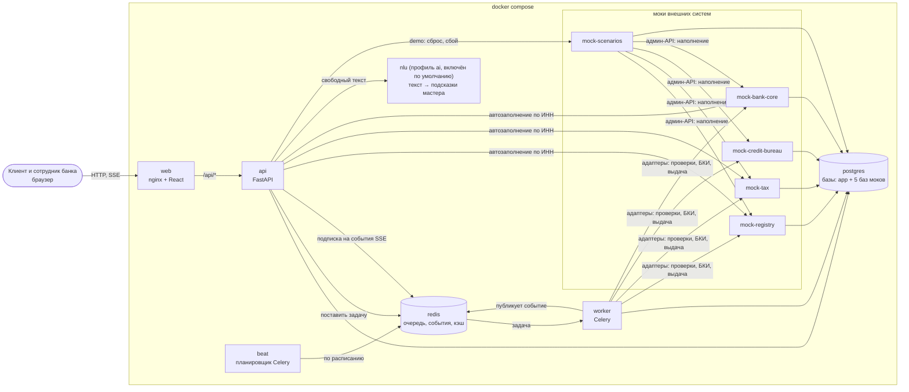

# Архитектура: контейнеры и потоки данных

| | |
|---|---|
| Статус | APPROVED 21.10.2026 (D-080) |
| Владелец | Агент A (черновик субагента) |
| Зависит от | [20-01](../20-process/01-process-model.md), [20-02](../20-process/02-application-states.md), [моки, разделы 3 и 9](../../specs/mocks.md), D-050…D-058, D-066 |
| Решения | Реализует D-052, D-054, D-056, D-066, D-094 (профиль `ai` включён по умолчанию). Q-044, Q-045 приняты D-080 |
| Обновлено | 21.10.2026, ред. 3: пересчитан бюджет памяти после D-094 |

## Зачем

Документ отвечает на вопрос «из каких запускаемых частей состоит система и кто с кем разговаривает». Он же источник **архитектурной схемы для сдачи** (кейс, чек-лист стр. 7): диаграмма ниже потом выгружается в картинку для README.

## Схема контейнеров

Контейнер — отдельный запущенный процесс в Docker. Стрелка — «обращается к».

Что важно на схеме:

- **`api`, `worker` и `beat` собираются из одного образа**, запускаются разными командами. Одна кодовая база, один набор зависимостей, меньше сборки и места на диске.
- Браузер видит только `web`. Он же проксирует `/api/*` в `api`: один адрес, нет проблем с CORS (запрет браузера на запросы к чужому адресу), SSE идёт без хитростей.
- **В моки ходит только серверная часть** (`api` и `worker`) и только через адаптеры (D-052). Фронт моков не видит.
- **Postgres один**, базы раздельные: `app` (наша) и по одной на мок (database-per-service из спецификации моков, 3.1).
- Redis — **транспорт, а не хранилище правды** (кроме сессий: потеря Redis = пользователи входят заново). Потеряли Redis — ничего не потеряно: всё важное лежит в Postgres (подробно в [50-05](05-async-processing.md)).

## Контейнеры и бюджет памяти

Цель D-066: весь compose ≤ 4 ГБ при запуске по умолчанию, то есть вместе с `nlu` (D-094). «Ожидаемо» — типичное потребление, «лимит» — `mem_limit` в compose (при превышении Docker перезапустит контейнер, остальные не пострадают). Цифры **плановые**, измерим `docker stats` при интеграции.

| Контейнер | Что делает | Ожидаемо, МБ | Лимит, МБ | Профиль |
|---|---|---|---|---|
| `web` | nginx, статика React, прокси `/api` | 20 | 64 | основной |
| `api` | REST, SSE, автозаполнение, демо-управление (uvicorn, 1 процесс) | 220 | 384 | основной |
| `worker` | Celery: конвейер заявки, outbox, разбор документов (3 процесса-исполнителя) | 400 | 512 | основной |
| `beat` | Celery beat: расписание. Нужен (повтор outbox, подбор «зависших» заявок, таймеры) | 70 | 96 | основной |
| `redis` | Очередь, шина событий SSE, кэш автозаполнения, **сессии** (Q-062). Сохранение на диск (AOF) **включено** ради сессий | 30 | 96 | основной |
| `postgres` | 6 баз в одном сервере (`shared_buffers` 128 МБ) | 300 | 384 | основной |
| `mock-registry`, `mock-tax`, `mock-credit-bureau`, `mock-bank-core`, `mock-scenarios` | 5 × FastAPI, один процесс каждый ([моки, 3.1](../../specs/mocks.md)) | 5 × 110 | 5 × 160 | основной |
| `db-init` | Разовый: создаёт базы и пользователей | 0 после старта | — | основной |
| `nlu` | Модель «текст → подсказки мастера» в ONNX (CPU) | 700 | 1024 | `ai` (включён по умолчанию, D-094) |
| `flower`, `prometheus`, `grafana` | Панели наблюдения (Q-065) | 300 | 450 | `obs` (выкл.) |

Расчёт: основа без `nlu` и `obs` = 20 + 220 + 400 + 70 + 30 + 300 + 5 × 110 = 1 590 МБ ожидаемо; по лимитам 64 + 384 + 512 + 96 + 96 + 384 + 5 × 160 = 2 336 МБ. `nlu` добавляет 700 МБ ожидаемо и 1 024 МБ по лимиту.

| Итог | Ожидаемо, МБ | По лимитам, МБ |
|---|---|---|
| Основа без `ai` (если профиль отключить) | ≈ 1 600 | ≈ 2 340 |
| **Запуск по умолчанию (основа + `ai`, D-094)** | **≈ 2 300** | **≈ 3 360** |
| Запуск по умолчанию + `obs` | ≈ 2 600 | ≈ 3 810 — на грани 4 ГБ. Профили `ai` и `obs` одновременно на ПК жюри не включаем, в README это сказано |

Цель ≤ 4 ГБ выполняется: по лимитам запас больше 600 МБ, ожидаемо около 1,7 ГБ. На ПК с 8 ГБ остаётся не меньше 4,5 ГБ системе и браузеру. Тяжёлую модель-кандидат нужно брать в int8, иначе `nlu` не уложится в лимит 1 024 МБ ([40-06](../40-ai/06-model-packaging-and-licenses.md)).

Генеративная LLM (Q-007, 2–5 ГБ) в бюджет **не входит**: это отдельный профиль `llm`, явно «на свой риск», по умолчанию выключен.

## Потоки данных

| Поток | Путь | Что гарантируем |
|---|---|---|
| Обычный запрос клиента | Браузер → `web` → `api` → Postgres | Ответ за десятки миллисекунд. Изменяющие `POST` идемпотентны ([50-07](07-api-design.md)) |
| Автозаполнение по ИНН | `api` → registry, tax, bank-core | Кэш в Redis 24 ч, **только для анкеты** (Q-038). Сбой источника → ручной ввод с пометкой |
| Отправка заявки | `api`: смена статуса и копия заявки (`application_versions`) в **одной транзакции** → после коммита задача в Redis → `worker` | Задача не теряется: если постановка не удалась, её подберёт `beat` ([50-05](05-async-processing.md)) |
| Конвейер | `worker` → адаптеры → моки → снимки источников в Postgres → `decide()` → переход статуса | Свежие данные на каждом запуске (Q-038). Шаги повторяемы без побочных эффектов |
| Сообщения во внешний мир | Запись в `outbox` в той же транзакции, что и событие → ретранслятор → БКИ или АБС с `Idempotency-Key` | «Хотя бы один раз» + идемпотентность на стороне мока = эффект «ровно один раз» |
| Живые статусы (SSE) | `worker` после коммита публикует в Redis → `api` пересылает в открытое соединение браузера | Если соединение оборвалось, браузер при переподключении дочитывает пропущенное из журнала событий (`Last-Event-ID`) |
| Демо-управление | `api` (модуль `demo`) → админ-API моков и `mock-scenarios` | Только при `DEMO_MODE=true`. Сброс чистит и базу `api`, и кэш |
| Свободный текст в мастере | `api` → `nlu`: подсказки, которые клиент подтверждает (D-094). Нет `nlu` или он молчит → мастер на кнопках | Путь без ИИ всегда работает (D-060) |

## Порядок запуска

1. `postgres` и `redis` → `db-init`.
2. Пять моков (ждут `db-init`) → `mock-scenarios` готов, когда персоны применены ([моки, 10.6](../../specs/mocks.md)).
3. `api`: сам применяет миграции Alembic при старте, затем отвечает на `/health/ready`. Миграции выполняет **только `api`**, иначе `worker` и `api` столкнутся.
4. `worker`, `beat` ждут `api` в состоянии «готов». `web` ждёт `api`.

## Профили compose

Подробно — в 50-13 (конфигурация). Здесь только набросок: **запуск по умолчанию** (без флагов) поднимает основу и `nlu` (профиль `ai` включён везде, D-094; выключить можно одной настройкой), `obs` (+ метрики и панели), `llm` (+ генеративная модель, Q-007, не планируется). Облачный режим — как в спецификации моков (`docker-compose.cloud.yml`: порты моков закрыты, ключи обязательны).

## Границы

- **Входит:** состав контейнеров, связи, память, порядок запуска.
- **Не входит:** устройство `api` внутри ([50-04](04-modules-and-boundaries.md)), очереди ([50-05](05-async-processing.md)), адаптеры (50-08), безопасность и роли (50-09).

## Как проверяем

- `docker compose up` на чистой машине доводит стенд до готовности без ручных действий (e2e-тест в CI).
- Тест «потолка памяти»: после прохода всех персон сумма `docker stats` ≤ 4 ГБ.
- Тест устойчивости: остановить `redis`/`worker` посреди конвейера, поднять обратно, заявка доходит до решения ровно один раз.

## Решённые развилки

**Q-044. (принято D-080: вариант A; профиль включён по умолчанию, D-094) Где живёт модель для свободного текста (`nlu`)?**

| Вариант | Плюсы | Минусы |
|---|---|---|
| A. Отдельный контейнер `nlu` в профиле `ai` | Основной стенд не тяжелеет, модель ломается отдельно от `api`, легко отключить | Ещё один образ и сетевой вызов |
| B. Внутри `worker`/`api` (библиотека в процессе) | Меньше контейнеров | Модель в каждом процессе: +500–700 МБ, образ `api` тяжелее для всех |
| C. Не делать модель, только правила и ключевые слова | Ничего не весит | Теряем «умную» функцию (D-060), хуже на русских фразах |

**Рекомендация: A.** Свободный текст — «Should» (после сквозного сценария, D-065), основной путь на кнопках. Отдельный контейнер не ставит под угрозу основной сценарий жюри; в бюджет памяти он входит (D-094). Какая модель — решит замер T-001.

**Q-045. Что отдаёт фронт браузеру? (принято D-080: вариант A)**

| Вариант | Плюсы | Минусы |
|---|---|---|
| A. Контейнер `web`: nginx со статикой React и проксированием `/api` | Один адрес, без CORS, привычная схема, кэш статики, 20 МБ | Ещё один контейнер, конфиг nginx |
| B. Статику раздаёт сам `api` (FastAPI) | Контейнером меньше | Смешивает ответственность, хуже кэш и сжатие, неудобно масштабировать |
| C. Dev-сервер Vite в контейнере | Горячая перезагрузка | Тяжёлый (Node в рантайме), небезопасно, не «продакшн» для жюри |

**Рекомендация: A.** Так делают в настоящих проектах, и этот контейнер почти ничего не стоит по памяти. Для разработки Vite запускается отдельно на машине разработчика.

## Заметки для реализации

- Порты на хосте: `web` — 8080, `api` — 8000 (только `127.0.0.1`, для Swagger и коллекции запросов), моки — 8101–8105 ([моки, 3.4](../../specs/mocks.md)).
- `api` в compose ждёт `mock-scenarios` «здоровым», чтобы после `up` персоны уже были применены.
- Один процесс `uvicorn` у `api` достаточно: SSE и ввод-вывод не блокируются, нагрузка демо мала. Масштабирование («`api` в 2+ экземпляров за балансировщиком») описывается в 50-15 как история для критерия enterprise: состояние нигде не хранится в памяти процесса, кроме circuit breaker (его состояние планируется держать в Redis, см. 50-08).
- В `worker` держим 3 процесса-исполнителя: хватит на параллельные заявки жюри и не раздувает память.

**Доступ к схеме, C-16:** `web` проксирует `/docs` и `/openapi.json` в `api` и локально, и на облачном стенде. Swagger моков доступен только через локальные служебные порты. Открытая документация не отменяет авторизацию самих операций.
