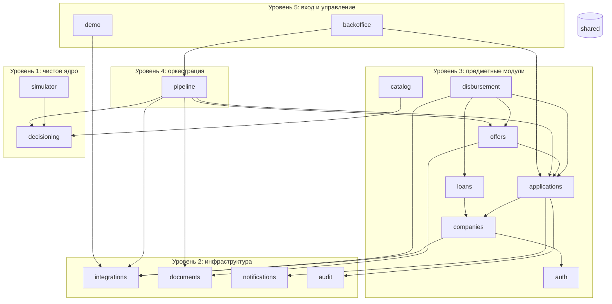

# Модули `api` и правила зависимостей

| | |
|---|---|
| Статус | DRAFT |
| Владелец | Агент A (черновик субагента) |
| Зависит от | [50-01](01-overview.md), [50-03](03-repo-and-conventions.md), [20-02](../20-process/02-application-states.md), [30-00](../30-decisioning/00-problem-map.md), D-030, D-052, D-054, D-055, D-075 |
| Решения | Реализует D-030, D-052. Предлагает Q-052. Связан с Q-034 (объём `backoffice`) |
| Обновлено | 21.10.2026 |

## Зачем

`api` — модульный монолит (D-052): один процесс, но внутри чёткие «комнаты» с дверями. Правила зависимостей не дают коду превратиться в клубок, а ядру решения (D-030) — случайно обратиться к сети или базе. Для ИИ-агентов это ещё и **защита от самих себя**: нарушение правила ломает CI.

## Модули

Колонка «Таблицы» — кто **владеет** таблицей: только он пишет в неё и читает напрямую; остальные ходят через его `service` (подробнее в [50-06](06-data-model.md)).

| Модуль | За что отвечает | Таблицы | Заметки |
|---|---|---|---|
| `shared` | Настройки, часы (`APP_TODAY`), ошибки, сессия БД и транзакции, request-id, **outbox** и идемпотентность запросов (платформенный код) | `outbox`, `idempotency_keys` | Ни от кого не зависит. Обработчики outbox регистрируют модули при старте, а не `shared` их знает |
| `auth` | Пользователи, вход, роли, текущий «субъект» (кто спрашивает) | `users` | Способ входа — Q-035 (отложен). Остальные модули видят только `Principal` |
| `companies` | Компании, участники и доверенности, **автозаполнение** карточки по ИНН (D-015: личный ИНН → «вы директор ООО X») | `companies`, `company_members` | Проверка «имеет ли пользователь доступ к компании» живёт здесь |
| `catalog` | Каталог продуктов, мастер подбора (таблица правил D-011), калькулятор платежа, клиент `nlu` | — (каталог — файл конфигурации) | Свободный текст без `nlu` не ломается (D-060) |
| `applications` | Заявка, **стейт-машина** (D-055), черновик и версии, журнал переходов, согласия, задачи клиенту, залог и поручительство | `applications`, `application_versions`, `application_events`, `consents`, `tasks`, `collaterals` | Единственное место, где меняется статус заявки |
| `pipeline` | Оркестрация шагов конвейера, сбор данных, сохранение снимков, вызов `decide()`, переход статуса по результату | `pipeline_runs`, `source_snapshots`, `decisions`, `policy_versions` | Знает порядок шагов; не знает формулы. Загружает `policy/vN.yaml` |
| `decisioning` | **Чистое ядро**: признаки, скоринг, доступность (DSCR), ставка, встречные предложения, объяснения, кредитная математика | нет | Без сети, БД, времени и случайности. См. правило R2 |
| `integrations` | Адаптеры к 4 мокам: таймауты, повторы, circuit breaker, кэш автозаполнения, журнал вызовов | `integration_calls` | Возвращают собственные модели (`CompanyProfile`, `CreditHistory`…). Подробно — 50-08 |
| `documents` | Загрузки, **парсер выписки 1С**, хранение файлов, генерация договоров | `documents` | Парсер — чистая функция, без ИИ (D-065) |
| `offers` | Оферта и варианты, принятие, договор, имитация подписи (только руководитель) | `offers`, `offer_variants`, `contracts`, `signatures` | Подпись — отдельный подмодуль `signing` |
| `disbursement` | Выдача: открытие счёта (если нужно), выдача в АБС через outbox, переход `DISBURSING → DISBURSED` | `disbursements` | Идемпотентный ключ строится по заявке |
| `loans` | «Мои кредиты»: кредит и график платежей | `loans`, `payment_schedule` | Только чтение для клиента; запись — из `disbursement` |
| `notifications` | Уведомления внутри продукта и живые события SSE (Redis) | `notifications` | Только в продукте, без почты и SMS (D-020) |
| `audit` | Журнал действий вне заявки (вход, смена ролей, действия андеррайтера и демо) | `audit_log` | Журнал заявки — `application_events` в `applications` |
| `backoffice` | Очередь ручного рассмотрения, карточка заявки, решение андеррайтера | — | Объём не решён (Q-034). Минимум: те же сервисы по API с ролью `UNDERWRITER` |
| `demo` | Сброс стенда, переключение сбоев моков («уронить БКИ»), список персон | — | Только при `DEMO_MODE=true`. Сброс: каждый модуль сам чистит свои таблицы (`reset_demo_data`) |
| `simulator` | Имитатор бизнеса по месяцам (D-075): портфель для обучения, стресс-тест Монте-Карло, массовые тесты | нет | Чистая библиотека + скрипты. В запросах клиента не участвует |

## Уровни и граф зависимостей

Правило простое: **зависеть можно только вниз**. Стрелка «A → B» значит «A использует B».

Все модули кроме `decisioning` и `simulator` могут использовать `shared` (на схеме не нарисовано). `demo` дополнительно вызывает `reset_demo_data` у остальных модулей через реестр, а не импортирует их напрямую.

## Правила

| № | Правило | Чем обеспечиваем |
|---|---|---|
| R1 | Зависимости только вниз по уровням; из другого модуля импортируем **только его публичный интерфейс** (`__init__.py`: сервисные функции и типы), но не `repo`, не `domain`, не модели таблиц | import-linter: контракты «слои» и «запрещённые импорты» |
| R2 | **`decisioning` не импортирует ничего из `app`** и не использует: SQLAlchemy, httpx, Celery, redis, `os.environ`, `datetime.now()`, `random` без заданного seed. Получает данные и правила аргументами, возвращает результат (D-030) | import-linter + тест: `decide()` с запрещёнными сокетами возвращает один и тот же результат дважды |
| R3 | `simulator` зависит только от `decisioning` и numpy; seed обязателен | Тот же контракт |
| R4 | `integrations` не знает про заявки и решения. Возвращает свои модели; перевод в понятные ядру входные данные делает `pipeline` (файл `pipeline/facts.py`) | Контракт + код-ревью |
| R5 | В таблицу пишет **только владелец**. Чужие данные берём через его `service`. Исключение: `backoffice` и `demo` строят чтение «списком» через явный `queries.py` | Ревью, тест «таблицы принадлежат ровно одному модулю» |
| R6 | Роутер тонкий: разобрать запрос → вызвать сервис → вернуть ответ. Бизнес-логики и SQL в роутере нет | Ревью |
| R7 | **Транзакцию открывает сервис** (один сценарий — одна транзакция). Celery-задача — тонкая обёртка над функцией сервиса | Ревью, паттерн в каркасе |
| R8 | Побочные эффекты (уведомление, запись аудита, outbox) вызываем **явно** в том же сервисе и той же транзакции. Скрытых «сигналов» и внутренней шины событий нет: цепочку видно в коде | Ревью |
| R9 | Время — только из `shared.clock`; запрет `datetime.now()` / `date.today()` вне него | Правило ruff `DTZ` + контракт |
| R10 | Фоновую задачу «вверх по уровням» (например, `applications` после отправки заявки запускает конвейер) ставим **по имени задачи** через `shared` (`enqueue("pipeline.run", …)`), без импорта `pipeline`. Постановка делается после коммита транзакции | Контракт + тест «заявка без запуска подхватывается сторожем» ([50-05](05-async-processing.md)) |
| R11 | Любая функция сервиса, затрагивающая компанию, принимает `Principal` и проверяет доступ через `companies` (см. Q-058 в [50-06](06-data-model.md)) | Тест «чужая компания → 404» на каждый ресурс |

## Границы

- **Входит:** состав и владение модулей, правила импортов.
- **Не входит:** внутренняя структура `decisioning` (его расписывают документы 30-xx), форма таблиц ([50-06](06-data-model.md)), ручки API ([50-07](07-api-design.md)).

## Как проверяем

- import-linter в `make check` и CI: нарушение правила R1–R4, R9 = красный CI.
- Тест на чистоту `decide()` (R2): сеть закрыта, БД нет, повтор даёт идентичный результат.
- Тест владения таблицами: каждая таблица SQLAlchemy числится ровно за одним модулем.
- Тест `reset_demo_data`: после сброса таблицы пусты, а `policy_versions` и справочники на месте.

## Развилки для пользователя

**Q-052. Чем держим границы модулей?**

| Вариант | Плюсы | Минусы |
|---|---|---|
| A. Папки в одном пакете + **import-linter** в CI | Автоматическая проверка, нулевая стоимость в рантайме, один пакет и один lock-файл | Нарушить можно локально, поймает только `make check` / CI |
| B. Ядро отдельным Python-пакетом (`uv workspace`: `core/` рядом с `api/`), остальное папками | Ядро физически не может импортировать `app` (его там нет); легко переиспользовать симулятором и скриптами | Сложнее сборка, два `pyproject`, агентам чуть больше возни |
| C. Только договорённость и код-ревью | Ничего настраивать | Агенты нарушат под давлением времени; мы этого не заметим |

**Рекомендация: A.** Проверка в CI даёт 95% пользы B при 20% затрат. Если ядру понадобится жить вне `api` (например, чтобы отдельным пакетом выдать «песочницу правил»), переезд в B несложен: правила R2 уже соблюдены.

## Заметки для реализации

- Начинать с каркаса: пустые модули с `__init__.py`, контракты import-linter и тест «чистоты» — в первом же коммите кода. Дальше правила работают автоматически.
- `pipeline` — самое «толстое» место. Не складывать в него формулы: если в шаге появляется арифметика, она переезжает в `decisioning`.
- Публичный интерфейс модуля — маленький: 3–8 функций. Растёт список — признак, что границы проведены неверно.
- Для `decisioning` внутри пакета: `features`, `scoring`, `affordability`, `pricing`, `counteroffers`, `explain`, `money` (кредитная математика, 30-16), `policy` (разбор уже загруженного словаря правил в типы), `types`. Чтение файла `policy/v1.yaml` с диска — в `pipeline`, а не в ядре.
- Как только решается Q-034, `backoffice` либо получает экраны, либо остаётся тонкой обёрткой над API; других изменений в архитектуре это не вызывает.
