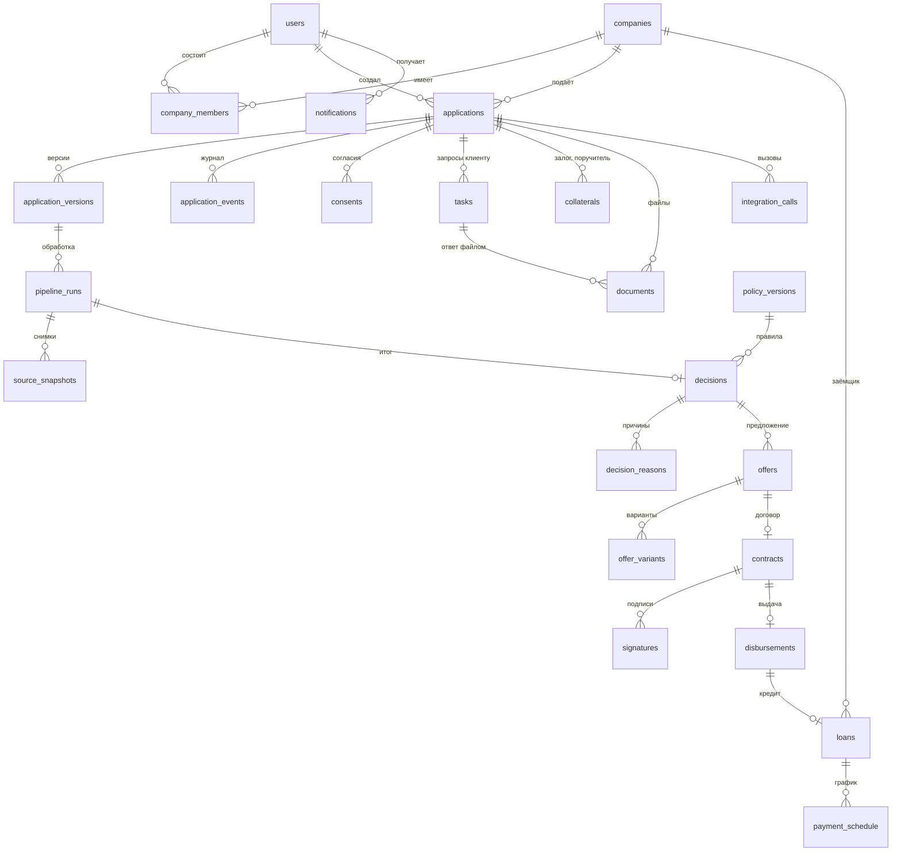

# Модель данных базы `api`

| | |
|---|---|
| Статус | APPROVED 21.10.2026 (D-080) |
| Владелец | Агент A (черновик субагента) |
| Зависит от | [50-04](04-modules-and-boundaries.md), [50-05](05-async-processing.md), [20-02](../20-process/02-application-states.md), [моки, 9.4](../../specs/mocks.md), D-030, D-036, D-054, D-055 |
| Решения | Предлагает Q-057, Q-058. Источник артефакта сдачи «модель данных» |
| Обновлено | 21.10.2026, ред. 2: агент B, сведение R-002 |

## Зачем

Описывает, **что и где хранит `api`**. По документу пишутся миграции Alembic и рисуется ER-диаграмма для сдачи. Базы моков здесь не описаны: у каждого мока своя ([моки, 3.2](../../specs/mocks.md)). Таблицы «согласия», «снимки источников», «журнал вызовов» и «outbox» уже заданы в спецификации моков (9.4), здесь они уточнены.

## Общие правила

- **Идентификаторы** — UUID версии 7 (случайные, но упорядоченные по времени; не угадываются по ссылке, в отличие от 1, 2, 3). Человеку — отдельный номер заявки (`number`, вида `АЗ-2026-000123`).
- **Время** — `timestamptz` в UTC, поля `*_at`. **Деньги** — целые рубли `*_rub` (как в моках). Проценты — `numeric`. Перечисления — строки `UPPER_SNAKE` с проверкой в БД.
- У каждой таблицы `created_at`; у изменяемых — `updated_at`. У `applications` ещё `version` (счётчик для безопасной смены статуса, [50-05](05-async-processing.md)).
- **Неизменяемые журналы** (только добавление; триггер запрещает `UPDATE`): `application_events`, `decisions`, `decision_reasons`, `source_snapshots`, `audit_log`. Это основа аудита и воспроизводимости решения (D-030).
- Владелец таблицы — модуль из [50-04](04-modules-and-boundaries.md) (колонка «Модуль»). Все данные синтетические, но обращаемся с ними как с персональными: ИНН маскируем в логах.

## ER-диаграмма

Без связей на диаграмме (отдельные таблицы): `audit_log`, `outbox`, `idempotency_keys`. `decisions` ссылается на использованные снимки массивом `snapshot_ids` (отчёт БКИ может быть из прошлого запуска той же заявки).

## Таблицы

### Люди и компании

| Таблица | Модуль | Назначение | Ключевые поля |
|---|---|---|---|
| `users` | auth | Учётные записи клиентов и сотрудников банка. Для персон создаются из блока `users` сценария ([Q-023](../00-meta/06-open-questions.md)) | `id`, `display_name`, `role` (`CLIENT`, `UNDERWRITER`, `ADMIN`), `status`, `person_inn` (личный ИНН; D-062), `login_ref` (внутренний идентификатор), `scenario_code` |
| `companies` | companies | Компания или ИП клиента, кэш карточки автозаполнения | `id`, `inn` (уникален), `kind` (`LEGAL`, `IP`), `name`, `okved`, `registered_on`, `is_bank_customer`, `profile` (JSONB: карточка с источником и датой каждого поля), `profile_fetched_at` |
| `company_members` | companies | Кто и с какой ролью работает от компании (D-014, D-015) | `company_id`, `user_id`, `role` (`DIRECTOR`, `ACCOUNTANT`, `GUARANTOR`), `can_sign`, `poa_permissions` (список; среди значений SIGN_COMPANY_CONSENTS), `poa_number`, `poa_valid_until`, `status` |

### Заявка

| Таблица | Модуль | Назначение | Ключевые поля |
|---|---|---|---|
| `applications` | applications | Заявка и её текущий статус (14 статусов, [20-02](../20-process/02-application-states.md)) | `id`, `number`, `company_id`, `created_by`, `product_code`, `status`, `amount_rub`, `term_months`, `purpose_code`, `draft` (JSONB: ответы мастера и анкета, автосохранение), `flags`, `current_version_id`, `version`, `submitted_at`, `closed_at` |
| `application_versions` | applications | Неизменяемая копия того, **что именно оценивали**: создаётся при отправке и при каждой повторной отправке (ответ клиента, залог) | `id`, `application_id`, `number`, `reason` (`SUBMIT`, `INFO_PROVIDED`, `COLLATERAL_ADDED`), `data` (JSONB), `data_hash` |
| `application_events` | applications | Журнал заявки = **аудит + таймлайн клиента**. Каждый переход и шаг конвейера | `id` (последовательный: задаёт порядок и `Last-Event-ID`), `application_id`, `kind` (`TRANSITION`, `STEP`, `TASK`, `OVERRIDE`, `NOTE`), `from_status`, `to_status`, `step_code`, `actor_type` (`CLIENT`, `SYSTEM`, `UNDERWRITER`), `actor_id`, `reason_code`, `payload`, `request_id` |
| `consents` | applications | Согласия на БКИ, обороты и персональные данные ([моки, 9.4](../../specs/mocks.md)) | `application_id`, `bundle_id`, `subject_inn`, `subject_type`, `kind` (`BKI`, `TURNOVER`, `PERSONAL_DATA`), `purpose`, `text_version`, `text_hash`, `signed_at`, `valid_until`, `signer_user_id`, `sign_method`, `proof` (HMAC-доказательство), `revoked_at` |
| `tasks` | applications | Запрос информации или подписи участнику заявки | `application_id`, `kind` (`DOCUMENT`, `EXPLANATION`, `COLLATERAL`, `CONFIRM_REVENUE`, `SIGNATURE`, `GUARANTOR`), `assignee_user_id`, `assignee_person_inn`, `round`, `title`, `why_text`, `status` (`OPEN`, `ANSWERED`, `EXPIRED`, `CANCELLED`), `expires_at`, `answer` (JSONB; пока `OPEN` это черновик, банк его не видит), `answered_by`, `answered_at`, `details` (JSONB: «что именно», «где взять»), `cancel_reason`, `created_by_actor`, `created_by_id` |
| `collaterals` | applications | Залог и поручительство (`quick-start`, `stankoprom`) | `application_id`, `kind` (`COLLATERAL`, `GUARANTEE`), `description`, `estimated_value_rub`, `person_inn` (связь заявки с конкретным поручителем), `status` |

### Решение

| Таблица | Модуль | Назначение | Ключевые поля |
|---|---|---|---|
| `pipeline_runs` | pipeline | Один запуск конвейера; «аренда» от двойного исполнения ([50-05](05-async-processing.md)) | `id`, `application_id`, `version_id`, `run_key` (уникален: версия + событие-причина), `trigger`, `status` (`QUEUED`, `RUNNING`, `DONE`, `FAILED`), `current_step`, `locked_until`, `attempts`, `started_at`, `finished_at` |
| `source_snapshots` | pipeline | Факты, на которых принято решение (ответы моков как есть) | `run_id`, `application_id`, `system`, `resource`, `subject_inn`, `payload` (JSONB), `payload_hash`, `data_actual_at`, `retrieved_at`, `request_id` |
| `policy_versions` | pipeline | Реестр версий правил: файл `policy/vN.yaml` регистрируется при старте по хешу | `id`, `version`, `content_hash` (уникален), `content` (JSONB, полная копия), `effective_from` |
| `decisions` | pipeline | **Снимок решения** (D-030): воспроизводим по нему, не заглядывая никуда ещё | `id`, `application_id`, `run_id`, `source` (`ENGINE`, `UNDERWRITER`), `outcome` (`APPROVED`, `COUNTER_OFFER`, `NEEDS_INFO`, `MANUAL_REVIEW`, `REJECTED`), `route`, `policy_version_id`, `engine_version`, `inputs` (JSONB), `inputs_hash`, `features` (JSONB), `score`, `grade`, `pd`, `revenue_monthly_rub`, `free_cash_flow_rub`, `dscr`, `stress_dscr`, `max_amount_rub`, `rate_percent`, `explain` (JSONB: вклад факторов), `snapshot_ids` (массив), `overrides_decision_id`, `override_reason` |
| `decision_reasons` | pipeline | Коды причин: по строке на код | `decision_id`, `code` (`TAX_ARREARS_HIGH`, `DSCR_LOW`…), `kind` (`STOP`, `FLAG`, `CONSTRAINT`, `FACTOR`), `points`, `params` (JSONB) |
| `integration_calls` | integrations | Журнал каждого вызова моков ([моки, 9.4](../../specs/mocks.md)) | `system`, `method`, `path`, `subject_inn_masked`, `status_code`, `error_code`, `duration_ms`, `attempt`, `circuit_state`, `request_id`, `application_id` |

### Предложение, подпись, выдача, кредит

| Таблица | Модуль | Назначение | Ключевые поля |
|---|---|---|---|
| `offers` | offers | Предложение банка по решению | `application_id`, `decision_id`, `kind` (`AS_REQUESTED`, `COUNTER`), `status` (`OPEN`, `ACCEPTED`, `DECLINED`, `EXPIRED`), `expires_at`, `variants_status` (`READY`, `PENDING`: запасное состояние без вариантов, принять нельзя), `accepted_variant_id`, `accepted_by`, `accepted_at`, `closed_at`; одно предложение на решение |
| `offer_variants` | offers | Карточки-варианты (до 3, D-072) | `offer_id`, `label`, `product_code`, `amount_rub`, `term_months`, `rate_percent`, `payment_rub`, `last_payment_rub`, `overpayment_rub`, `collateral_required`, `recommended`, `what_changed` (JSONB), `note`; неизменяемы |
| `contracts` | offers | Договор по принятому варианту | `application_id`, `variant_id`, `offer_id`, `revision`, `contract_uid` (стабильный УИд в формате БКИ), `number`, `document_id` (пока пуст, T-336), `template_version`, `body` (детерминированный JSON до появления PDF), `content_hash` (SHA-256 `body`), `status` (`READY`, `SIGNED`, `CANCELLED`); один живой договор на заявку |
| `signatures` | offers | Имитация простой электронной подписи (без SMS) | `contract_id`, `signer_user_id`, `signer_person_inn`, `signer_role`, `proof` (HMAC-доказательство), `method`, `attempt_id` (код запроса подписи: повтор не создаёт вторую подпись), `consent_text_version`, `content_hash`, `signed_at`; неизменяемы |
| `disbursements` | disbursement | Выдача в АБС | `application_id` (уникален), `contract_id`, `amount_rub`, `account_number`, `status` (`PENDING`, `SENT`, `CONFIRMED`, `FAILED`), `idempotency_key`, `bank_core_ref`, `confirmed_at` |
| `loans` | loans | «Мои кредиты» | `company_id`, `application_id`, `disbursement_id`, `bank_core_loan_id`, `product_code`, `principal_rub`, `rate_percent`, `term_months`, `opened_on`, `status`, `outstanding_rub` |
| `payment_schedule` | loans | График платежей | `loan_id`, `seq`, `due_date`, `principal_rub`, `interest_rub`, `total_rub`, `status` |

### Сквозное

| Таблица | Модуль | Назначение | Ключевые поля |
|---|---|---|---|
| `documents` | documents | Метаданные файлов; сами файлы — в хранилище (50-12) | `company_id`, `application_id`, `task_id`, `kind` (`BANK_STATEMENT_1C`, `FINANCIALS`, `CONTRACT`, `CREDIT_AGREEMENT`, `PAYMENT_SCHEDULE`, `OTHER`), `origin` (`UPLOADED` / `GENERATED` / `DEMO_GENERATED`), `template_version` (у сгенерированных), `filename`, `mime`, `size_bytes`, `sha256`, `storage_key`, `parse_status`, `parsed` (JSONB: период, счёт, обороты по месяцам) |
| `document_blobs` | documents | Содержимое файлов (Q-068: файлы в Postgres за интерфейсом `FileStore`) | `storage_key`, `content` (bytea), `size_bytes` |
| `notifications` | notifications | Уведомления внутри продукта (D-020) | `user_id`, `company_id`, `application_id`, `kind`, `text_key`, `params`, `read_at` |
| `audit_log` | audit | Действия вне заявки: вход, роли, действия андеррайтера, демо | `at`, `actor_id`, `actor_role`, `action`, `object_type`, `object_id`, `company_id`, `details`, `request_id` |
| `outbox` | shared | Сообщения в БКИ и АБС ([50-05](05-async-processing.md)) | `id` (последовательный), `aggregate_id`, `event_type`, `target_system`, `payload`, `idempotency_key` (уникален), `status` (`PENDING`, `SENT`, `FAILED`), `attempts`, `next_attempt_at`, `lease_until`, `last_error`, `sent_at` |
| `idempotency_keys` | shared | Защита `POST` от двойного нажатия ([50-07](07-api-design.md)) | `scope` (пользователь + метод + путь), `key`, `request_hash`, `response_status`, `response_body`, `expires_at`; уникальность пары `scope` + `key` |

## Границы

- **Входит:** таблицы `api`, их смысл и связи.
- **Не входит:** точные типы столбцов и индексы (их определяет миграция), схемы JSON внутри JSONB (контракты `decisioning` и `integrations`), базы моков.

## Как проверяем

- Тест миграций: «с нуля до актуальной схемы» и «модели SQLAlchemy = схема после миграций».
- Тест владения: каждая таблица принадлежит одному модулю ([50-04](04-modules-and-boundaries.md)).
- Воспроизводимость: взять `decisions.inputs` + `policy_versions.content` → `decide()` даёт тот же `outcome` и те же `decision_reasons` (e2e по всем персонам).
- Тест неизменяемости: `UPDATE` журналов отклоняется.

## Развилки для пользователя

**Q-057. Снимки и входы решения: JSONB или нормализованные таблицы?** JSONB — столбец с произвольным документом внутри строки таблицы.

| Вариант | Плюсы | Минусы |
|---|---|---|
| A. Гибрид: факты и входы целиком в JSONB, а **итог решения — обычные столбцы** (`outcome`, `grade`, `dscr`, `rate_percent`…), причины — отдельная таблица | Снимок точный и не ломается при смене формата моков; по итогам можно считать статистику и строить списки; миграций меньше | Внутри JSONB нет внешних ключей; поиск по нему медленнее и сложнее |
| B. Всё нормализовано (таблицы под каждый тип факта: оборот, кредит БКИ, налоговый профиль…) | Строгость, любые запросы | Десятки таблиц; формат моков меняется — миграция; «снимок как был» теряется |
| C. Всё в JSONB, включая итог | Быстрее всего писать | Нечем считать «долю одобрений», список причин и фильтры бэкофиса |

**Рекомендация: A.** Снимок источника по смыслу «фотография ответа», его нельзя нормализовать без потери точности; а то, по чему ищем и считаем, — в столбцах. Это ещё и ответ на вопрос жюри «покажите, на чём принято решение».

**Q-058. Как разделяем данные разных компаний (мультиарендность)?**

| Вариант | Плюсы | Минусы |
|---|---|---|
| A. Столбец `company_id` у верхних сущностей (`applications`, `documents`, `loans`, `notifications`) + обязательный фильтр в репозитории через `Principal` + тест «чужая компания → 404» | Просто, прозрачно, быстро; дочерние таблицы защищены через родителя | Защита держится на дисциплине кода и тестах |
| B. То же + **Row-Level Security Postgres** (БД сама не отдаёт чужие строки) | Второй рубеж защиты, сильный довод для «enterprise» | Сложнее миграции, настройка соединения на каждый запрос, больше шансов на загадочные ошибки у агентов |
| C. Без `company_id` в таблицах; доступ проверяем только цепочкой `заявка → компания` в API | Меньше столбцов | Легко забыть проверку, нет быстрого «все объекты компании» |

**Рекомендация: A.** Для масштаба прототипа достаточно; RLS (B) можно добавить позже как усиление, схема данных к этому уже готова. Сотрудники банка (`UNDERWRITER`) видят все компании по явной проверке роли.

## Заметки для реализации

- После сквозного сценария (Q-066, вариант Б): в `application_events` добавить `prev_hash` и `hash` — цепочка хешей для проверки целостности аудита.
- Новый флаг `PIPELINE_ERROR` (50-05): заявка ушла на ручное рассмотрение, потому что конвейер 5 раз не смог завершиться. Внести в справочник кодов 30-12.

- Статусы и коды — строки с `CHECK` в БД (не `ENUM` Postgres): добавлять значения миграцией проще.
- `applications.draft` меняется на каждом автосохранении; `application_versions` — только при отправке. Мастер создаёт заявку `DRAFT` сразу в начале.
- `decisions` создаётся и для исходов `NEEDS_INFO` и `MANUAL_REVIEW`: решение андеррайтера — новая запись с `source = UNDERWRITER` и ссылкой `overrides_decision_id`, старая не меняется.
- `idempotency_keys` и `integration_calls` чистятся по сроку (сутки и неделя); журналы и снимки — нет.
- `reset_demo_data` в каждом модуле чистит свои таблицы; журналы, которые защищены триггером, чистятся `TRUNCATE` от имени владельца схемы (только `DEMO_MODE`).
- Хранение файлов в БД или на диске — 50-12; здесь только метаданные.
- Сверено с 50-10/11: application_events — события заявки и источник SSE, audit_log — действия вне заявки; отдельной audit_events нет. Старая заметка про переименование снята.

**D-091, D-096 (решено):** у `company_members` есть явный список `poa_permissions` (включая SIGN_COMPANY_CONSENTS), срок доверенности уже есть; `can_sign` не универсальное право на все виды подписи (только кредитный договор). Участие поручителя создаёт директор, роль `GUARANTOR`, связь с личным ИНН обязательна. Права поручителя (D-096): только адресованные ему задачи, свои согласия и поручительство, сводка «за что поручаетесь»; чтения всей заявки и данных компании нет.
