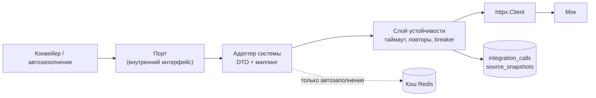

# Адаптеры интеграций

| | |
|---|---|
| Статус | APPROVED 21.10.2026 (D-080) |
| Владелец | Агент A (черновик субагента) |
| Зависит от | [спецификация моков](../../specs/mocks.md) (разделы 2, 8, 9), [01-overview](01-overview.md), [02-tech-stack](02-tech-stack.md) (Q-047), [05-async-processing](05-async-processing.md) (Q-054), [06-data-model](06-data-model.md) |
| Решения | D-052, D-054, D-068 (кэш только для автозаполнения), D-090 (БКИ до расчёта; D-033 заменён) |
| Вопросы пользователю | Q-060, Q-061 |
| Обновлено | 21.10.2026 |

**Адаптер** — код внутри `api`, который ходит в одну внешнюю систему и переводит её ответы в наши внутренние модели. Остальной код про формат БКИ или реестра ничего не знает. Этот документ превращает раздел 9 спецификации моков в план для `api`. Саму спецификацию не повторяем: таймауты и сценарии сбоев берём оттуда.

## Слои

| Слой | За что отвечает |
|---|---|
| Порт | Интерфейс на языке бизнеса: `get_company(inn)`, `request_credit_report(...)`. Конвейер и тесты работают только с ним |
| Адаптер | Свои DTO под JSON системы, маппинг в `CompanyProfile`, `CreditHistory`, `Turnover`. Код моков не импортируем, связь только по контракту |
| Слой устойчивости | Один общий для всех адаптеров: таймаут, повторы, circuit breaker, заголовки, журнал. Пишется один раз |
| Результат | Либо данные + `snapshot_ids`, либо `SourceUnavailable(система, причина)`. Причины: `TIMEOUT`, `HTTP_5XX`, `CIRCUIT_OPEN`, `SCHEMA_ERROR` |

Любой ответ, который не прошёл проверку схемы (дрейф формата), считается недоступностью источника с причиной `SCHEMA_ERROR`, а не падением конвейера.

## Правила по системам

Значения из раздела 9.2 спецификации. Лежат в одном файле настроек, множитель `INTEGRATION_TIMEOUT_SCALE` ([13](13-config-and-profiles.md)) растягивает таймауты на слабом ПК.

| Система | Таймаут | Повторы | Кэш (только автозаполнение) | Если недоступна |
|---|---|---|---|---|
| registry: карточка, роли | 2 с | 2 | 24 ч | Автозаполнение: поля вручную, пометка «не подтверждено реестром» |
| registry: банкротства | 2 с | 2 | нет | Конвейер: `SOURCE_UNAVAILABLE` → `MANUAL_REVIEW` |
| tax: профиль, МСП, НПД, блокировки | 2 с | 2 | 24 ч | То же |
| tax: отчётность | 2 с | 2 | 7 дней | То же |
| tax: контракты (ЕИС) | 2 с | 2 | список для выбора 1 ч; проверку в конвейере делаем свежим запросом | То же |
| credit-bureau: отчёт | 5 с | 1, тот же ключ | нет; внутри заявки отчёт берём из снимков до 30 дней | `MANUAL_REVIEW` (главный сценарий демо) |
| credit-bureau: submissions | 5 с | через outbox | — | Не блокирует заявку |
| bank-core: чтение | 1 с | 2 | нет | Выручка из отчётности или выписки, иначе `NEEDS_INFO` |
| bank-core: выдача, открытие счёта | 5 с | через outbox, тот же ключ | — | «Выдача в обработке», повторы |

## Повторы

- Повторяем только `GET` и `POST` с `Idempotency-Key`.
- Повод для повтора: обрыв соединения, таймаут, `502/503/504`, `429` (ждём `Retry-After`, если он до 5 с), `409 IDEMPOTENCY_IN_PROGRESS` (ждём `Retry-After`, не тратит попытку).
- Не повторяем: остальные `4xx`, `404`, `422`, `409 IDEMPOTENCY_KEY_REUSED` (это наша ошибка, пишем в лог уровня ERROR).
- Пауза: экспонента от 0,3 с с полным разбросом (jitter). Сумма всех попыток одного вызова не больше таймаута шага конвейера.
- Отчёт БКИ повторяем один раз и только после `503` или обрыва, с тем же ключом (иначе второй платный запрос). Так выглядит сбой `LOST_RESPONSE`: клиент не знает, дошло ли, повтор вернёт тот же отчёт с `Idempotent-Replayed: true`.

## Circuit breaker

**Circuit breaker** («предохранитель») — после серии ошибок перестаём ходить в систему на время, чтобы не ждать таймауты зря и не добивать упавший сервис.

| Параметр | Значение |
|---|---|
| Область | Один на систему (registry, tax, credit-bureau, bank-core). Не на эндпоинт |
| Открывается | 5 ошибок за скользящие 30 с |
| Что считается ошибкой | Таймаут, обрыв, `5xx`, `SCHEMA_ERROR`. Не считаются `4xx` и `404` |
| Открыт | 30 с: вызов сразу даёт `CIRCUIT_OPEN`, в сеть не идём |
| Полуоткрыт | После 30 с пропускаем **один** пробный запрос. Успех → закрыт, ошибка → снова открыт на 30 с |
| Для outbox | Если предохранитель открыт, сообщение откладывается до его закрытия, попытки не тратятся |

Правило «5 ошибок за 30 с» — окно по времени. Готовые библиотеки считают **подряд идущие** ошибки, поэтому это учтено в Q-060. Состояние предохранителя видно в метриках и в демо-панели ([10](10-audit-and-observability.md)).

## Кэш

Кэш нужен только когда клиент вводит ИНН и ждёт автозаполнения (D-068, Q-038). **Решение по заявке всегда на свежих данных.**

- Реализация: Redis, ключ `lookup:{система}:{ресурс}:{ИНН}`, срок из таблицы выше. Хранится уже смапленная внутренняя модель, без отчётов БКИ.
- Как это гарантировать: у конвейера и автозаполнения **разные входы**. Конвейер получает клиента без доступа к кэшу (`FreshGateway`), автозаполнение — с кэшем (`CachedGateway`). Ошибиться параметром нельзя, потому что параметра нет.
- Тест: правим налоговый долг через админ-API мока → новая заявка видит его сразу, а автозаполнение может показать старое.
- `POST /demo/reset` удаляет ключи с префиксом `lookup:`.

## Снимки и журнал вызовов

| Что | Когда пишем | Зачем |
|---|---|---|
| `source_snapshots` | Каждый ответ источника в конвейере (не в автозаполнении) | Через месяц показать, на каких данных от какой даты принято решение. Решение хранит список `snapshot_ids` ([06](06-data-model.md)) |
| `integration_calls` | Каждая **попытка**, включая неудачные и отказ предохранителя | Отладка, метрики ([10](10-audit-and-observability.md)), показ жюри «что произошло» |

- Журнал пишется отдельной короткой транзакцией, чтобы запись пережила откат основной.
- Ошибка записи журнала не должна ломать вызов (логируем и идём дальше).
- В журнале ИНН замаскирован (`0017****22`), тел запросов и ответов нет. Полный ответ лежит только в снимке.
- Поля — по разделу 9.4 спецификации; точные типы в [06-data-model](06-data-model.md).

## Сквозной `X-Request-Id`

1. Middleware `api` принимает `X-Request-Id` или создаёт новый (`req_` + ULID) и кладёт его в контекст логов.
2. Постановка Celery-задачи копирует ID в заголовки задачи; воркер восстанавливает контекст.
3. Слой устойчивости шлёт ID в каждый вызов мока; мок возвращает его в `meta.requestId`.
4. ID попадает в `integration_calls`, события аудита и логи. По одному ID находится вся цепочка.

## Ключи идемпотентности

Ключ формируем из бизнес-данных, **не случайно**, и храним в outbox. Тогда повтор после падения воркера отправит тот же ключ.

| Вызов | Ключ |
|---|---|
| `POST credit-reports` | `bki-report:{заявка}:{ИНН субъекта}` |
| `POST disbursements` | `disb:{заявка}` |
| `POST customers/{inn}/accounts` | `acct:{заявка}` |
| `POST submissions` | `sub:{заявка}:{тип события}`, плюс `eventId` в теле |

Ограничение: мок помнит ключ 24 часа. Поэтому outbox пробует не дольше суток (30 попыток или 24 ч, [05](05-async-processing.md)), потом сообщение получает статус `FAILED`: оно видно в демо-панели и метрике, есть кнопка «повторить вручную» ([15](15-reliability-and-scaling.md)).

## Что покажет каждый сбой моков

| Режим мока | Что делает адаптер | Что видит жюри |
|---|---|---|
| `SLOW` | Ждёт до таймаута, потом повтор | Шаг «БКИ» дольше, потом успех или `MANUAL_REVIEW` |
| `ERROR` | Повторы, потом счёт ошибок | В журнале попытки 1, 2, 3 |
| `DOWN` | Предохранитель открывается после 5 ошибок | Индикатор «БКИ: недоступен», заявка на ручном рассмотрении |
| `TIMEOUT` | Таймаут клиента, не зависает | Заявка не «висит» |
| `LOST_RESPONSE` | Повтор с тем же ключом | Один кредит в АБС, в журнале `Idempotent-Replayed` |

## Развилки для пользователя

### Q-060. Библиотека повторов и предохранителя

| Вариант | Плюсы | Минусы |
|---|---|---|
| А. `tenacity` для повторов + собственный предохранитель (~80 строк) | Правило «5 за 30 с» делается точно; состояние можно хранить где угодно; код понятен и тестируется | Пишем и тестируем сами (~3 ч) |
| Б. `pybreaker` (+ повторы `tenacity`) | Готовая, известная, подходит к синхронному коду; есть хранение состояния в Redis (проверить версию) | Считает ошибки подряд, а не по окну; метрики и «полуоткрытое» состояние подгоняем |
| В. `aiobreaker` | Async из коробки | Те же «подряд»; рассчитана на asyncio, у нас код синхронный (02, Q-047); слабая поддержка проекта |

**Рекомендация: А.** Требование спецификации (окно по времени) готовыми библиотеками не закрывается, а свой предохранитель нужен ещё и для общего состояния в Redis (Q-061) и метрик. Платим тремя часами и тестами.

### Q-061. Где хранить состояние предохранителя

| Вариант | Плюсы | Минусы |
|---|---|---|
| А. В памяти процесса | Просто, быстро, без зависимостей | `api` и каждый воркер имеют **своё** состояние: при 2+ воркерах один «видит» сбой, другой ещё нет; в демо-панели нет единой картины |
| Б. В Redis | Единое состояние для всех процессов, метрика и демо-панель читают его, переживает рестарт воркера | Лишний вызов Redis на запрос (доли мс); при недоступном Redis нужен запасной вариант |

**Рекомендация: Б.** Redis у нас уже есть (D-056), а история про масштабирование ([15](15-reliability-and-scaling.md)) требует, чтобы несколько воркеров вели себя как один. Если Redis недоступен, предохранитель временно работает по памяти процесса.

## Заметки для реализации

- Стиль кода: пишем под рекомендации 02 (Q-047) и 05 (Q-054): **синхронный `httpx.Client`**, один набор адаптеров для `api` (автозаполнение, обычные `def`-эндпоинты) и для воркера (до 4 параллельных вызовов в пуле потоков). Предохранитель и кэш поэтому обязаны быть потокобезопасными. Если пользователь выберет асинхронный вариант, меняется только слой вызова, правила остаются.
- Redis-вариант предохранителя: отсортированное множество с временами ошибок за окно, ключ «открыт до», пробный запрос — через `SET NX` с коротким сроком.
- Контрактные тесты на каждый адаптер против запущенных моков; одиночные сбои — через заголовок `X-Mock-Scenario`, режим мока не трогаем.
- Демо-панель вызывает `PUT /admin/chaos` и сброс через модуль `demo` в `api` ([01](01-overview.md)). Это единственное исключение из правила «`api` не вызывает админ-API моков» (раздел 8.3). Включается только при `DEMO_MODE` и для роли `ADMIN` ([09](09-security.md)). Генерация тестовой выписки (D-068) использует админ-ключ по той же причине. Согласовать с 60-05.
- Адаптеры не логируют тела ответов. Единственное место с полными данными — `source_snapshots`.
