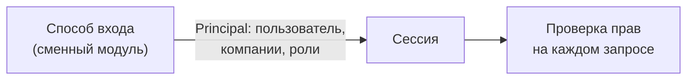

# Безопасность

| | |
|---|---|
| Статус | APPROVED 21.10.2026 (D-080) |
| Владелец | Агент A (черновик субагента) |
| Зависит от | [20-02](../20-process/02-application-states.md), [10-00](../10-product/00-organizer-clarifications.md), [04-modules](04-modules-and-boundaries.md) (правило R11), [06-data-model](06-data-model.md), [08](08-integration-adapters.md), [спецификация моков](../../specs/mocks.md) (9.4, 12) |
| Решения | D-014, D-020, D-057 (без Keycloak и настоящей ЭП), D-062 (ИНН + одноразовый код), D-082, D-085, D-086, D-091, D-092, D-096 |
| Вопросы пользователю | Нет: Q-062, Q-063 приняты D-080; Q-085 — D-085; Q-090 — D-086; Q-125, Q-126, Q-141 — D-091, D-096 |
| Обновлено | 21.10.2026, ред. 3: сведение R-002 после D-091, D-092, D-096 |

Критерий «Enterprise» называет безопасность первой. Данные у нас синтетические, но жюри оценит, что мы **знаем, как выглядит правильно**, и сделали это там, где недорого. Всё, что упрощено, называем явно.

## Вход, который не зависит от способа входа

Вход клиента выбран: ИНН + одноразовый код (D-062). В демо код показан на экране вместо SMS. Пароль и карточки быстрого входа клиента не используются. Вход отделён от сессии.

| Часть | Что делает | Меняется при смене способа входа? |
|---|---|---|
| Способ входа | Проверяет ИНН и одноразовый код, возвращает `Principal` | Да, только он |
| Сессия | Хранит `Principal`, выдаёт cookie, продлевает, закрывает | Нет |
| Права | Роль + принадлежность компании, проверяются в коде эндпоинта | Нет |

Данные берутся из таблиц [06](06-data-model.md): `users` (роль `CLIENT`, `UNDERWRITER`, `ADMIN`) и `company_members` (роль `DIRECTOR`, `ACCOUNTANT` или `GUARANTOR`, флаг `can_sign` для кредитного договора, список полномочий по доверенности `poa_permissions`). Один человек может состоять в нескольких компаниях, сессия работает в одной «активной». Учётки из блока `users` сценария создаёт `api` сам (Q-023). Замечание из Q-035: ИНН — открытые данные, поэтому вход «только по ИНН» без второго шага позволяет войти под чужой компанией. Поэтому и в демо обязателен второй шаг с кодом; демонстрационное упрощение — показ этого кода на экране, а не отсутствие проверки.

## Роли и права (RBAC)

**RBAC** — права зависят от роли. Роли клиента и банка:

| Роль (как в [06](06-data-model.md)) | Кто | Область |
|---|---|---|
| `CLIENT` + `DIRECTOR` (`can_sign`) | Руководитель или ИП | Своя компания, всё, включая подпись |
| `CLIENT` + `ACCOUNTANT` | Сотрудник с доверенностью (бухгалтер) | Своя компания, всё кроме подписи договора; согласия компании подписывает при полномочии SIGN_COMPANY_CONSENTS (D-091) |
| `CLIENT` + `GUARANTOR` | Поручитель, добавленный директором участником компании (D-091) | Только адресованные ему задачи, свои согласия и поручительство, сводка «за что поручаетесь» (D-096); чужие данные заявки и компании не видит |
| `UNDERWRITER` | Андеррайтер | Все заявки, ручное решение |
| `ADMIN` | Администратор | Всё, плюс демо-управление и журналы |

| Действие | DIRECTOR | ACCOUNTANT | UNDERWRITER | ADMIN |
|---|---|---|---|---|
| Создать и править черновик | да | да | нет | нет |
| Отправить заявку после подписания всех обязательных согласий (компании и личных, D-092) | да | да | нет | нет |
| Ответить на запрос информации, загрузить документ | да | да | нет | нет |
| Принять оферту | да | да | нет | нет |
| Подписать кредитный договор за компанию | да | нет, «передать руководителю» | нет | нет |
| Подписать согласия компании (БКИ, обороты) | да | да, при полномочии SIGN_COMPANY_CONSENTS в действующей доверенности (D-091); иначе «передать руководителю» | нет | нет |
| Подписать личное согласие и поручительство | только своё | нет, личное не делегируется | нет | нет |
| Отозвать заявку до подписи | да | да | нет | нет |
| Видеть решение и коды причин простым языком | да | да | да | да |
| Видеть внутренности: баллы, DSCR, снимки источников | нет | нет | да | да |
| Ручное решение, отклонение от рекомендации (с причиной) | нет | нет | да | да |
| Журнал аудита и вызовов интеграций | нет | нет | по заявке | да |
| `/demo/*`: сброс, сбои моков | Демо-исключение D-086: локально открыто, в облаке с кодом стенда; вне DEMO_MODE запрещено | — | — | — |

Как проверяем:
- Право проверяется в зависимости FastAPI на эндпоинте (`require(permission)`), а **принадлежность объекта** — в слое работы с данными: запрос заявки всегда фильтруется по компаниям из сессии. Чужая заявка отвечает `404`, а не `403`, чтобы не раскрывать, что она есть (защита от IDOR; правило R11 в [04](04-modules-and-boundaries.md), вариант разделения данных — Q-058 в [06](06-data-model.md)).
- Тесты: для каждого эндпоинта пара «своя компания — чужая компания» и матрица ролей выше.
- Каждое изменение статуса дополнительно проверяется состояниями из [20-02](../20-process/02-application-states.md) (кто вызывает переход).
- Роли банка: минимальный интерфейс в том же приложении, вход демо-кнопкой (D-010).

## Сессии

Развилка Q-062 ниже. Общие правила для любого варианта:

| Правило | Значение |
|---|---|
| Cookie | Две независимые сессии `sid_client` и `sid_bank` (Q-085, D-085); `HttpOnly` (скрипт на странице не прочитает), `SameSite=Lax`, `Secure` на HTTPS (настройка `COOKIE_SECURE`) |
| Срок | Простой 30 мин, абсолютный максимум 8 ч (настройки) |
| Смена идентификатора при входе | Да (защита от подмены сессии) |
| Выход | Сессия удаляется на сервере сразу |
| Смена роли или отзыв доступа | Действует с ближайшего запроса |

## Простая электронная подпись (имитация)

Настоящая ЭП не делается (D-057), SMS и почты нет (D-020). Что делаем:

1. Уполномоченный подписант нажимает «Подписать»: руководитель за компанию, сотрудник с полномочием SIGN_COMPANY_CONSENTS — за компанию только по согласиям (D-091), поручитель — только за себя (D-082). Достаточно галочки «Ознакомлен, согласен»; обязательного открытия документа нет (D-092). Один код подтверждает пакет согласий одного человека. `api` создаёт 6-значный код и кладёт в Redis только его хеш на 5 минут со счётчиком из 3 попыток (в базу код не пишется).
2. Код показывается **в интерфейсе** плашкой «Демо: в реальной системе код пришёл бы по SMS». Код возвращается ответом только при `DEMO_MODE=true`.
3. После ввода кода в `signatures` ([06](06-data-model.md)) пишется: кто, когда, метод `SIMPLE_ESIGN`. Хеш документа уже лежит в `contracts.content_hash` (SHA-256 сохранённого PDF, [12](12-files-and-documents.md)), подпись ссылается на этот договор. Сохраняется `proof`: HMAC серверным секретом от кода, хеша документа, ИНН подписанта и идентификатора попытки; открытый код не сохраняется, временный хеш удаляется по TTL. Подписывается именно сохранённый файл, а не пересозданный.
4. То же самое для согласий: БКИ, обороты, ПДн. Запись содержит версию и хеш текста согласия, срок действия (раздел 9.4 спецификации моков).
5. Код адаптера БКИ **не вызовется без `consent_id`** в аргументах. Это защита на уровне кода, а не только процесса.

Поручитель — участник компании с ролью `GUARANTOR`, которого добавил директор (D-091); подписывает только собственные согласия и поручительство (D-082). Видит только адресованные ему действия и сводку «за что поручаетесь» (D-096). Подпись сотрудника или руководителя не заменяет подпись другого человека.

## Персональные данные

| Что | Правило |
|---|---|
| Логи | ИНН маскируется (`0017****22`), ФИО, номера счетов, тела запросов не пишем вообще. Маскирование — обработчик логов, а не память разработчика |
| Ответы с ошибками | Формат RFC 7807, без стека и внутренних имён |
| Минимизация | Берём только поля, нужные процессу. Автозаполнение кэширует внутреннюю модель на 24 ч, не сырые ответы |
| Хранение | Полные данные только в `source_snapshots`, `consents`, `documents`; доступ по ролям. `POST /demo/reset` удаляет всё |
| Права на данные | Клиент видит только свою компанию; сотрудник банка — по роли |
| Данные синтетические | Региона `00` в ИНН не существует, реальных людей нет (раздел 12 спецификации). В README записано |

## Секреты и конфигурация

- Секреты только из переменных окружения, никогда из кода и образов. Список — в [13](13-config-and-profiles.md).
- Локальный запуск работает без `.env`: безопасные только для разработки значения по умолчанию (`dev-…`). На облачном стенде **все секреты обязательны**, без значений по умолчанию, иначе compose не стартует.
- При `APP_ENV=cloud` `api` отказывается стартовать, если секрет равен значению по умолчанию.
- `.env` в `.gitignore`; в CI сканер секретов (gitleaks) проверяет историю.

## Сетевая защита

| Тема | Решение |
|---|---|
| Единая точка входа | Один origin: интерфейс и `/api` отдаёт один прокси `web` ([01](01-overview.md), рекомендация Q-045). CORS не нужен |
| CORS | Только для разработки (Vite на другом порту): явный список `CORS_ORIGINS`, никакого `*` вместе с cookie |
| CSRF | Атака «чужой сайт отправил форму от имени клиента». Защита: `SameSite=Lax` + токен в заголовке `X-CSRF-Token` на всех не-GET запросах (cookie с токеном читаема скриптом, значение сверяется) + проверка `Origin` |
| Заголовки | `Content-Security-Policy`, `X-Content-Type-Options: nosniff`, `Referrer-Policy`, `frame-ancestors none`; HSTS на HTTPS-стенде |
| Порты | Наружу только вход (80/443 на стенде). Postgres, Redis, моки наружу не торчат ([14](14-deployment.md)) |
| Swagger `api` | Открыт (это артефакт сдачи), но авторизация сохраняется |

## Ограничение частоты запросов

**Rate limiting** — не больше N запросов за период, иначе `429` с `Retry-After`.

| Что | Лимит (по умолчанию, настройка) |
|---|---|
| Вход | 5 попыток в минуту на связку «ИНН + IP» |
| Подтверждение кода подписи | 3 попытки на код |
| Автозаполнение по ИНН (идёт во внешние системы) | 30 в минуту на сессию |
| Загрузка файлов | 10 в минуту на сессию |
| Остальное | 300 в минуту на сессию |

Реализация — Q-063.

## Загрузка файлов

Лимиты, проверка формата и хранение — в [12](12-files-and-documents.md). Принципы: размер проверяется до чтения всего файла, формат — по содержимому, а не по имени, имя файла клиента никогда не используется как путь, скачивание только через `api` с проверкой прав.

## OWASP Top 10 (2021) кратко

| Риск | Что делаем |
|---|---|
| A01 Нарушение контроля доступа | RBAC, фильтр по компании, `404` на чужое, тесты на матрицу |
| A02 Криптография | HTTPS на стенде, хеши кодов и документов, ничего не шифруем «своим» алгоритмом |
| A03 Инъекции | SQLAlchemy с параметрами, без «сырого» SQL со склейкой, проверка входа через Pydantic, React экранирует вывод |
| A04 Небезопасный дизайн | Стейт-машина с `409`, идемпотентность, лимиты, согласие как условие вызова БКИ |
| A05 Ошибки настройки | Нет секретов по умолчанию в облаке, закрытые порты, режим отладки выключен, админ-API моков не наружу |
| A06 Уязвимые компоненты | Lock-файлы + сканирование в CI (ниже) |
| A07 Ошибки аутентификации | Лимит попыток, смена ID сессии, срок жизни, `HttpOnly` |
| A08 Целостность ПО и данных | Сборка только из lock-файлов, версии образов зафиксированы, подпись документа по хешу |
| A09 Логи и мониторинг | Аудит и структурные логи ([10](10-audit-and-observability.md)) |
| A10 SSRF | Сервер ходит только по адресам из настроек. Пользователь не может задать URL |

## Сканирование зависимостей в CI

| Что | Инструмент | Правило |
|---|---|---|
| Python-библиотеки | `pip-audit` по `uv.lock` | Падаем на HIGH и CRITICAL, у которых есть исправление |
| JS-библиотеки | `pnpm audit --prod` | То же |
| Образы | `trivy image` | То же, плюс `trivy config` для Dockerfile и compose |
| Секреты | `gitleaks` | Любая находка |
| Исключения | Файл `security/allowlist` с причиной и сроком | Без причины не принимается |

Отчёты сохраняются артефактом CI. Из тех же lock-файлов собирается `THIRD_PARTY_NOTICES`.

## Решённые развилки

### Q-062. Как устроена сессия после входа (принято, D-080: вариант Б)

| Вариант | Плюсы | Минусы |
|---|---|---|
| А. JWT в `HttpOnly` cookie | Сервер не хранит состояние | Отозвать сессию сразу нельзя без «чёрного списка»; смена роли действует после истечения токена |
| Б. Случайный идентификатор в cookie, данные в Redis | Выход и смена роли действуют мгновенно; `EventSource` для живых статусов сам шлёт cookie; Redis уже есть | Каждый запрос читает Redis; при падении Redis входить нельзя |
| В. Токен в заголовке `Authorization`, хранит скрипт | Удобно тестировать из Swagger | `EventSource` не умеет заголовков; токен в памяти скрипта воруется через XSS |

**Рекомендация: Б.** Это самое простое, что даёт мгновенный отзыв, и подходит к живым статусам ([11](11-realtime.md)). Риск «Redis упал» мал: он поднимается за секунды, а сохранение на диск (AOF, как предусмотрено в [05](05-async-processing.md)) сохраняет сессии. Платим зависимостью от Redis.

### Q-063. Как ограничивать частоту запросов (принято, D-080: вариант Б)

| Вариант | Плюсы | Минусы |
|---|---|---|
| А. Библиотека `slowapi` | Готовая, с хранением в Redis | Привязана к декораторам; формат ошибки подгоняем |
| Б. Свой счётчик в Redis (~40 строк) | Любые ключи («ИНН + IP»), ошибка `429` в нашем формате, работает при нескольких `api` | Пишем и тестируем сами |
| В. На прокси (nginx `limit_req`) | Без кода | Не видит логин и сессию; в Caddy из коробки нет |

**Рекомендация: Б.** Код короткий, Redis уже есть. Вопрос малозначимый: можно принять рекомендацию, не вникая.

## Заметки для реализации

- Паролей демо-клиентов нет (D-062). Временный проверочный хеш кода хранится только с TTL и лимитом попыток; долговременное доказательство подписи — HMAC от подписываемого содержимого и подписанта. Секрет не попадает в БД и логи.
- Зависимость `require(permission)` и фильтр по компании — единственные места проверки прав. Эндпоинт без них не должен проходить тест «все маршруты защищены».
- Тест, который обходит все маршруты из OpenAPI без сессии и ждёт `401`.
- Сравнение кодов и токенов — `hmac.compare_digest`.
- `DEMO_MODE`, `/demo/*` и показ кода подписи выключаются одной настройкой; облачные сброс и сбои защищены кодом стенда (D-086), не требуют роли администратора.

**Разделение сессий (D-085, Q-085):** клиентские ручки читают только `sid_client`, банковские — только `sid_bank`. Вход и выход одной зоны не меняют другую. Общий SSE использует `zone` для выбора cookie и затем серверную проверку прав; клиент не может получить банковские события сменой параметра. Для CSRF и ограничений частоты контексты также независимы. Права демо-панели приняты Q-090/D-086, см. отдельное правило ниже.

**Принято Q-090, D-086:** при DEMO_MODE локально демо-панель доступна без административного входа. На облачном стенде сброс и включение/изменение сбоев требуют код стенда из README и ограничение частоты. Это барьер от случайного нажатия, не персональная защита: знающий код может затронуть общие данные. Код и проверка — на сервере; вне DEMO_MODE все демо-операции запрещены. Не распространять это исключение на админ-API моков или рабочее место банка.
