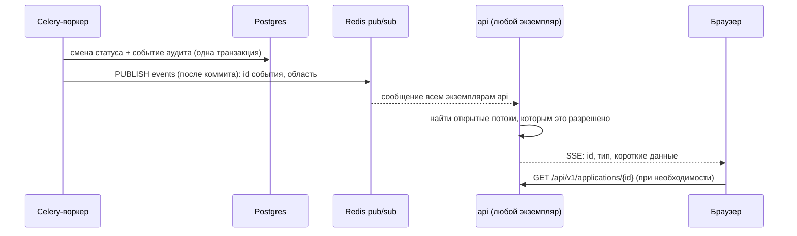

# Живые статусы

| | |
|---|---|
| Статус | DRAFT |
| Владелец | Агент A (черновик субагента) |
| Зависит от | [20-02](../20-process/02-application-states.md), [01-overview](01-overview.md), [05-async-processing](05-async-processing.md), [06-data-model](06-data-model.md), [09](09-security.md), [10](10-audit-and-observability.md) |
| Решения | D-020 (живые статусы через SSE), D-056 (Redis для доставки событий) |
| Вопросы пользователю | Q-067 |
| Обновлено | 21.10.2026 |

Клиент отправил заявку и видит, как таймлайн сам идёт вперёд: «проверяем реестр», «запрашиваем БКИ», «решение готово». Перезагружать страницу не нужно. Андеррайтер видит новые заявки в очереди так же. Это требование MVP (Must, RQ-05).

## Главная идея

**База данных — источник правды, Redis — только «звонок в дверь».** Событие уже записано в `application_events` ([06](06-data-model.md), [10](10-audit-and-observability.md)), у него есть номер. Redis лишь быстро сообщает всем процессам `api`: «есть новое». Если звонок потерялся, ничего страшного: браузер при переподключении спрашивает базу «что я пропустил после номера N».

## Путь события

1. Воркер меняет статус и пишет событие аудита в одной транзакции (всё или ничего).
2. **После** коммита публикует в канал Redis короткое сообщение: номер события, тип, к какой области относится (`company:{ИНН}`, `bank`). Публикация внутри транзакции запрещена: клиент мог бы получить событие раньше, чем данные станут видны.
3. Каждый экземпляр `api` держит одну подписку на каналы Redis и раздаёт события своим открытым потокам.
4. Браузер получает событие и обновляет экран.

## Поток для браузера

| Тема | Решение |
|---|---|
| Эндпоинт | Один `GET /api/v1/events/stream` на вкладку. Область определяется по сессии (компании пользователя; для банка — общая очередь). Не по потоку на заявку |
| Почему один | У браузера на HTTP/1.1 не больше ~6 соединений на сайт. Без HTTPS (локальный запуск) поток на каждую заявку упёрся бы в предел |
| Формат события | `id` = номер события аудита, `event` = тип (`status_changed`, `step_done`, `task_created`, `resync`), `data` = маленький JSON без персональных данных: `applicationId`, `status`, `clientStep` |
| Что делает браузер | Получает «уведомление + что поменялось», при необходимости перечитывает заявку обычным запросом. Права проверяет обычный эндпоинт, а не поток |
| Подтверждение жизни | Каждые 15 с строка-комментарий `: ping`, чтобы прокси не обрывал молчащее соединение |
| Заголовки | `Content-Type: text/event-stream`, `Cache-Control: no-cache`, отключение буферизации на прокси (см. заметки) |

## Авторизация потока

- Используется cookie сессии ([09](09-security.md), Q-062): `EventSource` в том же origin отправляет её сам. Токена в адресе нет, он не попадёт в логи.
- Проверка сессии при подключении, повторная — раз в минуту. Сессию закрыли или срок вышел → событие `auth_expired` и закрытие потока.
- Каждое событие фильтруется по области сессии **перед отправкой**. Чужая компания не получит даже номер события.
- Лимит: не больше 5 потоков на сессию; новые вытесняют старые.

## Переподключение и пропущенные события

| Ситуация | Что происходит |
|---|---|
| Сеть моргнула, экземпляр `api` перезапустили | Браузер сам переподключается через `retry: 3000` мс и передаёт заголовок `Last-Event-ID` |
| Сервер получил `Last-Event-ID` | Читает из `application_events` события с `id` больше этого номера в области сессии (по компании заявки; для банка — все) и отправляет их по порядку (максимум 100) |
| Пропущено больше 100 или номер слишком старый | Сервер шлёт `resync`, браузер перечитывает список заявок и текущую заявку целиком |
| Переполнена очередь отправки у медленного клиента | Сервер дропает накопленное и шлёт `resync` |
| Подключение с нуля (без `Last-Event-ID`) | Браузер сначала читает состояние обычным запросом, потом подписывается; события между этими двумя шагами закрывает номер последнего события в ответе |
| Redis недоступен | Новых событий нет. Браузер после 3 неудачных попыток переходит на опрос раз в 5 с (запасной режим) и возвращается к потоку, когда тот оживает |

## Масштабирование

Потоки не привязаны к экземпляру: любой `api` получает любое сообщение из Redis и раздаёт своим клиентам. Липких сессий на балансировщике не нужно. Несколько экземпляров `api` и воркеров — без изменения кода ([15](15-reliability-and-scaling.md)). При остановке экземпляр аккуратно закрывает потоки, браузеры уходят на другой.

## Сравнение

| Критерий | SSE + pub/sub | WebSocket | Опрос |
|---|---|---|---|
| «Живость» | Мгновенно | Мгновенно | Задержка 2–5 с |
| Сложность | Низкая | Выше: свой протокол, переподключение, проверка прав на сообщение | Минимальная |
| Работа через прокси и HTTP/2 | Обычный HTTP | Нужна отдельная настройка | Обычный HTTP |
| Автопереподключение и `Last-Event-ID` | Встроены в браузер | Пишем сами | Не нужно |
| Нужен ли обратный канал (клиент→сервер) | Нет, клиент пишет обычными запросами | Да, но нам не нужен | Нет |
| Нагрузка | Одно соединение на вкладку | То же | Много запросов |
| Надёжность | Запасной опрос закрывает отказ | Своё | Максимальная |

## Развилки для пользователя

### Q-067. Как доставляем живые статусы

D-020 уже называет SSE, а D-056 — Redis. Вопрос в том, подтверждаем ли мы схему целиком.

| Вариант | Плюсы | Минусы |
|---|---|---|
| А. SSE + Redis pub/sub, пропущенное докачиваем из базы по `Last-Event-ID`; запасной опрос в браузере | Просто; работает с несколькими `api`; потери звонка безопасны; естественно идёт через cookie | Нужно написать воспроизведение из `application_events` и фоллбэк в браузере (~5–6 ч) |
| Б. WebSocket | Двусторонний канал | Нам не нужен: клиент общается обычными запросами. Больше кода и проверок, сложнее с прокси |
| В. Только опрос раз в 3 с | 1–2 ч, надёжно | Не «живое», лишняя нагрузка, хуже на демо, не в духе D-020 |

**Рекомендация: А.** Решение уже принято в D-020 и D-056, а воспроизведение из базы делает схему устойчивой без Redis Streams. Платим 5–6 часами.

## Заметки для реализации

- Реализация на `StreamingResponse`/`EventSourceResponse` (`sse-starlette`) и `redis.asyncio` с одной задачей-подписчиком на процесс.
- Не использовать Redis Streams на старте. Если воспроизведение из базы окажется узким местом, это следующий шаг, интерфейс не изменится.
- Очередь на соединение ограничена (100 событий). Заполнилась → `resync` и очистка.
- События хранятся только в `application_events`, отдельной таблицы для SSE не заводим. Данных в событии минимум, подробности читаются обычным запросом с проверкой прав. Список уведомлений (`notifications`, D-020) читается обычным запросом после события `task_created`.
- Тесты: два экземпляра `api` (событие из воркера доходит до клиента на каждом), обрыв и докачка, чужая компания не видит чужих событий, `auth_expired`.
- Для прокси `web` (nginx): для `/api/v1/events/stream` `proxy_buffering off`, увеличенный `proxy_read_timeout`, HTTP/1.1 к `api`. Если на стенде добавляется Caddy ([14](14-deployment.md), Q-072), у него `flush_interval -1`.
- Фронт: хук `useEventStream` с тремя состояниями (подключено / переподключение / опрос), индикатор в интерфейсе «обновляется автоматически» (экраны клиента, 60-03).
