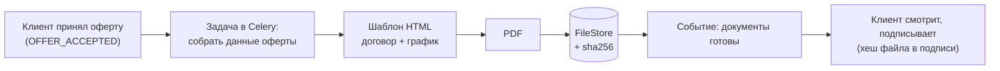

# Файлы и документы

| | |
|---|---|
| Статус | DRAFT |
| Владелец | Агент A (черновик субагента) |
| Зависит от | [05-async-processing](05-async-processing.md), [06-data-model](06-data-model.md), [09](09-security.md), [10](10-audit-and-observability.md), [20-01](../20-process/01-process-model.md), [спецификация моков](../../specs/mocks.md) (10.8) |
| Решения | D-068 (выписка: загрузка или генерация в демо-режиме), D-039, D-065 (парсер выписки идёт с основным сценарием) |
| Вопросы пользователю | Q-068, Q-069 |
| Обновлено | 21.10.2026 |

Какие файлы приходят от клиента, какие мы создаём сами, где всё лежит и как проверяется. Разбор содержимого выписки и отчётности — в документах про данные и ИИ (40-xx), здесь только «жизнь файла».

## Какие файлы есть

| Файл | Откуда | Формат | Лимит | Для чего | Приоритет |
|---|---|---|---|---|---|
| Выписка из другого банка | Клиент загружает или генерация в демо-режиме | `1CClientBankExchange`, текст Windows-1251 | 5 МБ | Выручка для `NEEDS_INFO` (Гарипов) | Should, идёт с основным сценарием |
| Бухгалтерская отчётность | Клиент | PDF | 10 МБ | Распознавание выручки | Could (Q-018 открыт) |
| Договор с поставщиком/заказчиком | Клиент | PDF | 10 МБ | Подтверждение контракта (продукт «под контракт») | Could |
| Кредитный договор | Мы генерируем | PDF | — | Подписание | Must |
| График платежей | Мы генерируем | PDF (+ таблица на экране) | — | «Мои кредиты» | Must |
| Выписка, созданная в демо-режиме | `api` получает от `mock-scenarios` | Тот же 1С-формат | — | Тот же путь, что и загрузка | Should |

Количество: не больше 10 файлов на заявку, не больше 50 МБ суммарно.

## Загрузка: проверки

Шаги 1–4 выполняются сразу при загрузке, на любой ошибке — понятное сообщение клиенту и `422` с машинным кодом. Шаг 5 — по смыслу — делает фоновая задача `documents.parse_statement` ([05](05-async-processing.md)): результат пишется в `documents.parse_status`, при ошибке клиент получает задачу с понятным текстом, статус приходит событием ([11](11-realtime.md)).

| Шаг | Проверка | Код ошибки |
|---|---|---|
| 1 | Размер: заголовок `Content-Length` и подсчёт байтов во время чтения; лишнее не читаем до конца | `FILE_TOO_LARGE` (`413`) |
| 2 | Тип по **содержимому**, не по имени: для PDF начало `%PDF-`, для выписки первая строка `1CClientBankExchange`. Расширение и `Content-Type` клиента только подсказка | `UNSUPPORTED_FORMAT` |
| 3 | PDF: не зашифрован, до 30 страниц | `PDF_ENCRYPTED`, `PDF_TOO_LONG` |
| 4 | Выписка: кодировка (Windows-1251, запасной UTF-8), не более 100 000 строк | `BAD_ENCODING`, `TOO_MANY_LINES` |
| 5 | Выписка по смыслу: ИНН владельца счёта совпадает с ИНН заявки, период не короче 3 месяцев, суммы сходятся (начальный остаток + приход − расход = конечный) | `INN_MISMATCH`, `PERIOD_TOO_SHORT`, `BALANCE_MISMATCH` |

- Имя файла клиента не используется как путь. Файл хранится под своим идентификатором, исходное имя — только в колонке для показа (очищенное).
- Скачивание — только через `api` с проверкой компании ([09](09-security.md)), заголовки `Content-Disposition: attachment`, `X-Content-Type-Options: nosniff`.
- Антивирус не ставим (ClamAV съел бы около 1 ГБ). Это упрощение, в README: «в промышленной системе — проверка антивирусом на загрузке».
- Парсер выписки — чистый Python, без вызова внешних программ, файл до 5 МБ разбирается меньше секунды. Ошибка парсера = ошибка проверки, не падение задачи.

## Где хранится

Все файлы лежат за интерфейсом `FileStore` (`put`, `get`, `delete`), код не знает, куда они физически уходят. Выбор — Q-068.

Метаданные лежат в таблице `documents` ([06](06-data-model.md)): компания, заявка, вид, имя, размер, `sha256`, `storage_key`, `parse_status`, `parsed`. Из этого документа в 06 нужно добавить: виды `CREDIT_AGREEMENT` и `PAYMENT_SCHEDULE` для созданных нами PDF (сейчас в 06 есть `BANK_STATEMENT_1C`, `FINANCIALS`, `CONTRACT`, `OTHER`; `CONTRACT` здесь — договор с поставщиком от клиента), поле происхождения (`UPLOADED`, `DEMO_GENERATED`, `SYSTEM_GENERATED`) и версию шаблона. Договор в `contracts` ссылается на свой файл через `document_id`.

## Генерация документов

Что создаём и когда:

| Документ | Данные | Правила |
|---|---|---|
| Кредитный договор | Стороны, продукт, сумма, ставка, срок, график, версия правил, номер заявки | Создаётся **один раз** при `OFFER_ACCEPTED`. Подписывается именно этот файл по хешу ([09](09-security.md)). Правка условий = новая версия и новая подпись |
| График платежей | Тот же расчёт, что у калькулятора; аннуитет по умолчанию | Не пересчитывается отдельным кодом: берёт числа из оферты, расхождение с экраном невозможно |
| Подпись в документе | Текст «Подписано простой ЭП (демо), дата, ФИО, хеш» | Добавляется в запись подписи и в отображаемый лист, сам PDF не меняется |

На каждом листе подпись «ДЕМО. Синтетический документ, юридической силы не имеет». Шрифты — открытые (например PT Sans, лицензия OFL), лежат в репозитории и попадают в `THIRD_PARTY_NOTICES`.

## Сгенерированная выписка (демо-режим)

Кнопка «Сгенерировать тестовую выписку» для компании без оборотов в нашем банке (D-068): `api` просит у `mock-scenarios` файл, сохраняет как обычную загрузку с происхождением `DEMO_GENERATED` и **дальше пользуется тем же парсером и теми же проверками**. Исходный файл хранится вместе с заявкой: решение опирается на него, и аудит может его показать. Результат разбора (месячные суммы) сохраняется в `documents.parsed`, а при использовании в решении попадает в снимок источника. Кнопка видна только при `DEMO_MODE`. Для запроса нужен админ-ключ ([08](08-integration-adapters.md)).

## Хранение и срок жизни

- Файлы живут столько же, сколько заявка. `POST /demo/reset` удаляет всё.
- Файл нельзя изменить. «Заменить» = новый файл + запись об отмене прежнего.
- События `FILE_UPLOADED`, `FILE_DOWNLOADED`, `DOCUMENT_GENERATED` пишутся в аудит ([10](10-audit-and-observability.md)).

## Развилки для пользователя

### Q-068. Где хранить файлы

| Вариант | Плюсы | Минусы |
|---|---|---|
| А. В Postgres (колонка `bytea` в таблице `document_blobs`) | Нет нового контейнера; файл и метаданные в одной транзакции; бэкап базы = бэкап файлов; работает с любым числом `api` | Раздувает базу при больших файлах; читаем целиком в память (у нас до 10 МБ, это нормально) |
| Б. MinIO (S3-совместимое хранилище) | «Как в проде», S3-API | +1 контейнер (около 150–250 МБ), ключи и бакет при старте; проект MinIO в конце 2025 года перешёл в режим поддержки, публичные образы нестабильны (проверить при реализации; есть Garage, SeaweedFS) |
| В. Папка на диске в Docker-томе | Проще Postgres, база не растёт | Метаданные и файл могут разойтись; со вторым сервером `api` на другой машине не работает; отдельный бэкап |

**Рекомендация: А** за интерфейсом `FileStore`. Для наших размеров это самое надёжное и простое. История для критерия «Enterprise»: «в промышленной системе `FileStore` переключается на S3 одной реализацией». Платим тем, что база становится больше (десятки МБ на демо).

### Q-069. Чем делать PDF договора и графика

| Вариант | Плюсы | Минусы |
|---|---|---|
| А. WeasyPrint (HTML + CSS → PDF) | Верстаем обычным HTML, тот же шаблон можно показать на экране; хорошая кириллица и таблицы; тестируется по тексту | Нужны системные библиотеки (Pango, Cairo), образ `api` больше примерно на 100–150 МБ; шрифты ставим сами; 0,3–1 с на документ |
| Б. ReportLab | Чистый Python, без системных библиотек | Вёрстка кодом, таблицы и перенос строк трудоёмки; кириллический шрифт регистрируем вручную |
| В. HTML + «Печать в PDF» в браузере | Ноль кода на сервере | Нет сохранённого файла и хеша для подписи, нечем тестировать, результат зависит от браузера |

**Рекомендация: А.** Нужен реальный файл с хешем для подписи и стабильный вид. Платим размером образа и необходимостью один раз правильно поставить библиотеки в Dockerfile.

## Заметки для реализации

- Метаданные — `documents` ([06](06-data-model.md)); байты (при выборе Q-068 А) — в отдельной таблице `document_blobs` по `storage_key`, чтобы список файлов не вытягивал содержимое. Таблицу добавить в 06.
- Генерация PDF — задача Celery `documents.render_contract` (тяжёлая по процессору), результат приходит событием ([11](11-realtime.md)). Простой тест: текст PDF содержит сумму, ставку, номер заявки и ИНН.
- Один тест «график PDF = график на экране = калькулятор»: числа совпадают до рубля.
- Фикстуры тестов: три настоящих по формату выписки (хорошая, чужой ИНН, битые суммы), «PDF» с расширением `.txt`, файл больше лимита.
- Список допустимых типов и лимиты хранятся в настройках ([13](13-config-and-profiles.md)): `UPLOAD_MAX_MB`, `UPLOAD_MAX_FILES_PER_APPLICATION`.
- Хеш считается при записи и проверяется при выдаче документа на подпись.
