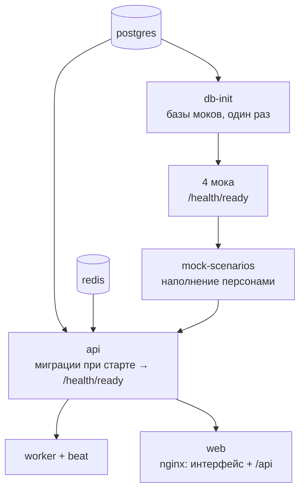

# Развёртывание

| | |
|---|---|
| Статус | APPROVED 21.10.2026 (D-080) |
| Владелец | Агент A (черновик субагента) |
| Зависит от | [01-overview](01-overview.md) (Q-045, память, порядок запуска), [13](13-config-and-profiles.md), [10](10-audit-and-observability.md), [10-00](../10-product/00-organizer-clarifications.md) (п. 8, 10, 11), [спецификация моков](../../specs/mocks.md) (3.1, 3.4) |
| Решения | D-058 (модели вшиты в образ), D-064, D-066 (ПК жюри), D-067 (платный VPS разрешён), D-080 (Q-072 Caddy), D-081 (образы: оба варианта, публичные), D-083 (публикация в день сдачи), D-094 (профиль `ai` включён по умолчанию; веса с Hugging Face) |
| Вопросы пользователю | Нет: Q-071 решён (D-081), Q-072 принят (D-080). Q-008 (где стенд) отложен пользователем |
| Обновлено | 21.10.2026, ред. 3: сведение R-002 после D-081, D-083, D-094 |

Жюри клонирует репозиторий и запускает `docker compose up` по README. Ничего не настраивает и не ждёт долго. Это главный сценарий; облачный стенд — приятное дополнение.

## Что поднимается и в каком порядке

Состав и память — в [01-overview](01-overview.md); здесь порядок и проверки готовности.

| Сервис | Условие запуска | Проверка готовности |
|---|---|---|
| `postgres` | — | `pg_isready` |
| `redis` | — | `redis-cli ping` |
| `db-init` | `postgres` здоров | Завершился с кодом 0 (`service_completed_successfully`) |
| `mock-*` | `db-init` выполнен | `GET /health/ready` |
| `mock-scenarios` | Все 4 мока здоровы | Готов после первой синхронизации (раздел 10.6 моков) |
| `api` | `postgres`, `redis`, `mock-scenarios` | `GET /health/ready` (после миграций) |
| `worker`, `beat` | `api` здоров | Файл-сигнал воркера моложе минуты ([10](10-audit-and-observability.md)) |
| `web` | `api` здоров | Ответ на `/` |

- Миграции `api` применяет сам при старте (решение [01](01-overview.md)). Чтобы два экземпляра не делали это одновременно, миграция берёт блокировку Postgres (advisory lock): второй экземпляр ждёт и видит схему уже готовой.
- Жюри открывает интерфейс, когда готово всё: пока `api` не здоров, `web` не стартует, и страница сразу с персонами. Готовность видна в `docker compose ps`.
- `beat` (плановые задачи) всегда в одном экземпляре ([15](15-reliability-and-scaling.md)).

## Бюджет памяти и времени

Таблица памяти по контейнерам — в [01-overview](01-overview.md). Запуск по умолчанию включает `nlu` (профиль `ai`, D-094): около 2,3 ГБ ожидаемо и около 3,4 ГБ по лимитам, цель D-066 (≤ 4 ГБ) выполняется. Без `nlu` было бы 1,6 и 2,3 ГБ. Каждому сервису задан `mem_limit`, чтобы один процесс не съел машину. Дополнения этого документа:

- Профиль `obs` (Prometheus + Grafana) по нашей оценке +250–450 МБ ([10](10-audit-and-observability.md)); вместе с `ai` это ≈ 3,8 ГБ по лимитам, поэтому `obs` на ПК жюри не включаем.
- Профиль `ai` — модель `nlu` (Q-044), входит в основной бюджет.
- Цифры плановые: на чистой машине замерить `docker stats` и записать итог в README.

| Этап | Оценка (допущение, замерить) |
|---|---|
| Первая сборка образов (4 образа: `api`, `mocks`, `web`, `nlu`; для `nlu` нужен Hugging Face) | 5–10 минут при хорошем интернете, образы из GHCR — 1–2 минуты |
| Повторный запуск | 1–2 минуты |
| Готовность после `up` (мок-сценарии и миграции) | 60–90 секунд |

Как не раздувать время: образ `mocks` один на 5 контейнеров; `api`, `worker` и `beat` — один образ; `uv sync --frozen` и `npm ci` кэшируются слоями; финальные образы собираются многоступенчато (без компиляторов).

## Образы: собирать у жюри или скачивать

Решено Q-071 → D-081: **оба варианта**. В compose у сервисов и `image` из GHCR, и `build`; в README основной путь `docker compose up` (образы скачиваются), запасной — `up --build`. Образы публичные, код в них увидит любой (пользователь принял); `docs/` в образы не копируется. Образы выкладываются только в день сдачи 26.10 (D-083). Перед сдачей проверить на чистой машине, как compose выбирает между `image` и `build`. Одинаковое для всех: версии образов привязаны к хешу коммита, базовые образы — с зафиксированной версией.

## Работа без интернета

После первой сборки/загрузки образов стенд работает офлайн (RQ-53). Для этого:

- Во время запуска ничего не скачивается: ни пакеты, ни шрифты, ни модели. Шрифты и иконки интерфейса лежат в сборке, внешних CDN нет.
- Модели ИИ вшиты в образ (D-058): веса скачиваются с Hugging Face при сборке образа (докачка и проверка хеша), в готовом образе GHCR модель уже внутри; в запуске обращение к хабу отключено (D-094).
- HTTPS-сертификаты нужны только на облачном стенде; локально интерфейс по HTTP на `127.0.0.1:8080`.
- Проверка перед сдачей: на чистой машине собрать, отключить сеть, пройти сценарий.

## Облачный стенд

Платный VPS разрешён (D-067), но проверка не должна от него зависеть: README ведёт жюри на локальный запуск. Где именно арендуем — Q-008.

**Требования к VPS:**

| Параметр | Минимум | Комфортно (с Grafana) |
|---|---|---|
| Процессор | 2 vCPU | 4 vCPU |
| Память | 4 ГБ + 2 ГБ swap | 8 ГБ |
| Диск | 30 ГБ SSD | 40 ГБ |
| ОС | Ubuntu 24.04 LTS (или 22.04) | то же |
| Сеть | Открыты порты 22 (по ключу), 80, 443 | то же |
| Адрес | Домен или бесплатное имя вида `<ip>.sslip.io` (проверить при реализации) | то же |

**Шаги в общем виде:**

1. Арендовать VPS, добавить SSH-ключ, отключить вход по паролю, создать пользователя без root.
2. Включить файрвол (`ufw`: 22, 80, 443) и автоматические обновления безопасности.
3. Поставить Docker Engine и плагин Compose.
4. Склонировать репозиторий (доступ на чтение по deploy-ключу) нужной версии (тегом).
5. Создать `.env` с настоящими секретами (`openssl rand -hex 24` для каждого) и доменом для HTTPS.
6. Запустить `docker compose -f docker-compose.yml -f docker-compose.cloud.yml up -d --build`.
7. Проверить: `curl` на `/health/ready`, прогон сценария-проверки (smoke) с вашего ПК.
8. Настроить ночной бэкап базы (`pg_dump`, [15](15-reliability-and-scaling.md)) и проверку после перезагрузки сервера.
9. Обновление: `git fetch && git checkout <тег> && docker compose … up -d --build`.

Порты моков и `api` на стенде наружу не открываются (раздел 3.4 моков). Админ-ключ мока без значения по умолчанию.

## Решённые развилки

### Q-071. Образы: собирать у жюри или заранее выложить (решено, D-081: вариант В; Б публично в день сдачи, D-083)

| Вариант | Плюсы | Минусы |
|---|---|---|
| А. Жюри собирает само (`docker compose up --build`) | Репозиторий закрытый, реестр не нужен; всё воспроизводимо из исходников | 5–10 минут ожидания; нужен интернет для сборки; чем дольше, тем выше шанс, что жюри бросит |
| Б. Образы заранее в публичном GHCR (GitHub Container Registry), `docker compose up` их скачивает | Запуск за 1–2 минуты | Пакет должен быть публичным: код внутри образов виден всем (противоречит D-001); плюс процесс публикации, версии; при сбое реестра нет запасного пути |
| В. Оба: в compose у сервиса и `image:`, и `build:`; README основной путь `up`, запасной `up --build`; образы публикуются тегом перед сдачей | Быстро, если образы есть; если нет — сборка | Публичный пакет всё равно нужен; точное поведение `up` при двух ключах проверить на чистой машине |

**Рекомендация: А как основной путь** (надёжность и закрытый репозиторий), **В — если пользователь согласен открыть образы**. Платим временем жюри в варианте А: компенсируем «первая сборка — время выпить чаю» в README и экраном ожидания. Решение также требует от пользователя: готов ли он публиковать код образов?

### Q-072. Как включить HTTPS на облачном стенде (принято D-080: вариант А, Caddy)

Точка входа `web` — nginx (рекомендация Q-045 в [01](01-overview.md)); локально HTTPS не нужен. Вопрос только про стенд.

| Вариант | Плюсы | Минусы |
|---|---|---|
| А. Перед `web` добавляется Caddy (только в `docker-compose.cloud.yml`) | Сертификат Let's Encrypt выпускается и продлевается сам, 5 строк настроек, локальный запуск не меняется | Два прокси подряд (буфер SSE отключить в обоих); нужен домен или имя вида sslip.io |
| Б. nginx в `web` сам принимает HTTPS, сертификаты получает certbot | Один прокси, привычная связка | Два контейнера, настройка продления; на первом выпуске «курица и яйцо» (сертификата нет, nginx без него не стартует) |
| В. Заменить nginx на Caddy везде (локально и на стенде) | Один прокси и один конфиг для всех профилей, автоматический HTTPS | Меняется Q-045; Caddy менее привычен агентам-разработчикам |

**Рекомендация: А.** Не трогает основной профиль (то, что проверяет жюри), а на стенде даёт HTTPS минимальными усилиями. Если пользователь в Q-045 захочет один простой прокси, естественным становится В. Платим вторым прокси на стенде и необходимостью домена.

## Заметки для реализации

- Фронтенд собирается в статические файлы в этапе сборки образа `web`; контейнер `web` — nginx с этими файлами и проксированием `/api` (Q-045).
- Healthcheck каждого сервиса описан в compose; `depends_on` только с `condition: service_healthy`/`completed_successfully`.
- `docker compose down` не трогает тома; полный сброс — `down -v` (в README, с предупреждением) или `POST /demo/reset`.
- В CI отдельная задача: `docker compose up --wait` на чистом раннере, прогон smoke-сценария, замер `docker stats`, ограничение по времени. Если она красная, сдавать нельзя.
- Скрипт `scripts/smoke.sh` вызывает: `/health/ready`, вход под демо-персоной, подача заявки персоны `sokolova` (счастливый путь), ожидание `APPROVED`. Его же запускают и на стенде.
- Использованные базовые образы фиксируются по версии (желательно по хешу), раз в неделю обновляются и проходят `trivy`.

**Доступ к схеме, C-16:** `web` проксирует `/docs` и `/openapi.json` в `api` и локально, и на облачном стенде. Swagger моков доступен только через локальные служебные порты. Открытая документация не отменяет авторизацию самих операций.
