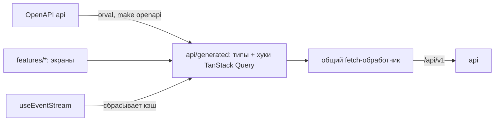

# Фронт: структура приложения

| | |
|---|---|
| Статус | DRAFT |
| Владелец | Агент A (черновик субагента) |
| Зависит от | [50-02](../50-architecture/02-tech-stack.md), [50-07](../50-architecture/07-api-design.md), [50-09](../50-architecture/09-security.md), [50-11](../50-architecture/11-realtime.md), [20-02](../20-process/02-application-states.md) |
| Решения | Реализует D-010, D-020, D-063, D-080; вход — решение Q-035 (вариант Б) |
| Вопросы пользователю | Q-085, Q-086 |
| Обновлено | 21.10.2026, ред. 2: агент B, сведение R-002 |

## Зачем

Одно описание того, как устроено приложение целиком: зоны, адреса, кто куда может зайти, как фронт говорит с `api`, как реагирует на живые события и ошибки. Экраны — в [60-03](03-client-screens.md), [60-04](04-backoffice-screens.md), [60-05](05-demo-panel.md).

## Одно приложение, три зоны

Одно SPA (single-page application: страницы переключаются без перезагрузки), которое отдаёт `web` (nginx). Зоны разделены адресом и внешним видом (D-010).

| Зона | Адрес | Кто попадает | Как выглядит |
|---|---|---|---|
| Вход | `/login` | Все без сессии | Минимум элементов, сменный блок (см. ниже) |
| Клиент | `/` и всё, что не `/bank`, `/demo` | `CLIENT` (директор или бухгалтер) | Основной вид продукта |
| Банк | `/bank/*` | `UNDERWRITER`, `ADMIN` | Другая цветовая полоса в шапке и подпись «Рабочее место банка (демо)»: нельзя спутать с клиентской частью |
| Демо | `/demo` и выдвижная панель | Любой при `DEMO_MODE` (доступ на публичном стенде — Q-090) | Служебный вид, пометка «Только для проверки» |

Зоны банка и демо подгружаются отдельно (lazy loading): клиент их кода не скачивает.

## Карта адресов клиента

| Адрес | Экран ([60-03](03-client-screens.md)) | Примечание |
|---|---|---|
| `/login` | Вход | ИНН → код → кабинет |
| `/company` | Выбор компании | Только если у пользователя их больше одной |
| `/` | Главная | Задачи, заявки, кредиты, предодобрение |
| `/wizard`, `/wizard/result` | Мастер и результат подбора | Ответы хранятся в заявке-черновике |
| `/products`, `/products/:code` | Каталог и калькулятор | |
| `/applications/:id/edit/:step` | Заявка по шагам | Шаг в адресе: кнопка «назад» браузера работает |
| `/applications/:id` | Страница заявки с таймлайном | **Одна страница на все статусы**: блок исхода выбирается по `status` |
| `/applications/:id/offer` | Выбор варианта (3 карточки) | |
| `/applications/:id/sign` | Подписание | |
| `/loans`, `/loans/:id` | Мои кредиты и график | |
| `/notifications` | Уведомления | Колокольчик в шапке ведёт сюда или раскрывает список |

Исходы (одобрено, встречное, нужна информация, ручное, отказ) — не отдельные адреса, а состояния страницы заявки. Так адрес не расходится со статусом, а при смене статуса по SSE экран меняется сам.

## Карта адресов банка и демо

| Адрес | Экран |
|---|---|
| `/bank` | Очередь ([60-04](04-backoffice-screens.md)) |
| `/bank/applications/:id` | Карточка заявки |
| `/demo` | Демо-панель ([60-05](05-demo-panel.md)); короткий вариант — выдвижная панель в углу любой зоны |

## Защита маршрутов

Принцип: **интерфейс скрывает лишнее, решает сервер.** Фронтовая защита нужна ради удобства (не показывать кнопку, которая вернёт `403`), а не ради безопасности.

| Что | Как |
|---|---|
| Кто пользователь | Один запрос `GET /me` при старте: пользователь, роль, компании, активная компания. Результат лежит в кэше TanStack Query |
| Нет сессии (`401`) | Редирект на `/login` с запоминанием адреса возврата |
| Роль не подходит | Клиент зашёл на `/bank` → экран «Эта часть для сотрудников банка» с кнопкой «Вернуться». Не тихий редирект: жюри должно понять, что произошло |
| Кнопки действий | Строятся из `allowedActions` в ответе заявки (50-07), а не из копии стейт-машины на фронте. Бухгалтер вместо «Подписать» получает «Передать руководителю» |
| Чужая заявка | `404` → общий экран «Не нашли такую заявку» |
| Демо выключено | Адреса `/demo` недоступны, пункта меню нет. Признак — публичная настройка (см. заметки) |

## Вход как сменный блок

Способ входа решён (Q-035, вариант Б): **ИНН + одноразовый код**. Шаги и тексты — в [60-03](03-client-screens.md). Весь вход живёт в `features/auth` и заканчивается одним результатом: сессия создана, `GET /me` отдаёт данные. Остальное приложение про способ входа ничего не знает. Если способ поменяется, переписывается только эта папка. Андеррайтер входит отдельной кнопкой «Войти как андеррайтер» (D-010).

## Слой API

Правила:

1. Экраны вызывают только сгенерированные хуки (D-080). Руками сгенерированное не правим; запросов через голый `fetch` в экранах нет.
2. Общий обработчик запросов добавляет: `X-Request-Id` (новый на запрос), `X-CSRF-Token` (из cookie) для не-GET, `Idempotency-Key` для действий из [50-07](../50-architecture/07-api-design.md).
3. **Ключ идемпотентности создаётся на действие пользователя**, а не на запрос: нажали «Отправить» → ключ создан → при повторе после обрыва уходит тот же. После успеха ключ сбрасывается.
4. Ошибки `application/problem+json` превращаются в один тип `AppError` с полями `code`, `status`, `requestId`, `errors[]`. Текст для человека берётся из словаря по `code` ([60-06](06-ux-writing.md)), не из `detail`.
5. Черновик заявки сохраняется автоматически (пауза ввода ~1 с, `PATCH …/draft` с `version`). Ответ `409 VERSION_CONFLICT` → мягкое сообщение «Заявку изменили в другой вкладке» и кнопка «Обновить».

## Живые события (SSE)

Хук `useEventStream` открывает один поток на вкладку (50-11) и ничего не рисует сам: он **сбрасывает кэш** нужных запросов, а экран перечитывается обычным запросом.

| Событие | Что сбрасываем |
|---|---|
| `status_changed`, `step_done` | Заявку `applicationId`, её таймлайн, список заявок, главную |
| `task_created` | Задачи, уведомления, главную |
| `resync` | Всё (заявки, уведомления, текущая страница) |
| `auth_expired` | Переход на `/login` с сообщением «Сессия закончилась» |

Три состояния, видимые в шапке мелкой подписью (50-11): «обновляется автоматически» · «восстанавливаем связь…» · «обновляем раз в 5 секунд» (запасной опрос). В очереди банка то же самое.

## Ошибки и загрузка

| Уровень | Что показываем |
|---|---|
| Поле | Ошибка рядом с полем: из zod (на лету) и из `errors[]` сервера |
| Блок | Карточка источника не загрузилась → в самом блоке «Не удалось получить. Повторить», остальная страница работает |
| Страница | Общий экран ошибки: понятная фраза, кнопка «Повторить», мелко «Код для поддержки: `requestId`» с копированием |
| Сеть пропала | Тонкая полоса сверху «Нет связи», действия блокируются, кнопки не «висят» |
| Источник данных недоступен | **Не ошибка**: поле помечено «не подтверждено» (20-01), можно ввести вручную |

Загрузка: на экранах со списками и карточками — «скелетоны» (серые заглушки по форме блока), а не спиннер на всю страницу. Кнопки действий показывают состояние «выполняется» и блокируются от двойного нажатия. Операции дольше секунды (конвейер) не держат экран: они идут в таймлайне ([60-03](03-client-screens.md)).

## Границы

- **Входит:** зоны, адреса, защита, слой API, SSE, ошибки.
- **Не входит:** тексты ([60-06](06-ux-writing.md)), выбор библиотеки компонентов ([60-02](02-design-system-options.md)), визуальные макеты ([60-07](07-mockups.md)). Перевод интерфейса не нужен: язык один (русский); словарь текстов существует ради единого тона, а не ради i18n. Адаптив под телефон не делаем (D-063): минимальная ширина экрана 1280 px, ниже — подсказка «Откройте на компьютере».

## Как проверяем

- Playwright: персона проходит весь путь без перезагрузки страницы, статус меняется сам.
- Клиент по адресу `/bank` видит экран «Для сотрудников банка», по `/demo` при выключенном демо — «не найдено».
- Обрыв SSE (остановить `api` на 10 с): шапка показывает «восстанавливаем связь», потом возвращается.
- Двойной клик на «Отправить заявку» создаёт одну заявку.

## Развилки для пользователя

**Q-085. Могут ли «клиент» и «андеррайтер» быть открыты в одном браузере одновременно?** Это важно для проверки: жюри хочет видеть, как заявка Станкопрома зависла у клиента и как её одобряет банк. По [50-09](../50-architecture/09-security.md) сессия одна (одна cookie), вход под другой ролью выкинет первую.

| Вариант | Плюсы | Минусы |
|---|---|---|
| А. Одна сессия на браузер | Как сейчас в 50-09, нулевая доработка | Чтобы увидеть обе стороны, нужно второе окно в режиме инкогнито или другой браузер, либо выходить и входить. Жюри легко запутается |
| Б. **Две независимые сессии**: `sid_client` для `/api/v1/*`, `sid_bank` для `/api/v1/backoffice/*`; вкладки разных зон живут вместе | Две вкладки: слева клиент, справа банк, статус меняется на глазах. Лучшая демонстрация «связанного процесса» (п. 15 в 10-00) | Правка 50-09 (два имени cookie, поток SSE знает свою зону — параметр `?zone=bank`), +2–3 ч, тесты на изоляцию |
| В. Банк — только отдельным окном инкогнито, интерфейс подсказывает | Без доработки сессий | То же, что А, плюс подсказка |

**Рекомендация: Б.** Главное, что хочет увидеть жюри, — связку «клиент отправил → банк решил → клиент увидел сразу». Платим 2–3 часами и правкой 50-09. Если времени нет, откатываемся на А, интерфейс этого не заметит.

**Q-086. Как называется продукт и как помечаем, что он синтетический?** Кейс — от Альфа-Банка, но выдавать прототип за настоящий продукт банка нельзя (10-00, п. «Реальные продукты… вымышленные»; D-016).

| Вариант | Плюсы | Минусы |
|---|---|---|
| А. Нейтральное название («Кредитный кабинет»), свой цвет, без логотипа и имени Альфа-Банка. Постоянная узкая плашка «Демо-прототип. Все данные синтетические» в шапке всех зон, плюс подпись в подвале и на документах | Нет риска «выдают себя за банк»; плашка видна на любом скриншоте жюри | Выглядит менее «как у банка» |
| Б. Название с отсылкой к кейсу («Альфа-…»), палитра близкая к банковской, плашка только на входе и в подвале | Узнаваемо | Риск подмены; на скриншоте без входа плашки нет |
| В. Как А, но цвета близки к банковским (красный акцент) | Узнаваемо и без имени | Спорно: близкая палитра всё равно ассоциируется с брендом |

**Рекомендация: А.** Постоянная плашка — дешёвая страховка (3 строки кода). Связано с выбором библиотеки: [Q-084](02-design-system-options.md).

## Заметки для реализации

- **Публичная настройка.** Экрану входа и шапке нужно знать, включён ли `DEMO_MODE`, ещё до входа. В [50-07](../50-architecture/07-api-design.md) такой ручки нет: нужна `GET /public-config` (флаг демо, название стенда, версия). Без неё фронт гадает по ответу `403 DEMO_MODE_DISABLED` у `/demo/personas`.
- **Вход** требует ручек, которых в 50-07 пока нет: «запросить код по ИНН» и «подтвердить код» вместо одного `POST /auth/login`; «роли по личному ИНН» (в моках есть `persons/{inn}/roles`, в `api` — нет).
- Каталог `web/src/features/`: добавить к списку из [50-03](../50-architecture/03-repo-and-conventions.md) папки `auth`, `home`, `catalog`, `notifications`.
- Деньги форматировать одной функцией (`1 500 000 ₽`, неразрывные пробелы), даты — `21 окт 2026`. Сервер отдаёт целые рубли (`*Rub`), проценты числом (`ratePercent`).
- Хук `useEventStream` и обработчик ошибок пишутся первыми: на них опираются все экраны.

**Ответ пользователя 21.10, D-085:** Mantine; две независимые сессии; нейтральное название с красным акцентом и постоянной демо-плашкой; источники по значку «Откуда?» со сводкой. Выбор этих развилок принят, остальные вопросы документа не закрываются автоматически. Версия библиотеки и совместимость проверяются при разрешённой пробной сборке после одобрения плана.
