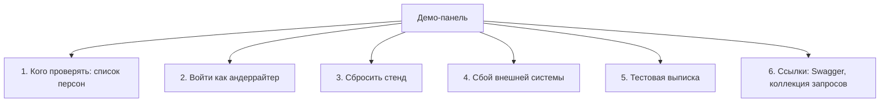

# Демо-панель

| | |
|---|---|
| Статус | DRAFT |
| Владелец | Агент A (черновик субагента) |
| Зависит от | [60-01](01-app-structure.md), [10-02](../10-product/02-personas.md), [50-07](../50-architecture/07-api-design.md), [50-09](../50-architecture/09-security.md), [моки, 8.2 и 10.4](../../specs/mocks.md) |
| Решения | Реализует D-064, D-066, D-068, D-081, Q-035 (вариант Б), Q-038, Q-042 |
| Вопросы пользователю | Q-090, Q-091, Q-092 |
| Обновлено | 21.10.2026 |

## Зачем

Жюри проверяет прототип **само, без нас** (D-064). Панель отвечает на вопросы, с которыми проверяющий наткнётся первым: «Под кем входить? Что должно получиться? Как вернуть всё как было? Как посмотреть, что система выдерживает сбои?». Без панели всё это пришлось бы искать в README и в админ-API моков.

Панель существует **только при `DEMO_MODE=true`**. В режиме без демо нет ни пункта меню, ни адреса, ни кода в экранах (60-03). Все ручки `/demo/*` при выключенном режиме отвечают `403 DEMO_MODE_DISABLED`.

## Что есть в панели

### 1. Список персон: подсказка, а не вход

Решение Q-035: клиент входит **только по ИНН и коду**, карточек быстрого входа нет ни на экране входа, ни здесь. ИНН жюри берёт из README. Панель — шпаргалка «что проверять».

Для каждой из девяти основных персон (10-02) строка с раскрытием:

| Что показываем | Пример (`snabkontrakt`) |
|---|---|
| Название и тип | ООО «СнабКонтракт», госпоставки, клиент банка |
| **Что просит** (блок `application` сценария) | «Оборотный кредит 8 млн на 12 месяцев» |
| **Ожидаемый исход** | Встречное предложение (`COUNTER_OFFER`) |
| Ожидаемые коды причин | `DSCR_LOW` (с коротким названием) |
| Что дальше | «Выберите «Ваша сумма, дольше срок», подпишите» |
| Что покажет | «Хороший клиент, но запрошенное не проходит: три варианта» |

Технические сценарии (`t-aml`, `t-mass`…) в отдельном свёрнутом списке: у них нет учёток, их проверяют через «Создать тестовую компанию» (блок 6 ниже) и автотесты. Данные списка — `GET /demo/personas`; панель ничего не придумывает.

Рядом с каждой строкой нет кнопки «Войти». Вместо неё подпись «ИНН — в README, раздел «Самопроверка»».

### 2. Войти как андеррайтер

Одна кнопка (D-010). Создаёт сессию `UNDERWRITER` и открывает `/bank`. Если принят Q-085 (две сессии), клиентская вкладка остаётся открытой, и можно смотреть обе стороны рядом. Кнопка есть и на экране входа (под основной формой, малым шрифтом).

### 3. Сбросить стенд

- Кнопка «Сбросить стенд» с подтверждением («Все заявки, документы и кредиты будут удалены. Демо-компании вернутся в исходное состояние»).
- Выполняет единый сброс (Q-038): моки, база `api`, файлы, кэш; сбои возвращаются в `OK`. После сброса — тост «Готово» и переход на экран входа; сессия закрыта.
- Занимает несколько секунд: кнопка показывает прогресс и недоступна до конца (защита от двойного нажатия).
- Пока на публичном стенде могут быть и другие проверяющие, у кнопки подпись «Сброс затронет всех, кто сейчас пользуется стендом» (Q-090).

### 4. Сбой внешней системы (хаос)

Четыре переключателя по числу внешних систем (реестр, налоговая, кредитное бюро, банк-ядро), у каждого режим из спецификации моков:

| Режим | Подпись в панели | Что покажет |
|---|---|---|
| `OK` | Работает | — |
| `SLOW` | Отвечает медленно | Таймаут и повтор |
| `ERROR` | Иногда ошибка | Повторы адаптера |
| `DOWN` | Не работает | Выключатель (circuit breaker): заявка уходит на ручное рассмотрение, а не падает (`SOURCE_UNAVAILABLE`) |
| `LOST_RESPONSE` | Ответ потерялся | Идемпотентность: двойной выдачи нет |

- Главный сценарий демо в один клик: «**Уронить кредитное бюро**» (`DOWN`) → подать заявку (например, `snabkontrakt`) → в таймлайне клиента «Часть проверок затянулась, передали специалисту» → в `/bank` заявка с красной плашкой «БКИ не получено» и кнопкой «Перезапросить» → «Починить БКИ» → «Перезапросить» → решение.
- Активный сбой виден **везде**: красная полоса в шапке всех зон «Включён сбой: кредитное бюро. Не забудьте вернуть». Иначе проверяющий забудет и решит, что система сломана.
- Ручка: `GET /demo/chaos`, `PUT /demo/chaos/{system}`.

### 5. Тестовая выписка

Нужна для сценария `garipov` (нет оборотов в нашем банке, `NEEDS_INFO`). Основная кнопка «Сгенерировать тестовую выписку» стоит **на экране задачи у клиента** (60-03, экран 11), потому что её место в контексте. В панели — подсказка и дубль: «Выписка для заявки открытой компании», работает только если у активной компании есть открытая задача на документ или подтверждение выручки (`DOCUMENT`, `CONFIRM_REVENUE`). Файл можно скачать и посмотреть, что внутри (формат 1С) или загрузить свой.

### 6. Ссылки

Карточки-ссылки: Swagger `api` и четырёх моков (`/docs`), коллекция запросов (файл в репозитории), «Создать тестовую компанию» (прямая ссылка на `POST /scenarios` в Swagger моков, без ключей в интерфейсе). Адреса берутся из публичной настройки (`/public-config`), а не зашиты. Админ-ключи моков в интерфейсе не показываются.

## Как это помогает самопроверке жюри

| Что хочет проверить жюри | Где в панели |
|---|---|
| Пройти основной сценарий и знать, правильно ли | 1 (ожидаемый исход) |
| Увидеть «банковскую» сторону | 2 |
| Повторить сценарий снова | 3 |
| Надёжность, enterprise-подход | 4 |
| Сценарий «Нужна информация» без возни с файлами | 5 |
| Убедиться, что API настоящий, посмотреть контракты | 6 |

README ссылается на панель по пунктам («Самопроверка, шаг 3: откройте демо-панель…»). Порядок шагов самопроверки и панель должны совпадать.

## Границы

- **Входит:** шесть блоков выше.
- **Не входит:** управление правилами и «песочница» (Could), просмотр журналов, метрики (Grafana — отдельным профилем).

## Состояния

| Ситуация | Что видит |
|---|---|
| Демо выключено | Ничего: адрес `/demo` возвращает «Не найдено» |
| Моки недоступны | В блоке «Сбои» — «Не удалось связаться с «Кредитное бюро». Проверьте, что контейнер запущен»; остальные блоки работают |
| Сброс не удался | «Сброс остановился на шаге «моки». Повторить»; данные не считаются целыми, кнопка предлагает повторить |
| Нет списка персон | «Сценарии ещё применяются» с повтором (при старте стенда) |

## Как проверяем

- Playwright: сброс → персона `romashka` → отказ → сброс → заявок нет.
- Тест: при `DEMO_MODE=false` нет пункта меню, `/demo` пустой, ручки `403`.
- Тест: включение `DOWN` на БКИ → заявка в `MANUAL_REVIEW` с `SOURCE_UNAVAILABLE` → возврат `OK` → перезапрос → решение.
- Тест: красная полоса видна в клиентской и банковской зонах, пока сбой включён.

## Развилки для пользователя

**Q-090. Кто может пользоваться панелью на публичном стенде?** По [50-09](../50-architecture/09-security.md) `/demo/*` на публичном стенде доступны только администратору, а локально — всем. Но жюри, зашедшее на стенд, администратором не является.

| Вариант | Плюсы | Минусы |
|---|---|---|
| А. Открыта всем (как локально), пока `DEMO_MODE=true`; на стенде добавляется ограничение частоты | Просто, жюри не упирается в пароль | Любой посетитель сбросит данные других; ключ-стенд в README не нужен |
| Б. Открыта, кроме «Сбросить стенд» и «Сбой»: они требуют короткий код стенда из README (не пароль, а защита от случайного нажатия) | Случайно не сломают друг другу проверку | Лишний шаг, нужна доработка 50-09 |
| В. Только за входом администратора | Строго по 50-09 | Жюри придётся искать логин администратора: ломает «самопроверку» |

**Рекомендация: А локально; Б на публичном стенде.** Платим небольшой доработкой 50-09 (около 1 ч). Решение о публичном стенде зависит от Q-008.

**Q-091. Где живёт панель?**

| Вариант | Плюсы | Минусы |
|---|---|---|
| А. Только страница `/demo` | Просто | Чтобы уронить БКИ, надо уйти с экрана и вернуться |
| Б. **Страница `/demo` + выдвижная панель-«язычок» в правом краю любой зоны (кнопка «Демо» в шапке)** | Сбой включается не уходя со страницы заявки | +2–3 ч; чуть сложнее верстка |

**Рекомендация: Б.**

**Q-092. Показывать ли на экранах заявки подсказку «ожидается такой-то исход»?**

| Вариант | Плюсы | Минусы |
|---|---|---|
| А. Нет: исход видно только в панели | Честный вид: экран выглядит как настоящий продукт | Жюри сверяется с двумя местами |
| Б. **Да, в демо-режиме: сворачиваемая плашка «Демо-подсказка: для этой компании ожидается встречное предложение (`DSCR_LOW`)» на странице заявки** | Сверка «получилось как задумано» за секунду | Подсказывает ответ, нужна возможность скрыть; чуть больше кода |

**Рекомендация: Б**, плашка свёрнута по умолчанию, но заметна. Платим 1 ч.

## Заметки для реализации

- Панель вызывает только `api` (`/demo/*`), на моки не ходит. Завершение сброса — по ответу `api`, не по таймеру.
- Если в панели не показан ИНН персон, это сознательное следствие Q-035. Если юзабилити-тест покажет, что копирование из README мешает, можно добавить в список копируемый ИНН (не вход).
- Тексты режимов — в [60-06](06-ux-writing.md), названия систем на языке жюри («Кредитное бюро»), коды — мелко.
- Один и тот же компонент «Полоса активного сбоя» стоит в шапке всех трёх зон.

**Ответ пользователя 21.10, D-086:** локально панель открыта; в облаке сброс и сбои с кодом стенда; /demo и выдвижная панель. Q-092 пока открыт. Не обещать изоляцию посетителей: данные стенда общие.
