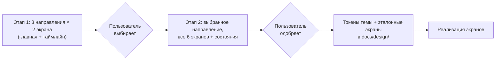

# Макеты: как выбираем внешний вид

| | |
|---|---|
| Статус | DRAFT |
| Владелец | Агент A (черновик субагента) |
| Зависит от | [60-02](02-design-system-options.md), [60-03](03-client-screens.md), [60-04](04-backoffice-screens.md), D-059, D-063 |
| Вопросы пользователю | Q-093, Q-094 (решает пользователь, D-073) |
| Обновлено | 21.10.2026 |

## Зачем

D-059: агент делает несколько вариантов вида, команда выбирает. Выбор нужен **до** написания экранов, иначе их придётся перекрашивать. Времени мало (дедлайн 26.10), поэтому процесс короткий и устроен так, чтобы макеты потом не пропали, а стали основой токенов темы.

## Три визуальных направления

Описаны словами, чтобы пользователь заранее понимал, что получит. Название экранов, тексты и пометка «Демо-прототип» ([Q-086](01-app-structure.md)) одинаковые во всех направлениях: сравнивается только вид.

| | **1. «Спокойный банк»** | **2. «Дружелюбный помощник»** | **3. «Деловой финтех»** |
|---|---|---|---|
| Впечатление | Надёжно, строго, много воздуха | Тепло, просто, как разговор | Плотно, профессионально, «рабочий инструмент» |
| Фон и цвета | Светлый, графит и глубокий синий, один акцент на кнопках | Тёплый светлый фон, мягкий бирюзово-зелёный акцент, цветные метки статусов | Светлая область и тёмная боковая панель, акцент насыщенный (оранжевый или красный) |
| Типографика | Один шрифт, крупные числа сумм | Крупные заголовки, дружелюбный шрифт, длинные подписи | Мелкая плотная, цифры моноширинные |
| Карточки | Тонкая линия, малые скругления | Крупные скругления, тени, иконки | Таблицы и ряды, без теней |
| Сильные места | Таймлайн, подписание | Мастер, встречные предложения | Карточка банка, очередь |
| Слабые места | Может показаться скучным | Банковская часть выглядит «несерьёзно» | Клиентская часть строгая и холодная |
| Лучше всего ложится на | Mantine, shadcn | Mantine, shadcn | Ant Design, shadcn |

Если выбран вариант А в [Q-084](02-design-system-options.md) (библиотека банка), направление 3 заменяется на «в стиле библиотеки» с её токенами.

## Шесть ключевых экранов

Выбраны те, которые жюри увидит первыми и которые «продают» продукт.

| № | Экран | Что в макете | Почему этот |
|---|---|---|---|
| 1 | Вход ([60-03](03-client-screens.md), экран 1) | ИНН → выбор пользователя → код с плашкой «Демо» | Первое впечатление и объяснение демо |
| 2 | Главная клиента (экран 3) | «Что нужно от вас», предодобрение, заявки | Главный экран, показывает суть кабинета |
| 3 | Мастер + результат подбора (4 и 5) | Вопрос с карточками, «Опишите своими словами», две карточки продукта | «Умная» часть продукта, ключ ЦА без экспертизы |
| 4 | Страница заявки с таймлайном (экран 8) | 6 шагов, подшаги проверки, блок справа | Главный экран по «динамике статуса» |
| 5 | Три встречных предложения (экран 10, СнабКонтракт) | Три карточки, «Рекомендуем», «как получить то, что просили» | Самое сильное место UX (30-10) |
| 6 | Карточка заявки банка (60-04) | Рекомендация ядра, источники, баллы, DSCR, кнопки | Показывает «банковскую сторону» |

Состояния (загрузка, пусто, ошибка) в макетах показываем только на одном экране (таймлайн): остальное — по общим правилам ([60-03](03-client-screens.md)).

## Как делаем

1. **Этап 1 (~3 ч).** Три направления, по два экрана: «Главная» и «Таймлайн заявки». Этого хватает, чтобы почувствовать вид, и не тратит силы на невыбранное.
2. **Выбор.** Пользователь смотрит, при желании спрашивает команду (4 человека, D-059) и отвечает: «направление N» или «N, но акцент из M». Для обсуждения — пять вопросов в конце страницы: «Какое выглядит надёжнее? Понятнее новичку? Приятнее? Серьёзнее для банка? Удобнее для работы?».
3. **Этап 2 (~4 ч).** Остальные четыре экрана и состояния в выбранном направлении.
4. **Одобрение.** После явного «да» пользователя макеты фиксируются.

## Формат и хранение

Одна страница HTML на экран, без сборки, без внешних шрифтов и скриптов с интернета (открывается двойным щелчком, автономность); стили — переменные CSS в начале файла (цвета, радиусы, отступы, шрифт). Эти переменные — прямой источник токенов темы выбранной библиотеки. Лежат в `docs/design/<направление>/NN-имя.html` в репозитории; пользователю удобный просмотр — одна опубликованная страница-галерея со ссылками (формат — Q-093).

Все экраны на русском языке и с реалистичными данными из персон ([10-02](../10-product/02-personas.md)): СнабКонтракт, Соколова, Станкопром. Деньги и даты по правилам [60-06](06-ux-writing.md).

## Что идёт в реализацию

| Что | Куда |
|---|---|
| Переменные направления (цвета, радиусы, шрифт, отступы, плотность) | Файл темы библиотеки компонентов (один файл, [60-02](02-design-system-options.md)) |
| Шесть HTML-экранов | Эталон для сверки: агент-исполнитель сравнивает результат со скриншотом, пиксель в пиксель не требуем |
| Список состояний и компонентов, увиденных в макетах | Задачи реализации (по компоненту: «карточка варианта», «таймлайн», «плашка демо») |
| Скриншоты готового интерфейса | Материалы сдачи, README |

В реализацию **не идёт** сам HTML макетов: экраны пишутся на выбранной библиотеке.

## Границы

- **Входит:** процесс, направления, перечень экранов, хранение.
- **Не входит:** адаптив (D-063), демо-панель (служебная, строится на компонентах библиотеки без макета), анимации (кроме движения таймлайна), логотип и иллюстрации (только заглушка с названием продукта).

## Как проверяем

- На каждом этапе опубликована страница со всеми экранами; пользователь отвечает на вопрос Q-093/Q-094.
- В реализации: те же шесть экранов в Playwright получают скриншоты; сравнение глазами с эталоном перед сдачей.
- Контраст текста не ниже 4,5:1 в выбранном направлении (проверяется на этапе 2).

## Развилки для пользователя

**Q-093. Формат и место макетов.**

| Вариант | Плюсы | Минусы |
|---|---|---|
| А. **Статические HTML-страницы в `docs/design/` + одна опубликованная страница-галерея для просмотра** | Автономно, макеты остаются в репозитории (след для критерия «потенциал развития»); быстро; переменные CSS = будущие токены | Не кликабельный «живой» прототип, только страницы |
| Б. Макеты в Figma (через инструмент агента) | Привычный формат, комментарии | Нужен аккаунт и вход в Figma; перенос в код через скриншоты; в репозиторий не попадает |
| В. Живой прототип на выбранной библиотеке (React) | Сразу готовая основа кода | Прежде нужен Q-084 и каркас; выбрать вид из трёх нельзя, не сделав три прототипа: работа утраивается |

**Рекомендация: А.** Страница-галерея публикуется как приватная; ссылку получает только пользователь.

**Q-094. Сколько работы вкладываем в выбор?**

| Вариант | Плюсы | Минусы |
|---|---|---|
| А. Три направления × шесть экранов сразу (18 страниц, ~10 ч) | Выбор на полном материале | Дорого; 2/3 труда уходит в никуда |
| Б. **Двухэтапно: три направления × два экрана → выбор → шесть экранов в выбранном (~7 ч суммарно)** | Дешевле на 3 ч; та же уверенность | Выбор на двух экранах: банковская карточка видна только на втором этапе |
| В. Без макетов: брать тему библиотеки по умолчанию и править по ходу | 0 ч | Противоречит D-059; вид получается случайным; перекраска в конце дороже |

**Рекомендация: Б.** Если пользователь хочет оценить банковскую часть заранее, в этап 1 добавляется третий экран (карточка банка) за +1 ч.

## Заметки для реализации

- Порядок: [Q-084](02-design-system-options.md) (библиотека) → этап 1 макетов → Q-094 → реализация. Если выбор библиотеки задерживается, этап 1 можно начинать: он не зависит от неё (кроме замены направления 3).
- Все макеты содержат плашку «Демо-прототип. Все данные синтетические» и не содержат логотипа и названия Альфа-Банка.
- Данные в макетах берутся из мока персон, а не выдумываются: иначе сумма на макете разойдётся с реальным расчётом.

**Ответ пользователя 21.10:** Q-093/094: автономные HTML-макеты и галерея в репозитории; внешняя публикация отдельно. Три направления по два экрана, затем шесть экранов выбранного (D-087). Выбор этой развилки не означает одобрение всех остальных требований документа.
