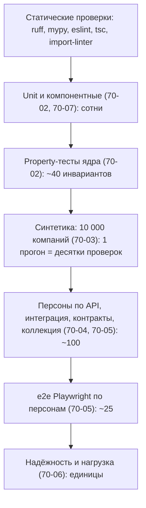

# Стратегия тестирования

| | |
|---|---|
| Статус | REVIEW |
| Владелец | Агент A (черновик субагента) |
| Зависит от | [10-01](../10-product/01-requirements-matrix.md), [10-02](../10-product/02-personas.md), [20-02](../20-process/02-application-states.md), [50-02](../50-architecture/02-tech-stack.md), [50-03](../50-architecture/03-repo-and-conventions.md), [моки, раздел 11](../../specs/mocks.md) |
| Решения | Реализует D-003 (много тестов), D-013, D-055, D-064. Q-100 принят (D-087) |
| Обновлено | 21.10.2026, ред. 3: сведение R-002 (развилки решены) |

## Зачем

Прототип пишут ИИ-агенты, и код вживую читает мало кто. Тесты здесь заменяют внимательного ревьюера: красный CI значит «не вливаем». Документ отвечает на один вопрос: **что проверяем на каком уровне и как это связано с требованиями кейса**. Подробности по уровням лежат в 70-02…70-09.

## Принципы

1. **Тест пишется в том же коммите, что и код** (50-03). Нет теста на новое поведение — задача не готова (80-04).
2. **Много быстрых, мало медленных.** Самое ценное (расчёты и правила) проверяется на уровне, где тест идёт миллисекунды.
3. **Ядро проверяем свойствами, а не только примерами.** Примеры показывают, что мы подумали об одном случае; свойства («рост просрочки не улучшает решение») — что ядро не противоречит себе ни на одном из тысяч.
4. **Никакой случайности и «сегодня» из системных часов.** Время — только `APP_TODAY`; генераторы — с seed; в e2e только данные персон из моков.
5. **Тест не лечится повтором.** Нестабильный тест чинится или помечается `quarantine` с датой удаления. Повторов, прячущих проблему, нет (исключение: один повтор Playwright в CI с сохранением трассы).
6. **Тесты — это и артефакт сдачи.** Человекочитаемый каталог (70-09) и сценарий самопроверки жюри (80-07) опираются на те же персоны, что и автотесты.

## Пирамида

Числа — ориентиры для планирования, не цель сама по себе.

## Что проверяем на каком уровне

| Что проверяем | Основной уровень | Дополнительно |
|---|---|---|
| Аннуитет, DSCR, обратная задача лимита, ставка | Unit + property (70-02) | Синтетика в массе (70-03) |
| Стоп-факторы, флаги, пороги (30%, 10%, 6 мес) | Unit на границах | Технические сценарии по API (`t-*`) |
| Согласованность решения (монотонность, детерминизм) | Property | Синтетика: «двойники» компаний |
| Исход по каждой персоне | Персоны по API (70-05) | e2e в браузере |
| Стейт-машина, `409` на запрещённый переход | Unit + property + API | Тест «диаграмма = таблица» |
| Идемпотентность, гонки | Интеграция с настоящими Postgres и Redis | Хаос `LOST_RESPONSE` (70-06) |
| Права ролей, чужая компания → `404` | Интеграция (матрица 50-09) | e2e: бухгалтер не может подписать |
| Контракт API и адаптеров | Контрактные (70-04) | Schemathesis, коллекция запросов |
| Живые статусы без перезагрузки | Компонентные (мок `EventSource`) | e2e, перезапуск redis |
| Экраны, формы, тексты, доступность | Vitest + axe (70-07) | Playwright + axe на живом стенде |
| Отказоустойчивость | Хаос-сценарии (70-06) | Строки сценария самопроверки |
| Запуск на чистой машине, ≤ 4 ГБ | Smoke в CI (50-14) | Ручной прогон перед сдачей |

## Пороги покрытия (приняты: Q-100, D-087)

| Область | Порог по строкам | Что в области |
|---|---|---|
| Ядро | **≥ 90%**, ветви ≥ 85% | `decisioning`, `simulator`, `pipeline`, `applications` (те же, что под строгим mypy, Q-051) |
| Остальной бэкенд | **≥ 70%** | Роутеры, репозитории, адаптеры, документы, `demo` |
| Моки | ≥ 70% | `mocks/` отдельным отчётом |
| Фронт | ≥ 70% | `features/`, `components/`, `lib/`; без `api/generated` |

Исключаются: сгенерированный клиент, миграции Alembic, `__init__.py`, ветки `if TYPE_CHECKING`. Покрытие — **нижняя планка**, а не мера качества: настоящая мера для ядра — инварианты (70-02) и метрики на синтетике (70-03). «Могло бы пригодиться» — тесты на мутации (`mutmut` для ядра): Could, если останется время.

## Как тесты связаны с требованиями

Цепочка короткая: **RQ → TS → автотест**.

- Каждое требование с колонкой «Как проверяем» в [10-01](../10-product/01-requirements-matrix.md) ссылается минимум на один сценарий `TS-NNN` из 70-09.
- Каждый `TS` в 70-09 называет автотест (файл или метку) или явно «вручную».
- Автотест помечается меткой своего `TS` (pytest-маркер, тег Playwright, имя в Vitest). Скрипт `check-docs` сверяет каталог и метки (Q-109).

Основные связи (полная таблица — в 70-09):

| Требование | Чем доказываем |
|---|---|
| RQ-03, RQ-40 | e2e по каждой персоне до результата |
| RQ-04, RQ-65, RQ-66 | Unit, property, персоны по API, один грейд — разные продукты (СнабКонтракт) |
| RQ-05, RQ-43 | e2e без перезагрузки; данные переживают рестарт; `409` на запрещённый переход |
| RQ-11, RQ-13, RQ-53 | Smoke на чистом compose; установка строго по lock; запуск без сети |
| RQ-18, RQ-19, RQ-20 | OpenAPI-дифф; Bruno CLI в CI; тест «диаграмма = таблица» |
| RQ-44 | Хаос-сценарии, идемпотентность, нагрузка на 2 `api` + 3 воркера |
| RQ-52 | Проверка, что все ИНН и ОГРН в данных синтетические (регион `00`) |
| RQ-54 | e2e не выходит за пределы браузера: ни почты, ни SMS |
| RQ-67 | Отчёт синтетики: Gini, KS, PSI, калибровка |

## Данные для тестов

| Что | Откуда |
|---|---|
| Персоны и технические сценарии | Встроенные сценарии `mock-scenarios` (10-02) |
| Свои компании | `POST /demo/scenarios` и пресеты; для нагрузки — пачками |
| Массовая популяция | Имитатор D-075, seed фиксирован |
| Выписки 1С | Три настоящих по формату (хорошая, чужой ИНН, битые суммы) + «PDF» с расширением `.txt` + файл больше лимита (50-12) |
| Время | `APP_TODAY`, сдвиг на 30 дней проверяет пересчёт просрочки (моки, раздел 11) |

## Решённые развилки

**Q-100. Пороги покрытия и что они блокируют.**

| Вариант | Плюсы | Минусы |
|---|---|---|
| A. Ядро ≥ 90%, остальное ≥ 70%, падение ниже порога блокирует merge | Простое правило; ядро защищено | Агент может «нагонять» покрытие бессмысленными тестами |
| B. Те же цифры, но только отчёт, не блокировка | Не мешает темпу | Через 3 дня никто на цифры не смотрит |
| C. Только порог на ядро, остальное без порога | Меньше шума | Адаптеры и роутеры остаются без страховки |

**Рекомендация: A**, плюс правило ревью: тест без проверки результата (assert) в 80-04 считается дефектом. Платим тем, что агентам придётся дописывать тесты на «скучный» код.

## Заметки для реализации

- Структура папок тестов уже зафиксирована в [50-03](../50-architecture/03-repo-and-conventions.md): `unit/`, `property/`, `integration/`, `contract/`, `personas/`, `synthetic/`; добавить `resilience/` (70-06).
- Маркеры pytest: `unit`, `property`, `integration`, `contract`, `persona`, `synthetic`, `chaos`, `slow`. `make check` гоняет только быстрые.
- Все числа (пороги, коридоры) лежат в одном месте, а не в десятках тестов: файл допусков синтетики и профиль Hypothesis.

**Решено 21.10:** Q-100: пороги ядра 90% строк и 85% ветвей, остальных зон 70%; падение блокирует слияние (D-087).
