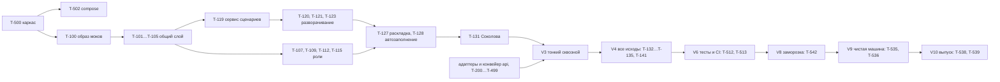

# График поставки: 22–26 октября

| | |
|---|---|
| Статус | DRAFT (ждёт ответа на Q-026) |
| Владелец | Агент A |
| Зависит от | [10-05 Границы MVP](../10-product/05-mvp-scope.md), [50-01 Архитектура](../50-architecture/01-overview.md), [70-08 CI](../70-quality/08-ci-pipeline.md), [30-17 Прохождение персон](../30-decisioning/17-persona-walkthrough.md), [реестр решений](../00-meta/05-decisions-index.md) |
| Решения | Реализует D-00B (готово к вечеру 25.10), D-064, D-083; предлагает ответ на Q-026 |
| Обновлено | 21.10.2026 |

## Зачем

Документ отвечает на вопрос «что должно быть готово и когда, а что режем, если не успеваем». Он же задаёт веху (`V1…V10`), которая стоит в каждой карточке задачи. Реестр задач (80-01) собирается из папки `tasks/`; здесь только порядок и контрольные точки.

## Допущения

- **Время.** Пользователь в Новосибирске (НСК, UTC+7), дедлайн в чате звучал как «26.10, 18:00 МСК» (Q-009a, не подтверждено организаторами). МСК на 4 часа раньше НСК: **18:00 МСК = 22:00 НСК**. Работаем так, будто всё готово к вечеру 25.10 (D-00B), а 26.10 служит запасом и днём выпуска.
- **«Полудень» (Ч1, Ч2)** — первая и вторая половина суток: Ч1 до обеда, Ч2 после обеда и вечер. Ночью идут автоматические прогоны CI.
- **Оценка в часах.** В карточках «1 ч» — час работы среднего разработчика. Агент делает быстрее; для плана принято **допущение: 1 оценочный час ≈ 15–25 минут активной работы агента плюс ожидание CI**. Коэффициент проверяется в контрольной точке K1 (см. ниже); если реальность хуже, включается лестница сокращений.
- **Ёмкость.** Работают два агента (Claude Code и Codex) попеременно или одновременно на разных ПК (D-00A), плюс параллельные субагенты (D-00D). Лимиты подписок конечны: считаем, что у каждого агента около 60% времени суток «живое окно».
- **Объём.** Задачи моков и инфраструктуры (T-100…T-141, T-500…T-544): 87 задач, 359 оценочных часов, из них Must 315, Should 40, Could 4. Задачи ядра, `api` и фронта (T-200…T-499) считает 80-01; общая сумма сверяется с ёмкостью там же.

## Календарь по полудням

| Дата | Ч1 | Ч2 | Ночь |
|---|---|---|---|
| Ср 21.10 | Завершение плана, показ пользователю (Q-026, согласие на слияние PR) | Одобрение плана, ветки, подготовка карточек | — |
| Чт 22.10 | **V1** каркас, compose, CI-каркас, образ моков, общий слой ([T-500](tasks/T-500-monorepo-skeleton.md)…[T-504](tasks/T-504-compose-override-ports.md), [T-509](tasks/T-509-ci-skeleton.md), [T-522](tasks/T-522-check-docs-links.md), [T-100](tasks/T-100-mocks-skeleton.md), [T-101](tasks/T-101-mocks-common-ids.md)…[T-103](tasks/T-103-mocks-common-clock-db.md)) | Идемпотентность и админ-API ([T-104](tasks/T-104-mocks-common-idempotency.md), [T-105](tasks/T-105-mocks-admin-api.md)); параллельно четыре потока моков (см. ниже); `api`: стейт-машина, модель данных, вход | Первый зелёный `ci-ok` на `main` |
| Пт 23.10 | **V2** моки тонкого сценария готовы; Соколова применяется при `up` ([T-131](tasks/T-131-mocks-persona-sokolova.md)) | **V3** тонкий сквозной сценарий: вход → мастер → заявка → моки → решение → подпись → «Мои кредиты». Смоук ([T-515](tasks/T-515-smoke-script.md)), обвязки тестов ([T-516](tasks/T-516-testcontainers-harness.md), [T-517](tasks/T-517-personas-api-harness.md), [T-518](tasks/T-518-playwright-harness.md)) | Ночной прогон: первая синтетика |
| Сб 24.10 | **V4** все исходы: 9 персон и 10 технических, ЕФРСБ, ЕИС, chaos, выписка, банковская сторона | **V5** фронт полностью (клиент, банк, демо-панель). **V6** тесты и CI: полный набор зелёный; юзабилити-тесты команды ([T-537](tasks/T-537-usability-pack.md)), пробная проверка на Windows | Полный ночной прогон: хаос, нагрузка, синтетика 10 000 × 3 |
| Вс 25.10 | **V7** документы сдачи (README, диаграммы, OpenAPI, коллекции, уведомления, каталог TS). **V8** заморозка в 12:00 после регрессии ([T-542](tasks/T-542-freeze-regression.md)) | **V9** проверка на чистой машине: Linux ([T-535](tasks/T-535-clean-machine-linux.md)), Windows силами команды ([T-536](tasks/T-536-windows-check-pack.md)), облако ([T-540](tasks/T-540-cloud-stand.md), если Q-008 решён). Репетиция жюри ([T-533](tasks/T-533-jury-rehearsal.md)), замер ресурсов ([T-534](tasks/T-534-resource-measurement.md)) | Финальный полный прогон на коммите заморозки |
| Пн 26.10 | **V10** кандидат → выпуск: подготовка репозитория ([T-538](tasks/T-538-repo-prep-submission.md)), согласие пользователя, тег `submission`, образы в GHCR ([T-539](tasks/T-539-release-and-tag.md)) | Запас: только исправления блокирующих дефектов, проверка pull с чистой машины, повторная сверка [80-05](05-submission-checklist.md) | — |

## Вехи

| Веха | Срок | Критерий готовности (проверяемый) | Опорные задачи |
|---|---|---|---|
| **V1 Каркас и compose** | 22.10, конец Ч1 | `docker compose up --wait` поднимает все сервисы (заглушки допустимы), пять моков отвечают `/health/ready`, CI с `ci-ok` зелёный, линтеры работают | [T-500](tasks/T-500-monorepo-skeleton.md), [T-501](tasks/T-501-linters-precommit.md), [T-502](tasks/T-502-compose-main.md), [T-503](tasks/T-503-db-init.md), [T-504](tasks/T-504-compose-override-ports.md), [T-509](tasks/T-509-ci-skeleton.md), [T-522](tasks/T-522-check-docs-links.md), [T-100](tasks/T-100-mocks-skeleton.md) |
| **V2 Моки тонкого сценария** | 23.10, конец Ч1 | После `up` по ИНН Соколовой отвечают registry, tax, bki, bank-core; выдача идемпотентна; сценарий применяется и откатывается | [T-101](tasks/T-101-mocks-common-ids.md)…[T-105](tasks/T-105-mocks-admin-api.md), [T-107](tasks/T-107-mocks-registry-companies.md)…[T-109](tasks/T-109-mocks-tax-core.md), [T-112](tasks/T-112-mocks-bki-reports-consent.md), [T-113](tasks/T-113-mocks-bki-read-time-values.md), [T-115](tasks/T-115-mocks-bank-core-reads.md), [T-116](tasks/T-116-mocks-bank-core-disbursement.md), [T-118](tasks/T-118-mocks-bank-core-compliance.md)…[T-121](tasks/T-121-mocks-expand-finance-basic.md), [T-123](tasks/T-123-mocks-expand-bki-basic.md), [T-127](tasks/T-127-mocks-apply-rollback.md), [T-128](tasks/T-128-mocks-startup-fill.md), [T-131](tasks/T-131-mocks-persona-sokolova.md), [T-505](tasks/T-505-env-example.md), [T-516](tasks/T-516-testcontainers-harness.md) |
| **V3 Тонкий сквозной сценарий** | 23.10, конец Ч2 | Соколова проходит путь от входа до «Мои кредиты» в браузере и `smoke.sh` зелёный (правило [10-05](../10-product/05-mvp-scope.md): дальше строим на работающем пути) | [T-515](tasks/T-515-smoke-script.md), [T-517](tasks/T-517-personas-api-harness.md), [T-518](tasks/T-518-playwright-harness.md) + задачи `api` и фронта |
| **V4 Все исходы** | 24.10, конец Ч1 | Все 9 персон и 10 технических дают исход из [30-17](../30-decisioning/17-persona-walkthrough.md); chaos и выписка работают; банковская сторона завершает ручные исходы | [T-106](tasks/T-106-mocks-chaos.md), [T-108](tasks/T-108-mocks-registry-efrsb.md), [T-110](tasks/T-110-mocks-tax-eis.md), [T-111](tasks/T-111-mocks-tax-account-blocks.md), [T-114](tasks/T-114-mocks-bki-submissions.md), [T-117](tasks/T-117-mocks-bank-core-open-account.md), [T-122](tasks/T-122-mocks-expand-finance-advanced.md), [T-124](tasks/T-124-mocks-expand-bki-advanced.md)…[T-126](tasks/T-126-mocks-consistency-rules.md), [T-129](tasks/T-129-mocks-resync-reset.md), [T-130](tasks/T-130-mocks-bank-statement-1c.md), [T-132](tasks/T-132-mocks-personas-simple.md)…[T-135](tasks/T-135-mocks-technical-scenarios.md), [T-141](tasks/T-141-mocks-persona-numbers-check.md) |
| **V5 Фронт полностью** | 24.10, конец Ч2 | Все экраны клиента, банка и демо-панель по [60-03](../60-frontend/03-client-screens.md)…[60-05](../60-frontend/05-demo-panel.md); тексты из словаря; `nlu` включён или отключён осознанно | [T-506](tasks/T-506-compose-ai-profile.md) + задачи фронта |
| **V6 Тесты и CI** | 24.10, конец Ч2 | Полный набор CI зелёный на `main`: unit, property, интеграция, контракты, e2e, хаос, нагрузка, синтетика, безопасность; пороги покрытия соблюдены | [T-510](tasks/T-510-ci-tests-coverage.md)…[T-513](tasks/T-513-ci-nightly-full.md), [T-519](tasks/T-519-schemathesis-harness.md)…[T-521](tasks/T-521-synthetic-report-ci.md), [T-523](tasks/T-523-check-docs-ts-labels.md), [T-524](tasks/T-524-third-party-notices.md), [T-136](tasks/T-136-mocks-tests-endpoints.md)…[T-140](tasks/T-140-mocks-bruno-collection.md), [T-543](tasks/T-543-make-openapi-all.md) |
| **V7 Документы сдачи** | 25.10, до 12:00 | Есть все артефакты из [80-05](05-submission-checklist.md): README с самопроверкой, схема, состояния, ER, OpenAPI, коллекции, каталог TS, `THIRD_PARTY_NOTICES`, ADR | [T-514](tasks/T-514-ci-release-ghcr.md), [T-525](tasks/T-525-diagram-export-architecture.md)…[T-532](tasks/T-532-jury-self-check-readme.md), [T-544](tasks/T-544-bruno-collection-api.md), [T-508](tasks/T-508-compose-obs-profile.md) |
| **V8 Заморозка функций** | 25.10, 12:00 (Q-026) | Регрессия пройдена, список ограничений опубликован, новых функций в `main` нет | [T-542](tasks/T-542-freeze-regression.md), [T-533](tasks/T-533-jury-rehearsal.md), [T-534](tasks/T-534-resource-measurement.md), [T-537](tasks/T-537-usability-pack.md) |
| **V9 Проверка на чистой машине** | 25.10, конец Ч2 | Linux без кэша и без сети после сборки; Windows (команда) проходят сценарий; облачный стенд (если решён Q-008) | [T-535](tasks/T-535-clean-machine-linux.md), [T-536](tasks/T-536-windows-check-pack.md), [T-540](tasks/T-540-cloud-stand.md), [T-541](tasks/T-541-image-build-policy.md), [T-507](tasks/T-507-compose-cloud.md) |
| **V10 Кандидат и сдача** | 25.10 вечер: кандидат; 26.10: тег | Репозиторий чист, доступ `alfa-hack-2026`, зелёный полный CI на коммите тега, образы опубликованы и скачиваются без логина | [T-538](tasks/T-538-repo-prep-submission.md), [T-539](tasks/T-539-release-and-tag.md) |

Распределение объёма моков и инфраструктуры по вехам (оценочные часы): V1 — 29, V2 — 100, V3 — 12, V4 — 69, V5 — 2, V6 — 65, V7 — 46, V8 — 10, V9 — 20, V10 — 6.

## Как параллелим V2

После общего слоя ([T-101](tasks/T-101-mocks-common-ids.md)…[T-105](tasks/T-105-mocks-admin-api.md), около 20 ч) моки независимы и идут четырьмя потоками (по одному агенту или субагенту на поток):

| Поток | Задачи | Оценка, ч |
|---|---|---|
| Реестр и налоги | [T-107](tasks/T-107-mocks-registry-companies.md), [T-108](tasks/T-108-mocks-registry-efrsb.md), [T-109](tasks/T-109-mocks-tax-core.md) | 14 |
| БКИ | [T-112](tasks/T-112-mocks-bki-reports-consent.md), [T-113](tasks/T-113-mocks-bki-read-time-values.md) 🧠 | 12 |
| Банк-ядро | [T-115](tasks/T-115-mocks-bank-core-reads.md), [T-116](tasks/T-116-mocks-bank-core-disbursement.md) 🧠, [T-118](tasks/T-118-mocks-bank-core-compliance.md) | 14 |
| Сценарии | [T-119](tasks/T-119-mocks-scenarios-service.md), [T-120](tasks/T-120-mocks-expand-identity.md), [T-121](tasks/T-121-mocks-expand-finance-basic.md) 🧠, [T-123](tasks/T-123-mocks-expand-bki-basic.md) 🧠, [T-127](tasks/T-127-mocks-apply-rollback.md), [T-128](tasks/T-128-mocks-startup-fill.md), [T-131](tasks/T-131-mocks-persona-sokolova.md) | 32 |

Самый длинный поток — «Сценарии». Поэтому [T-119](tasks/T-119-mocks-scenarios-service.md) стартует сразу после [T-103](tasks/T-103-mocks-common-clock-db.md) и [T-104](tasks/T-104-mocks-common-idempotency.md), а поток «Реестр и налоги» после завершения подключает свободный агент к [T-121](tasks/T-121-mocks-expand-finance-basic.md) (финансы) или [T-123](tasks/T-123-mocks-expand-bki-basic.md) (кредитная история).

## Критический путь

Последовательная часть до V3 около 43 оценочных часов (T-500, T-100, T-103, T-104, T-119, T-120, T-121, T-127, T-128, T-131). **Узкие места:** (1) моки перед тонким сценарием; (2) готовность ядра `decide()` для [T-141](tasks/T-141-mocks-persona-numbers-check.md); (3) согласие пользователя на слияние PR (см. [80-04](04-definition-of-done.md)); (4) действия только человека: доступ `alfa-hack-2026`, смена видимости пакетов, VPS, проверка на Windows. Вторая цепочка поставки: диаграммы ([T-525](tasks/T-525-diagram-export-architecture.md)…[T-527](tasks/T-527-diagram-er.md)) → README ([T-530](tasks/T-530-readme-static.md)…[T-532](tasks/T-532-jury-self-check-readme.md)) → репетиция ([T-533](tasks/T-533-jury-rehearsal.md)) → проверка на чистой машине ([T-535](tasks/T-535-clean-machine-linux.md)) → выпуск ([T-539](tasks/T-539-release-and-tag.md)).

## Контрольные точки и лестница сокращений

| Точка | Когда | Что проверяем | Если плохо |
|---|---|---|---|
| **K1** | 22.10, вечер | V1 выполнена, готов общий слой моков; посчитан реальный коэффициент «оценочный час → время агента» | Если выполнено менее 60% оценки дня, включается уровень 1 |
| **K2** | 23.10, конец Ч1 | V2 выполнена | Подключить второго агента к самому длинному потоку; не начинать V4-задач, пока не идёт тонкий сценарий |
| **K3** | 23.10, вечер | V3: тонкий сценарий работает | **Всё остальное останавливается**, пока он не заработает (правило [10-05](../10-product/05-mvp-scope.md)) |
| **K4** | 24.10, вечер | V4…V6 | Включается уровень 2; замораживается список, что войдёт в сдачу |
| **K5** | 25.10, 12:00 | Заморозка | Уровень 3; только исправления и документы |

Лестница сокращений (порядок отказа; вычеркнутое переходит в README «Развитие» и в [80-09](09-risks.md)):

1. **Уровень 1 (Could и лишнее):** профиль `obs` ([T-508](tasks/T-508-compose-obs-profile.md)), песочница правил «а что если», Grafana, обученная ML-модель, генеративная LLM, извлечение цифр из PDF, дашборды.
2. **Уровень 2 (Should):** нагрузка Locust ([T-520](tasks/T-520-locust-harness.md)), фаззинг ([T-519](tasks/T-519-schemathesis-harness.md)), папка ADR ([T-529](tasks/T-529-adr-folder.md); остаётся ссылка на реестр), пакет юзабилити-теста ([T-537](tasks/T-537-usability-pack.md); тесты проводятся по 10-04), блокировки счетов ([T-111](tasks/T-111-mocks-tax-account-blocks.md)), `nlu` в compose ([T-506](tasks/T-506-compose-ai-profile.md); остаются кнопки), ночной набор сокращается до хаоса и синтетики ([T-513](tasks/T-513-ci-nightly-full.md)).
3. **Уровень 3 (с согласия пользователя):** выписка 1С и её парсер ([T-130](tasks/T-130-mocks-bank-statement-1c.md); `NEEDS_INFO` закрывается ручным вводом выручки), облачный стенд ([T-540](tasks/T-540-cloud-stand.md), [T-507](tasks/T-507-compose-cloud.md)), сокращение технических сценариев до пяти главных, e2e в PR — только smoke.
4. **Не режем никогда (Must по [10-05](../10-product/05-mvp-scope.md)):** тонкий и полный сквозной путь, `docker compose up` одной командой, README с самопроверкой, `THIRD_PARTY_NOTICES`, OpenAPI и коллекция, схема, диаграмма состояний, ER, каталог TS, lock-файлы, тесты ядра, CI.

Пороги покрытия (D-087), состав тестов (D-088) и другие решения пользователя агенты сами не смягчают: предлагают пользователю.

## Заморозка функций (Q-026)

**Предложение: 25.10, 12:00 по времени пользователя** (в бэклоге значилось 14:00). Причины: после заморозки нужны регрессия (3 ч), проверка Linux (4 ч), результат Windows от людей и репетиция (3 ч); при 14:00 остаётся запас лишь на одну неудачу, при 12:00 на две. Если пользователь выберет 14:00, V7 и V8 сдвигаются, а проверка Windows идёт параллельно с регрессией.

После заморозки в `main` попадают только: (а) исправления дефектов, найденных регрессией и проверками; (б) документы, диаграммы, README; (в) данные персон при расхождении с оракулом. Новые функции записываются в «Развитие». Любой PR после заморозки помечается `freeze-fix` и идёт только с явным согласием пользователя.

## 26.10: что происходит

1. Утро: чтение журнала и handoff, повторная проверка зелёного полного CI на коммите кандидата, исправление блокирующего.
2. Запрос согласия пользователя на выпуск: версия, список образов, что станет публичным (D-081, D-083).
3. Тег `submission`, публикация образов, проверка `docker compose up` с готовыми образами ([T-539](tasks/T-539-release-and-tag.md), [T-541](tasks/T-541-image-build-policy.md)).
4. Фиксация в README commit hash и тега. Коммиты после дедлайна не учитываются: ничего не вливаем после выпуска.
5. Точное время дедлайна сверить на платформе (Q-009a) **до вечера 25.10**: от него зависит, сколько запаса даёт 26.10.

## Вопросы пользователю

- **Q-026.** Заморозка 25.10 в 12:00 (рекомендация) или в 14:00?
- **Стоячее согласие на слияние PR** (формулировка и номер присвоит ведущий агент при внесении в реестр вопросов): иначе очередь PR на согласие станет узким местом (см. [80-04](04-definition-of-done.md)).

## Заметки для реализации

- В конце каждого дня агент пишет в журнал две строки: сколько оценочных часов закрыто и сколько заняло, чтобы коэффициент уточнялся.
- Дата и содержание вех живут здесь; если веха сдвигается, правка с отметкой «Ред. N» и запись в журнал.
